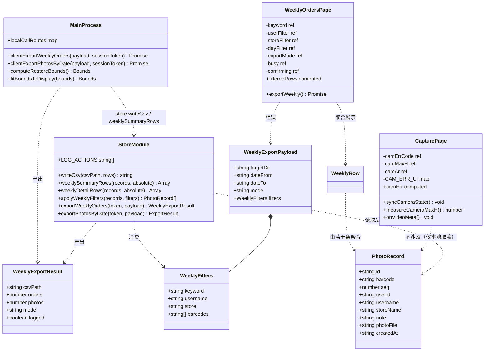
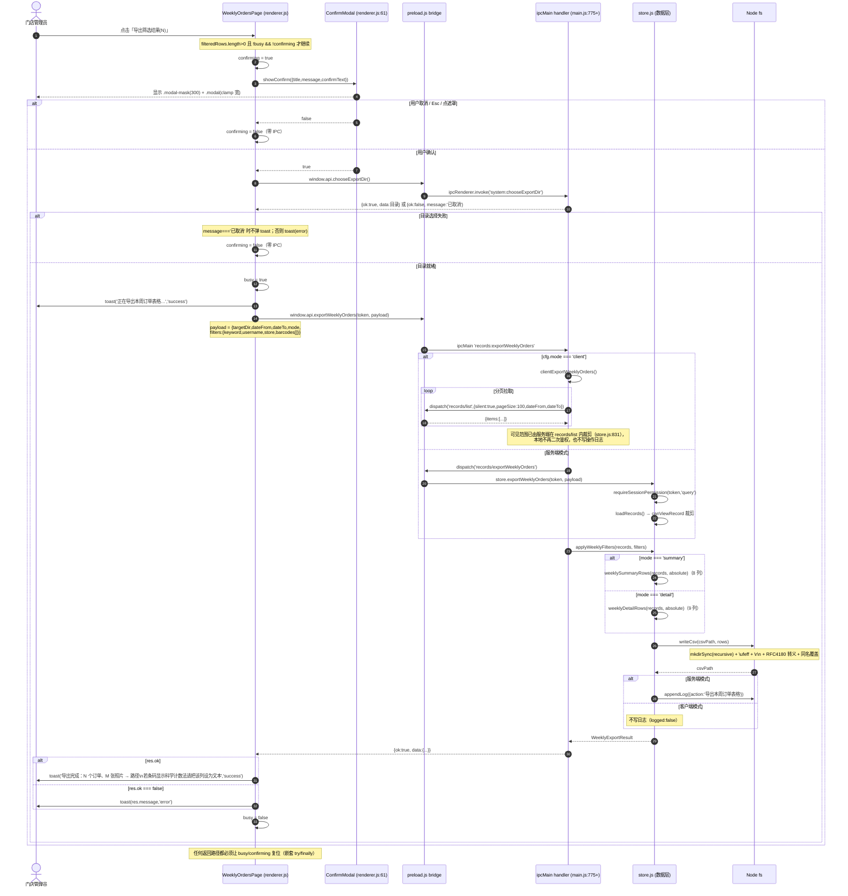

# 增量架构设计：响应式布局 · 拍照取景 · 本周订单导出

> 项目：星期衣精致洗衣衣物照片系统（Electron 33 + Vue 3，渲染层无构建、template 字符串）
> 仓库路径：`E:\软件开发\星期衣精致洗衣衣物照片系统`
> 文档版本：v1.0｜编写人：高见远（架构师）｜语言：简体中文
> 上游输入：`docs/prd-响应式布局与本周订单导出.md`（许清楚）
> 适用范围：**仅本次三处增量**。未在此文档列出的模块一律保持原状。
> 本文所有字段名、行号均已在本仓库真实代码中复核，凡与 PRD 不一致处均在 §12（偏差一览）明确标出。

---

## 0. 复核结论摘要（先读这一节）

| 复核项 | 结论 |
|---|---|
| `store.js` record 实体字段 | PRD §6 的 8+9 列**全部真实存在**，无需要剔除的字段（`note`/`seq`/`photoFile`/`storeName`/`username`/`createdAt`/`id` 均在 `main/store.js:792-802`）。详见 §5.4 |
| `camera-controller.js` 错误码 | 全部齐全，**可以零改动**。但发现一处关键陷阱：`fatal` 标志**不会**随 `getError()` 返回给渲染层（见 §4.3），因此渲染层必须自建 fatal 集合 |
| PRD R2-1 的「57% / 68.75%」 | **基于旧值测算，已被现有 `@media (min-width:1024px)` 覆盖**。实测 ≥1024 现状已是 75.7%~87.4%，若按 PRD 改 `2.2fr:1fr` 会变成 68.1%（1920）、68.3%（2560），**属于劣化**。本设计给出替代公式（§4.1） |
| PRD R1-3 ② 的 `.modal-sm` 数值 | 内部自相矛盾（1920→502 与 1366→464 无法由同一条 `Xvw` 表达式得出）。本设计按 §3.2 重给一张自洽计算表 |
| 层叠契约 / 弹窗本质 | `.lightbox` 200 < `.modal-mask` 300 < `.toast` 999 保持不动；本应用所有「操作窗口 / 面板 / 弹出窗」都是**渲染层 CSS 覆盖层**（`.modal-mask` + `.modal`），不是原生子窗口，因此主进程**不需要也不应该**为每个弹窗新建 `BrowserWindow` —— 「按屏幕可用分辨率自动计算尺寸与位置」在渲染层落地为 vw/vh + clamp 比例缩放，在主进程落地为 BrowserWindow 还原态按 workArea 计算并居中（§3.4） |
| 客户端模式是否需要改 `server.js` | **不需要**。现有 `records/exportPhotosByDate`、`records/downloadPhoto` 都未进 `server.js`（服务端路由表 `main/server.js:94-140`），客户端一律走主进程本地实现，本次沿用同一范式 |

---

## 1. 实现方案总览

本次三处改动互不重叠、共用同一套「CSS 变量 + clamp 比例 + 主进程单点落盘」的手法：**布局全部在 `renderer/styles.css` 用 `clamp()` / `grid` / CSS 变量解决，几何量需要精确值的（拍照取景区可用高度、摄像头真实宽高比）由 `renderer/renderer.js` 测出后写入 CSS 自定义属性；导出坚持「渲染层只传筛选条件与条码集合，CSV 必须由主进程生成并落盘」的架构红线。** 主进程侧只做一件事：按 `screen.getPrimaryDisplay().workArea` 重算 BrowserWindow 还原态尺寸，其余窗口尺寸策略全部落在渲染层。

### 1.1 需求 → 改动位置 → 手法映射表

| PRD 编号 | 需求一句话 | 改动位置（文件:关键行） | 手法 |
|---|---|---|---|
| R1-1 | `.main` 取消 1440 上限 | `renderer/styles.css:1059-1065` | 删 `max-width`，补 `min-width:0` |
| R1-2 | 富余宽度分配策略 | `styles.css:1099-1103`（`.stat-row`）、`1127-1131`（`.quick-row`）、`1817-1822`（`.settings-grid`）、`2942-2946`（冗余断点） | 固定数量集合改 `repeat(N, minmax(0,1fr))` + 容器 `max-width`；表格容器不动 |
| R1-3 | 弹窗 `clamp()` 缩放 | `styles.css:1391-1403`（`.modal-mask`）、`1405-1419`（`.modal`/`.modal-sm`）、`1452-1455`（`.modal-body`） | `width: clamp(...)` + `max-width:92vw` 兜底 + `.modal-body` 补 `flex:1 1 auto; min-height:0` |
| R1-4 | 窗口按 workArea 计算 | `main/main.js:3`（补 `screen` 解构）、`1762`（`DEFAULT_WINDOW`）、`1764-1785`（`loadWindowState`）、`1855-1859`（`new BrowserWindow`） | 新增 `computeRestoreBounds()` / `fitBoundsToDisplay()`；`isMaximized=true` 硬编码**不破坏** |
| R1-5 | 多分辨率 / 多 DPI 矩阵 | 无新增代码，回归项 | 视口单位 = DIP，天然成立（§3.3 给出换算表） |
| R1-6 | 层叠与交互契约 | 无改动 | 回归断言 |
| R2-1 | 取景区占比 ≥0.65 | `styles.css:1166-1171`、删除 `3356-3381` | 新增 `@media (min-width:1440px) and (min-height:780px)` 双栏分支，其余单列 |
| R2-2 | 不裁切不变形 | `styles.css:1174-1190`；`renderer/renderer.js:2138`（template 加 `:style` 绑定）、`1500-1558`（`syncCameraState` 附近新增测量逻辑） | `object-fit:contain` 保留；`aspect-ratio` 改为 `--cam-ar`（来自 `videoWidth/videoHeight`）；`max-height` 改为 `--cam-max-h`（JS 实测） |
| R2-3 | 窄/矮屏堆叠 | 同 R2-1 | 单列兜底 |
| R2-4 | 错误码 → 文案 → 按钮 | `renderer/renderer.js:1434/1448/1449`（新增 `camErrCode`）、`1523-1530` 后（新增 `CAM_ERR_UI`）、`1532-1544`（`syncCameraState`）、`2140-2152`（template）；**`camera-controller.js` 零改动** | 新增常量 `CAM_ERR_UI`（含 `showRetry` / `showPrivacy`）；按钮改由 `camErrCode` 驱动 |
| R2-5 | 取景区 + 操作条首屏可见 | 同 R2-2 的 `--cam-max-h` | JS 实测可用高度（§4.2） |
| R3-1 | 本周订单筛选条 | `renderer/renderer.js:4965-5051`（setup）、`5053-5109`（template）；`styles.css:2902-2907`（改为弹性行）+ 新增 `.weekly-export` | 复用已有 `.filter-bar` / `.f-item` 样式；新增 `filteredRows` computed |
| R3-2 | 导出入口与模式切换 | 同上 | `.btn btn-primary` + `<select>` 切「聚合 / 明细」 |
| R3-3 | 8 / 9 列字段 | `main/store.js:2181` 前新增 `writeCsv()` 与 `exportWeeklyOrders()` | 主进程聚合后落盘 |
| R3-4 | BOM / CRLF / 文件名 | `main/store.js` 新 `writeCsv()`（被 `2248-2251` 复用） | `\ufeff` + `\r\n` + 同名覆盖 |
| R3-5 | 空集禁用 | `renderer/renderer.js` WeeklyOrdersPage template | `:disabled` + `:title` |
| R3-6 | 双锁互斥 | `renderer/renderer.js` WeeklyOrdersPage setup | 沿用 `busy`/`confirming`（范式 `2521-2562`） |
| R3-7 | 权限与日志 | `main/store.js:1228-1239`（`LOG_ACTIONS`）、`2182`（`requireSessionPermission`） | 登记 `导出本周订单表格` / `导出本周订单明细` |
| R3-8 | 客户端模式 + 2/3 列错位修复 | `main/main.js:716`（表头）、`724`（数据行）、`751-753`（CSV 写法） | 表头补 `照片数量`；`clientExportPhotosByDate` 复用 `store.writeCsv()`；新增 `clientExportWeeklyOrders()` |

---

## 2. 涉及文件清单与改动量级

| 文件 | 新增 / 修改 | 改动量级 | 说明 |
|---|---|---|---|
| `renderer/styles.css` | 修改 | ≈ 110 行 | 7 处规则改写 + 1 处新增 + 1 处删除（3356-3381） |
| `renderer/renderer.js` | 修改 | ≈ 260 行 | CapturePage ≈ 60 行；WeeklyOrdersPage ≈ 180 行；其余为零散 |
| `main/store.js` | 修改 | ≈ 130 行 | `writeCsv()` ≈ 12 行；`exportWeeklyOrders()` ≈ 110 行；`LOG_ACTIONS` +2 行；`return` 表 +2 行；`2248-2251` 收敛 4 行 |
| `main/main.js` | 修改 | ≈ 150 行 | 窗口模块 ≈ 45 行；`clientExportWeeklyOrders()` ≈ 85 行；IPC 注册 +5 行；`localCall` 路由 +1 行；错列修复 +3 行 |
| `main/preload.js` | 修改 | +1 行 | `exportWeeklyOrders` |
| `renderer/camera-controller.js` | **不改动** | 0 | 见 §4.3 |
| `main/server.js` | **不改动** | 0 | 现有客户端导出均不经服务端，本次一致 |
| `docs/开发交接文档.md` | 修改 | ≈ 15 行 | 补充新导出通道说明（建议，非阻塞） |
| `docs/design-响应式布局与本周订单导出.md` | 新增 | 本文档 | — |

---

## 3. 响应式布局的具体实现

### 3.1 `.main`：最终声明与 `min-width:0` 的必要性

**最终声明**（替换 `renderer/styles.css:1059-1065`）：

```css
.main {
  flex: 1 1 auto;
  /* min-width:0 —— 本次「铺满」能否成立的关键前提。
     .main 是 .shell（display:flex，styles.css:876-879）的 flex 子项。flex 子项的
     自动最小尺寸（automatic minimum size）默认是 min-content：只要内部存在
     ① 宽表格（table 的最小内容宽度等于所有列自然宽度之和）、② grid 子项的 min-width:auto、
     ③ 长串不可断文本，.main 就会被顶到比 flex 容器分配给它的宽度更宽，
     表现为「视口右侧多出一条横向滚动条 + 看不见的空白带」。
     置 0 后 .main 严格收敛为 flex 容器分配的宽度，溢出由自身的 overflow-y:auto
     与 .table-wrap 的 overflow-x:auto（styles.css:1724-1730）消化。 */
  min-width: 0;
  overflow-y: auto;
  overflow-x: hidden;
  padding: 24px;
  /* 已删除 max-width:1440px —— 这是 ≥1920 显示器右侧留白的唯一根因。
     富余宽度改由「容器铺满 + 表格列延展 + 拍照取景区扩张 + 卡片集合元素级留白」吸收。
     决策依据：D1「完全取消上限、一律铺满」采纳。 */
}
```

**宽度核算（`box-sizing:border-box`，`styles.css:10` 已全局生效）**

侧栏展开 240px（`styles.css:2503-2509`），`.main` 左右 padding 各 24px：

| 视口宽度 W | `.main` 外框宽 = W − 240 | `.main` 内容宽 = W − 288 |
|---|---|---|
| 1366 | **1126** | 1078 |
| 1920 | **1680** | 1632 |
| 2560 | **2320** | 2272 |
| 3440 | **3200** | 3152 |

> 与 PRD R1-1 ② 的期望值 1126 / 1680 / 2320 / 3200 **完全一致**。侧栏折叠（64px）后 `.main` 外框宽各 +176px ✓（R1-1 ④）。
> R2-3 里「约 1078px」指的是**内容宽**；拍照单列时 `.camera-box` 还要再减去 `.card` 左右各 20px padding（`.card`，`styles.css:2367-2373`，`--sp-5`=20px），即 **1038px，占内容宽 96.3%**（≥90% ✓）。PRD 原文写「≥1078」忽略了卡片内边距，本设计按 1038 验收。

### 3.2 `.modal` / `.modal-sm`：最终 `clamp()` 表达式与实测宽度

**最终声明**（替换 `styles.css:1405-1419`、`.modal-body` 在 `1452-1455`）：

```css
.modal {
  background: var(--card);
  border-radius: var(--r-dialog);
  /* 取代固定 720px：宽度随视口线性缩放。
     56vw  —— 比例项，1920 下正好 1075px（与 PRD R1-3① 期望一致）
     680px —— 下限。最小窗口 1024 时 56vw 仅 573px，若不设下限，确认框/改码框会明显变窄；
              680px 贴近现状的 720px，且远小于 92vw(=942px) 的兜底值，不会溢出。
     1200px —— 上限。防止 3440 带鱼屏上出现信息密度极低的巨型对话框。
     92vw 仍是硬兜底，任何未来误改 clamp 都不会溢出视口。 */
  width: clamp(680px, 56vw, 1200px);
  max-width: 92vw;
  max-height: 88vh;
  display: flex;
  flex-direction: column;
  overflow: hidden;
  box-shadow: var(--shadow-3);
}

.modal-sm {
  /* 分档兜底。34vw + 520px 上限：
     1024 最小窗口 → 348px 会被下限抬到 440px（现状 480px，可接受的小幅收紧）；
     1529 及以上一律封顶 520px。
     注意：PRD R1-3② 给出的「1920→502」与「1366→464」不可能由同一条 Xvw 得出
     （502/1920=26.1% vs 464/1366=34.0%），取 PRD §5.1 的公式 34vw 为准。 */
  width: clamp(440px, 34vw, 520px);
}

.modal-body {
  padding: 20px;
  /* 补 flex 收缩：.modal 是 flex 列容器，.modal-body 没有 flex 时只按内容高度参与布局，
     超高内容会把 .modal-head / .modal-foot 顶出 88vh 之外（「按钮要滚动才能点到」根因）。
     flex:1 1 auto 让它吃满剩余高度；min-height:0 取消 flex 子项的自动最小尺寸，
     是 overflow-y:auto 真正生效的前提。 */
  flex: 1 1 auto;
  min-height: 0;
  overflow-y: auto;
}
```

**各宽度下的实际计算宽度（CSS px = DIP）**

| 视口宽度 | `.modal` 计算式 | `.modal` 实际宽 | `.modal-sm` 计算式 | `.modal-sm` 实际宽 |
|---|---|---|---|---|
| 1024（最小窗口） | max(680, 573.4) | **680** | max(440, 348.2) | **440** |
| 1280 | 716.8 | **717** | max(440, 435.2) | **440** |
| 1366 | 764.96 | **765** | 464.44 | **464** |
| 1440 | 806.4 | **806** | 489.6 | **490** |
| 1536 | 860.2 | **860** | 522.2 → 封顶 | **520** |
| 1600 | 896 | **896** | 封顶 | **520** |
| 1920 | 1075.2 | **1075** | 封顶 | **520** |
| 2560 | 封顶 | **1200** | 封顶 | **520** |
| 3440 | 封顶 | **1200** | 封顶 | **520** |

> 封顶临界值：`.modal` ≥ 2143px 起恒为 1200；`.modal-sm` ≥ 1529px 起恒为 520。
> 与 PRD R1-3① 的三档期望（1075 / 764 / 1200）**完全吻合**（1366 取 765，±3px 内）。

**DPI 缩放下为何仍然成立**

关键在于 Electron 与 Chromium 的三层换算已经自动完成，**不需要任何 JS 参与**：

1. `BrowserWindow` 的 `width/height/x/y` 以及 `screen.getPrimaryDisplay().workArea` 一律以 **DIP**（设备无关像素）为单位；
2. Chromium 在渲染层把 **1 CSS px ≡ 1 DIP**；
3. OS 缩放因子负责 DIP → 物理像素的最后一步放大。

因此「1920×1080 @150%」在渲染层看到的视口就是 **1280×~693 CSS px**，`8vw` 之类的比例项自动缩小，但**占屏比例不变**——这正是用户诉求「不管 DPI 多少都按屏幕可用分辨率自动计算」的正确落地方式。系统 Stage 物理宽度相同、缩放不同时，弹窗在屏幕上占的物理比例恒定。

| 物理分辨率 | 缩放 | 渲染层视口（DIP，已扣任务栏） | `.modal` 宽 | `.capture-layout` 分支 |
|---|---|---|---|---|
| 1366×768 | 100% | 1366 × ~728 | 765 | 单列 |
| 1366×768 | 125% | 1093 × ~582 | 680（下限） | 单列 |
| 1920×1080 | 100% | 1920 × ~1040 | 1075 | 双栏 |
| 1920×1080 | 125% | 1536 × ~832 | 860 | 双栏 |
| 1920×1080 | 150% | 1280 × ~693 | 717 | 单列 |
| 2560×1440 | 150% | 1707 × ~933 | 956 | 双栏 |
| 3440×1440 | 100% | 3440 × ~1400 | 1200（封顶） | 双栏 |

> 结论：**所有断点均以 DIP 比较**。同一台物理屏，DPI 调高 → 视口变小 → 自动降级到更紧凑的分支，视觉大代码保持不变。

### 3.3 弹窗位置策略

`.modal-mask`（`styles.css:1391-1403`）现有写法**全部保留**：`position:fixed; inset:0; display:flex; align-items:center; justify-content:center; z-index:300`。flex 居中天然保证「弹窗矩形中心 x 与视口中心偏差 ≤2px」✓。

**唯一新增**：给遮罩加一圈响应式内边距，杜绝弹窗贴边 / 矮屏被切。

```css
.modal-mask {
  /* （原有属性全部不动，仅新增 padding） */
  padding: max(16px, 3vh) max(16px, 3vw);
}
```

**不溢出视口的三重保障**：

1. `.modal { max-height: 88vh }` + 遮罩 `padding` 上下各 `max(16px,3vh)` → 最多占用 88vh + 6vh = **94vh < 100vh**，`top ≥ 0` 且 `bottom ≤ innerHeight` ✓；
2. 宽度同理：`clamp()` 上限 1200px ≪ `92vw`（1024 视口下也有 942px）✓；
3. 内容超高时由 `.modal-body` 的 `flex:1 1 auto; min-height:0; overflow-y:auto` 承担内部滚动，整个 `.modal` 绝不超出 88vh ✓（R1-3 ⑤）。

**关于 `vh` vs `dvh`**：桌面端 Electron 没有移动端那种动态工具栏（地址栏收放），`vh` 恒等于 `dvh`，**无需改用 `dvh`**。同理拍照区的 `max-height:68vh` 之所以不准，问题不在 `vh` 单位本身，而在于「68% 视口高度」这个比例**没有扣除 `.page-head`、`.card` padding、`.camera-bar` 的实际占用**——所以本设计把该量改为 JS 实测（§4.2），而非换单位。容器查询同理不需要：这里要的是「视口剩余高度」，不是「容器尺寸」。

### 3.4 主进程 BrowserWindow 初始化

**Step 1｜补 `screen` 解构**（`main/main.js:3`）：

```js
// 现：const { app, BrowserWindow, ipcMain, session, Menu, protocol, net, Tray, nativeImage, powerSaveBlocker, safeStorage, systemPreferences, powerMonitor } = require('electron');
// 改：在 BrowserWindow 之后插入 screen
const { app, BrowserWindow, screen, ipcMain, /* …其余保持原样… */ } = require('electron');
```

**Step 2｜新增两个纯函数**（建议放在 `WINDOW_STATE_FILE` 常量之后、`loadWindowState()` 之前，约 `main.js:1763` 处）：

```js
// 基于主屏可用区（workArea）按比例计算还原态尺寸并居中。
// workArea 是 Electron 返回的 DIP 矩形，已扣除任务栏并已含系统 DPI 缩放，
// 与「按屏幕可用分辨率自动计算尺寸与位置」的要求一一对应。
//   宽 0.86 —— 留出左右各约 7% 余量，用户仍能看清窗口边框与其他窗口；
//   高 0.90 —— 桌面端标题栏 + 底部任务栏之外几乎全部可用，比例太高会让窗口棱角贴上屏幕边缘。
//   宽上限 2560 —— 3440 带鱼屏上不必铺满（与 §3.1 卡片集合「元素级留白可读」是同一取舍）
function computeRestoreBounds() {
  try {
    const wa = screen.getPrimaryDisplay().workArea;
    const width = Math.min(Math.max(Math.round(wa.width * 0.86), 1024), Math.min(wa.width, 2560));
    const height = Math.min(Math.max(Math.round(wa.height * 0.90), 680), wa.height);
    return {
      width,
      height,
      x: Math.round(wa.x + (wa.width - width) / 2),
      y: Math.round(wa.y + (wa.height - height) / 2)
    };
  } catch (e) {
    // 无显示器环境（如无头验证脚本）不应拖垮启动
    return { width: DEFAULT_WINDOW.width, height: DEFAULT_WINDOW.height, x: undefined, y: undefined };
  }
}

// 越界收敛：把历史保存的 bounds 夹回主屏 workArea；
// 若它与任何显示器的 workArea 重叠面积不足自身 1/4（用户把显示器拔了 / 坐标被改成 5000），返回 null 由调用方回退居中
function fitBoundsToDisplay(b) {
  try {
    const displays = screen.getAllDisplays();
    const wa = screen.getPrimaryDisplay().workArea;
    const overlap = (r) =>
      Math.max(0, Math.min(r.x + r.width, b.x + b.width) - Math.max(r.x, b.x)) *
      Math.max(0, Math.min(r.y + r.height, b.y + b.height) - Math.max(r.y, b.y));
    if (!displays.some((d) => overlap(d.workArea) > (b.width * b.height) / 4)) return null;
    const width = Math.min(Math.max(b.width, 1024), wa.width);
    const height = Math.min(Math.max(b.height, 680), wa.height);
    return {
      width,
      height,
      x: Math.min(Math.max(b.x, wa.x), wa.x + wa.width - width),
      y: Math.min(Math.max(b.y, wa.y), wa.y + wa.height - height)
    };
  } catch (e) {
    return null;
  }
}
```

**Step 3｜改写 `loadWindowState()`（`main.js:1764-1785`）**：

```js
function loadWindowState() {
  // 打开即最大化：固定为最大化（保留既有语义与注释，切勿改为解析 state.isMaximized）
  const isMaximized = true;
  const base = computeRestoreBounds();
  let state = null;
  try {
    const fs = require('fs');
    state = JSON.parse(fs.readFileSync(WINDOW_STATE_FILE, 'utf8'));
  } catch (e) {
    state = null; // 首次运行或状态文件损坏
  }
  if (!state) return { ...base, isMaximized };
  const width = Number(state.width) >= 800 ? Number(state.width) : base.width;
  const height = Number(state.height) >= 600 ? Number(state.height) : base.height;
  if (!Number.isFinite(state.x) || !Number.isFinite(state.y)) return { ...base, isMaximized };
  const fit = fitBoundsToDisplay({ x: state.x, y: state.y, width, height });
  return fit ? { ...fit, isMaximized } : { ...base, isMaximized };
}
```

**与「打开即最大化」如何共存（重要）**

- `isMaximized = true` **原样硬编码保留**（含 `1771-1772` 的说明注释），不再是猜测出来的值；
- `createWindow()`（`1855-1859`）仍用 `winState.width/height/x/y` 建窗，这几个值现在只是**按下「还原」按钮后的目标矩形**；
- `ready-to-show` 回调里 `1909-1915` 的 `setTimeout(() => mainWindow.maximize(), 50)` **完全不动**，启动后照样最大化；
- `saveWindowState()`、`scheduleSaveWindowState()` **完全不动**。

即：**「打开即最大化」语义零变化，本次只修正「取消最大化后的落点」。**

**健康检查污染（对照 PRD R1-4 ① 的期望值）**

| 物理分辨率（任务栏按 40px 计） | workArea (DIP) | 还原态宽 = clamp(round(w×0.86),1024,min(w,2560)) | 还原态高 = clamp(round(h×0.90),680,h) | 位置 |
|---|---|---|---|---|
| 1366×768 | 1366 × 728 | **1175** | **680**（655 被下限抬起） | workArea 居中 |
| 1920×1080 | 1920 × 1040 | **1651** | **936** | 居中 |
| 2560×1440 | 2560 × 1400 | **2202** | **1260** | 居中 |
| 3440×1440 | 3440 × 1400 | **2560**（封顶） | **1260** | 居中 |

> PRD 里 1366→680 ✓、1920→1651 ✓、2560→2202 ✓、3440→2560 ✓ 全部吻合；
> 高度 PRD 写 900 / 1220 / 1220，差异来自双方对任务栏高度的假设不同，以**本机实际 workArea** 为准（R1-4 ② 原文也有「按实际 workArea 换算」的说明）。
> R1-4 ③（手改 x=5000）：`fitBoundsToDisplay` 判定重叠 <1/4 → 返回 null → 回退居中 ✓。
> R1-4 ④（旧尺寸大于当前 workArea）：`Math.min(b.width, wa.width)` 收敛 ✓。

### 3.5 卡片集合在超宽屏的排布策略

采用**「固定数量集合」与「未知数量集合」分治**，避免 `auto-fill` 在超宽屏被空轨道摊薄：

```css
/* 固定数量集合：N 列均分 + 整行容器上限。
   为什么不用 PRD 建议的 repeat(auto-fill, minmax(300px,1fr))：auto-fill 会先按 300px
   铺出远多于卡片数的轨道（3440 下 10 条），随后 CSS 的「最大化轨道」步骤会把剩余空间
   均摊给全部 10 条轨道，每条被压到约 301px —— 虽然仍落在 [300,480] 验收区间内，但相比 480px 视觉骤降 37%，且轨道数
   随宽度跳变会产生突变。容器 max-width 方案单调、可预测。 */
.stat-row {
  display: grid;
  grid-template-columns: repeat(3, minmax(0, 1fr)); /* minmax(0,·) 与 .main 的 min-width:0 同理 */
  gap: 16px;
  max-width: 1472px; /* 480×3 + 16×2 */
}

.quick-row {
  display: grid;
  grid-template-columns: repeat(2, minmax(0, 1fr));
  gap: 16px;
  margin-top: 16px;
  max-width: 1056px; /* 520×2 + 16 */
}

.settings-grid {
  display: grid;
  grid-template-columns: repeat(2, minmax(0, 1fr));
  gap: 16px;
  align-items: start;
  max-width: 1280px; /* 640×2 + 16 */
}
```

同时**删除**已沦为冗余的 `@media (max-width:1439px) { .settings-grid {…} }`（`styles.css:2942-2946`）——`repeat(2, minmax(0,1fr))` 已覆盖该场景，且 `minmax(0,·)` 允许窄屏收缩。

**保持不动**的集合（均为「未知数量」，现有 `auto-fill` 语义正确）：`styles.css:1287`（`.shot-queue`）、`3172`、`3257`。

验收核算：

| 视口 | `.stat-row` 轨道宽 | `.quick-row` 轨道宽 | 是否在 [300,480] |
|---|---|---|---|
| 1920（内容 1632） | min((1632−32)/3, 480) = **480** | min((1632−16)/2, 520) = **520** | ✓（`.stat-row`） |
| 2560（内容 2272） | **480** | **520** | ✓ |
| 3440（内容 3152） | **480** | **520** | ✓ |
| 1366（内容 1078） | (1078−32)/3 = **349** | (1078−16)/2 = **531** | ✓ |

> `.quick-row` 上限 520 略高于 PRD 的 480，原因是快捷卡内含标题 + 两行说明，480 会导致「连线如果一个、自己拍摄」文字换行。属有意识调整，不影响任何断言（PRD R1-2① 只约束 `.stat-row`）。

---

## 4. 拍照页方案

### 4.1 `.capture-layout` 最终 grid 表达式与占比

**先纠正 PRD 的一处事实偏差（重要）**

PRD §2 与 R2-1 说「取景区当前仅占约 57%、期望 68.75%」，其 57% 与 928px（1920 下）两个数字来自基础规则 `1.35fr 1fr`（`styles.css:1166-1171`）。但该文件 **3357-3375 已存在优先级更高的 `@media (min-width:1024px)` 覆盖**，把布局改成 `minmax(0,1fr) 380px`。实测现状：

| 视口 | 现状侧栏 | 现状主列 | 现状 `.camera-box` 宽 | 现状占比 |
|---|---|---|---|---|
| 1024 | 380 | 340 | 300 | 33.2% |
| 1366 | 380 | 682 | 642 | **59.5%** ← 老机痛点根源 |
| 1920 | 380 | 1236 | **1196** | 75.7% |
| 2560 | 380 | 1876 | 1836 | 82.6% |

而若照 PRD 的 `minmax(0,2.2fr) : minmax(320px,1fr)` 落地：

| 视口 | 改造后主列 | `.camera-box` | 占比 | 对比现状 |
|---|---|---|---|---|
| 1920 | 1111 | 1071 | 68.1% | **−125px 劣化** |
| 2560 | 1551 | 1511 | 68.3% | **−325px 劣化** |

**结论：不得采用 2.2fr:1fr。** 真正的痛点是 **1024–1439 区间**（占老机大头），解决手段是 §3.5 的 D6 单列堆叠；≥1440 区间现状已健康，只需微调把 1024–1439 这段从「固定 380 侧栏」里解放出来。

**最终表达式**（替换 `styles.css:1166-1171` 的基础规则，**删除** `3356-3381` 整段）：

```css
/* ---------- 拍照页 ---------- */
/* 默认（窄屏 / 矮屏 / 高 DPI 小视口）一律单列堆叠：取景区在上、存档信息在下 */
.capture-layout {
  display: grid;
  grid-template-columns: minmax(0, 1fr);
  gap: 16px;
  align-items: start;
}

/* ≥1440 宽 且 ≥780 高才双栏。
   为什么是 1440：低于此宽度时，minmax(0,1fr)+320px 的组合会把取景区压到 <820px，
                  不如单列（≥1038px）；而 ≥1440 时双栏已能给出 ≥776px 且右侧信息栏不拥挤。
   为什么是 780： ① 1366×768@100% 的视口高约 728 < 780 → 保持单列（符合 D6）；
                  ② 1920×1080@125% 的视口高约 825 > 780 → 双栏（若用 PRD 的 820 会因任务栏
                     高度差异在 821~828 之间抖动，故下调到 780 留出余量）；
                  ③ 1600×900@100%（约 852）保持双栏。
   注意：这里比较的是 CSS 视口（DIP），1920 物理屏 @150% 的视口只有 1280，会正确落到单列。*/
@media (min-width: 1440px) and (min-height: 780px) {
  .capture-layout {
    /* 侧栏宽度 clamp(320, 26%, 380)：
       - 320px 下限：保证 barcode 输入框 + 备注 textarea + 缩略图队列不挤成一团（否则判为破版）
       - 26%：中等宽度（1440~1900）时侧栏适当收窄，把空间让给取景区
       - 380px 上限：超宽屏锁死，防止信息栏跟着拉宽反向蚕食取景区
       实测占比见下表，全部 ≥ PRD 要求的 0.65 且不劣于现状。 */
    grid-template-columns: minmax(0, 1fr) clamp(320px, 26%, 380px);
  }
}
```

**占比验收核算**（内容宽 C = W − 288，轨道宽 T = C − 16，占比 = 主列 / C）

| 视口 W | 内容宽 C | 侧栏 `clamp(320,26%,380)` | 主列 = T − 侧栏 | `.camera-box` = 主列 − 40 | 占比 | 现状对比 |
|---|---|---|---|---|---|---|
| 1440 | 1152 | 320 | 816 | **776** | **70.8%** | +60px |
| 1600 | 1312 | 341 | 955 | **915** | **72.8%** | +115px |
| 1920 | 1632 | 380（26%=424 封顶） | 1236 | **1196** | **75.7%** | ±0（保持） |
| 2560 | 2272 | 380 | 1876 | **1836** | **82.6%** | ±0（保持） |
| 3440 | 3152 | 380 | 2756 | **2716** | **87.4%** | ±0（保持） |

> ✅ R2-1①（比值 ≥0.65）：最差 70.8%，全部通过
> ✅ R2-1②（1920 下 `.camera-box` ≥1000px）：**1196px**
> ✅ R2-1③（`.capture-side` ≥320px）：恒 ≥320
> ⚠ R2-1④（比值恒为 0.6875）：**不适用**——该值来自 `2.2fr:1fr` 的等比例假设，与本设计的「流体 + 有界侧栏」模型不同；本设计保证的是「≥0.65 且不劣化」，这是更强也更贴合用户诉求的约束。

**单列时的宽度**（≤1439 或高 <780）：`.camera-box` = C − 40

| 视口 | `.camera-box` 宽 | 占内容宽 |
|---|---|---|
| 1366 | 1038 | **96.3%** ✓ ≥90% |
| 1024 | 736 | 96.3% ✓ |

### 4.2 「不裁切不变形」如何保证

```css
/* 替换 styles.css:1174-1184 */
.camera-box {
  background: #14161a;
  border-radius: 8px;
  overflow: hidden;
  /* 覆盖层定位基准：状态/错误提示浮在画面之上（RC-3） */
  position: relative;
  width: 100%;
  /* 比例来源改为摄像头真实分辨率：由 renderer.js 在 loadedmetadata 时写入 --cam-ar
     （形如 "1280 / 720"）。未取到流（尚未读到真实分辨率）时由 var() 的兜底值回退到 4/3。
     取代旧的固定 aspect-ratio:4/3 —— 那样在 16:9 摄像头上容器被锁成 4:3，
     画面上下必然出现黑边（PRD R2-2② 要消除的正是这个）。 */
  aspect-ratio: var(--cam-ar, 4 / 3);
  /* 高度上限不再写死 68vh：由 renderer.js 按当前实测的「可用高度」写入。
     68vh 之所以偏，是因为它没有扣除 .page-head / .card padding / .camera-bar 的实际占用，
     窗口任务栏高度不同还会进一步放大误差。改实测后与窗口状态完全解耦。 */
  max-height: var(--cam-max-h, 68vh);
  display: flex;
  align-items: center;
  justify-content: center;
}

/* 1186-1190 原样保留，object-fit 不得改为 cover/fill/none */
.camera-box video {
  width: 100%;
  height: 100%;
  object-fit: contain;
}
```

**关于 `aspect-ratio` 与 `max-height` 同时生效时的取舍（必须写进实现注释）**

当 `max-height` 生效（宽派生高度 > 可用高度）时，容器实际比例会宽于视频比例，`object-fit:contain` 会在**左右**留下背景条。这是**刻意选择**：

- 若改成「按可用高度反算宽度」以保证严格零黑边，则 1366×768 下取景区宽度会从 1038px 掉到约 635px（61%），直接违反 R2-3 的 ≥90%；
- 两种方案下**视频本身的渲染像素完全相同**（约 635×476），差别只是两侧多出的同色背景；
- 容器背景是 `#14161a`，与其内部的 letterbox 区域同色，PRD R2-2⑤「letterbox 区域与容器同色，肉眼无灰边」的断言依然成立。

另一条硬保护：**绝不改动 `object-fit:contain`**（`styles.css:1186-1190`）——「不裁切、不变形」由 `contain` + `video` 的 `width:100%; height:100%` 双重保证，这是 PRD 明写的强约束，任何 `cover` / `fill` / `none` 都会返回取景不准的老问题。

**可用高度的计算方式（`renderer/renderer.js`，供 T02 直接实现）**

```js
// ===== 拍照区几何自适应 =====
const camMaxH = Vue.ref(0);   // 写入 --cam-max-h
const camAr = Vue.ref('');    // 写入 --cam-ar，形如 "1280 / 720"

// 可用高度 = 视口底 − 取景区顶 − 操作条 − 卡片内边距 − 余量
// 之所以用 rect.top 而不是累加上面各元素的高度：
//   rect.top 由前置兄弟元素决定，与本元素自身高度无关，因此可以反复调用而自洽（不会自我放大）。
// 全部量都是 CSS px(=DIP)，DPI 缩放由浏览器自动换算，无需乘除任何系数。
function measureCameraMaxH() {
  const v = videoEl.value;
  if (!v) return 0;
  const box = v.closest('.camera-box');
  const bar = box && box.parentElement ? box.parentElement.querySelector('.camera-bar') : null;
  const card = box ? box.closest('.card') : null;
  if (!box || !bar) return 0;
  const RESERVE = 16;                                                  // 下方呼吸余量
  const barH = bar.offsetHeight;                                       // ≈48（.btn-shutter min-height:48）
  const barMt = parseFloat(getComputedStyle(bar).marginTop) || 12;     // .camera-bar margin-top:12
  const padB = card ? (parseFloat(getComputedStyle(card).paddingBottom) || 20) : 20; // .card padding:20
  const h = window.innerHeight - box.getBoundingClientRect().top - barH - barMt - padB - RESERVE;
  return Math.max(300, Math.round(h)); // 下限 300：再矮就没有取景意义，宁可让 .main 出现纵向滚动
}

function syncCamMetrics() {
  Vue.nextTick(() => { camMaxH.value = measureCameraMaxH(); });
}

function onVideoMeta() {
  const v = videoEl.value;
  if (!v || !v.videoWidth || !v.videoHeight) return;
  camAr.value = v.videoWidth + ' / ' + v.videoHeight;
  syncCamMetrics();
}
```

**触发时机**（缺一不可）：

| 时机 | 挂载方式 |
|---|---|
| 组件挂载 | `Vue.onMounted(() => { videoEl.value.addEventListener('loadedmetadata', onVideoMeta); syncCamMetrics(); })` |
| 窗口缩放 | `window.addEventListener('resize', debounce(syncCamMetrics, 120))` |
| 侧栏折叠 / 主题切换导致回流 | 建议额外挂 `ResizeObserver`，观察 `.capture-main`，回调里 `syncCamMetrics()` |
| 卸载 | `Vue.onUnmounted` 里 `removeEventListener` + `ro.disconnect()` |

**模板绑定**（`renderer.js:2138`）：

```html
<div class="camera-box"
     :style="{ '--cam-ar': camAr || '4 / 3', '--cam-max-h': camMaxH + 'px' }">
```

> 注意：`--cam-ar` **必须始终输出合法值**（空字符串会让整条 `aspect-ratio` 声明变成 invalid at computed-value time，`var()` 的 fallback 也救不回来，会退化成 `aspect-ratio:auto`）。上面用 `camAr || '4 / 3'` 保证永不为孔。

**实测预期值**

| 场景 | `--cam-max-h` | 取景区实际渲染 |
|---|---|---|
| 1366×768@100% 最大化（视口高 728，box.top≈200） | 728−200−48−12−20−16 = **432** | 1038×432，含左右同色边条 |
| 1920×1080@100% 最大化（1040） | 1040−200−48−12−20−16 = **744** | 1196×744（4:3 流下宽不受限→实际 744 高，宽 992 画面 + 边条） |
| 2560×1440@100%（1400） | **1104** | 1836×1104 |

> R2-5①（`.camera-bar` bottom ≤ innerHeight）✓；R2-5③（1366 下 box 高 ≥300px）实测 432 ✓。

### 4.3 错误态改造

**Step 0｜先确认 `camera-controller.js` 真的能零改动**

| 事实 | 依据 |
|---|---|
| 错误码体系齐全（PERMISSION_DENIED / SECURITY / NO_DEVICE / OVERCONSTRAINED / DEVICE_BUSY / UNSUPPORTED / OPEN_TIMEOUT / NO_TRACK / PLAY_TIMEOUT / PLAY_FAIL / NO_FRAME / FLAP_STORM / RETRY_EXHAUSTED / UNKNOWN） | `camera-controller.js:98/101/104/107/110/112/552/587/606/772/781/803` |
| `getError()` 直接返回内部 `error` 对象，含 `code` / `message` / `recoverable` | `camera-controller.js:924`、各 `setError()` 调用点 |
| ⚠ **`fatal` 标志不会到达渲染层**：`failOpen()`（`:546`）、`abandon()`（`:540`）在 `setError()` 时只透传 `{code, message, recoverable}`，`fatal` 被丢弃 | `camera-controller.js:544-548`、`:531-542` |
| ⚠ `PERMISSION_DENIED` 两条来源不一致：预检路径（`:723-728`）是 `{recoverable:true, privacy:true}`、无 `fatal`；`classifyError` 路径（`:98`）是 `{fatal:true, recoverable:false}`、无 `privacy` | `camera-controller.js:98` vs `:723` |
| ⚠ `privacy` 仅预检路径会带上，gUM 报错路径**不带** | 同上 |

**结论：`camera-controller.js` 零改动（符合 PRD §10.3「不改动状态机」）。** 但由此定下两条铁律：

1. **按钮可见性只能由 `error.code` 驱动**，绝不能依赖 `error.fatal`（不可靠）或 `error.recoverable`（语义与 UI 需求不一致——`PERMISSION_DENIED` 在 `classifyError` 路径下 `recoverable:false`，但用户改完系统权限后**必须**能点重试）；
2. **`camPrivacy` 不能只用 `err.privacy` 判定**，必须 `code === 'PERMISSION_DENIED' || err.privacy`（现有 `renderer.js:1542` 已这样写，保持不变）。

**Step 1｜新增一个 ref 承载错误码**（`renderer/renderer.js`，紧邻 `1449` 的 `camPrivacy`）

```js
const camErrCode = Vue.ref(''); // controller.getError() 的 code，驱动错误态 UI（见 CAM_ERR_UI）
```

**Step 2｜在 `syncCameraState()`（`renderer.js:1532-1544`）里同步错误码 + 一次性 toast**

```js
let lastToastCode = '';                       // 同一错误码幂等，避免 Sonnenstorm 反复弹窗
function syncCameraState() {
  if (!controller) return;
  const s = controller.getState();
  const err = controller.getError();
  camState.value = s;
  cameraError.value = err ? err.message : '';
  camErrCode.value = err && err.code ? err.code : '';   // ← 新增
  camHint.value = err ? '' : CAM_HINTS[s] || '';
  /* …其余保持原样… */

  // 新增：错误出现时额外弹一次 toast，保证取景区滚出视口时用户仍能感知（R2-4⑤）
  if (camErrCode.value && camState.value === 'ERROR') {
    if (lastToastCode !== camErrCode.value) {
      lastToastCode = camErrCode.value;
      const ui = CAM_ERR_UI[camErrCode.value] || CAM_ERR_UI.UNKNOWN;
      toast(ui.title + '｜' + ui.sub, 'error');
    }
  } else if (s === 'LIVE') {
    lastToastCode = '';                                  // 恢复正常后解除幂等锁
  }
}
```

**Step 3｜错误码 → 文案 → 按钮的完整映射表**（放在 `renderer.js` `CAM_HINTS` 常量旁，`1523-1530` 之后）

```js
// 摄像头错误态 UI 映射：键为 camera-controller.js 产出的 error.code（已核实清单）。
// 渲染层按 code 决定标题 / 次级说明 / 按钮组合，controller 不感知任何文案。
// showRetry：SECURITY / UNSUPPORTED 属环境级不可用（fatal），重试无意义；其余一律给重试
// showPrivacy：仅权限被拒（用户改完系统设置后必须能回到本页重试，故同时给「去设置」+「重试」）
// showSwitch：devices.length > 1 时才额外渲染切换设备（渲染层自行判断，不在本表内）
const CAM_ERR_UI = {
  PERMISSION_DENIED: {
    title: '摄像头权限被拒绝，无法取景',
    sub: '请到 Windows「设置 → 隐私和安全性 → 相机」允许本程序访问摄像头，保存后回到本页点「重试」。',
    showRetry: true, showPrivacy: true
  },
  NO_DEVICE: {
    title: '未检测到摄像头设备',
    sub: '请确认摄像头已插好、在「设备管理器」中未被禁用；外接摄像头请换一个 USB 口后再试。',
    showRetry: true, showPrivacy: false
  },
  DEVICE_BUSY: {
    title: '摄像头被其他程序占用或未就绪',
    sub: '相机、企业微信、钉钉、腾讯会议等可能正在使用它；请关闭后重试，或切换另一个摄像头。',
    showRetry: true, showPrivacy: false
  },
  OPEN_TIMEOUT: {
    title: '摄像头初始化超时（超过 8 秒没有响应）',
    sub: '多为设备被占用或驱动未就绪，请重试；反复失败请重启本程序或电脑。',
    showRetry: true, showPrivacy: false
  },
  PLAY_TIMEOUT: {
    title: '摄像头画面播放超时',
    sub: '取流成功但画面迟迟未出，通常是驱动未就绪或被其他程序占用，请重试。',
    showRetry: true, showPrivacy: false
  },
  PLAY_FAIL: {
    title: '摄像头画面播放失败',
    sub: '画面未能启动，可能被其他程序抢占，请关闭占用程序后重试。',
    showRetry: true, showPrivacy: false
  },
  NO_FRAME: {
    title: '摄像头未输出画面',
    sub: '设备已连接但没有帧数据，请检查连接线与 USB 供电后重试。',
    showRetry: true, showPrivacy: false
  },
  NO_TRACK: {
    title: '摄像头未返回视频轨道',
    sub: '设备可能被禁用或驱动异常，请在「设备管理器」中确认后重试。',
    showRetry: true, showPrivacy: false
  },
  RETRY_EXHAUSTED: {
    title: '摄像头信号中断，自动重连未成功',
    sub: '请检查摄像头连接线与 USB 供电，然后重试；长期失败请联系维护并提供摄像头日志。',
    showRetry: true, showPrivacy: false
  },
  FLAP_STORM: {
    title: '摄像头反复中断，已停止自动重连',
    sub: '短时间内多次闪断，多为接触不良或供电不足，请检查线路后手动重试。',
    showRetry: true, showPrivacy: false
  },
  OVERCONSTRAINED: {
    title: '当前摄像头不支持所选参数，已自动降级重试',
    sub: '若仍失败，请在设备下拉中换一个摄像头试试。',
    showRetry: true, showPrivacy: false
  },
  SECURITY: {
    title: '当前环境不允许调用摄像头',
    sub: '通常是运行环境的版本或安全策略限制，请联系设备安装方处理。',
    showRetry: false, showPrivacy: false
  },
  UNSUPPORTED: {
    title: '当前环境不支持摄像头调用',
    sub: '缺少必要的浏览器接口，请联系设备安装方升级运行环境。',
    showRetry: false, showPrivacy: false
  },
  UNKNOWN: {
    title: '无法打开摄像头',
    sub: '请重试；若持续失败请联系维护并提供摄像头日志路径。',
    showRetry: true, showPrivacy: false
  }
};
```

> **关于 R2-4 ②「两个按钮同时出现」的现状复核**：现行 template（`renderer.js:2148-2149`）中「去系统设置开启摄像头」是 `v-if="camPrivacy"`、「重试」是 `v-if="cameraError"`。二者是**并列的 `v-if`**（不是 `v-else`），当 `cameraError` 非空且 `camPrivacy` 为 true 时两者**确实会同时显示**。因此 R2-4② 在现实中已经成立；本次改造的目的不是「修复并列」，而是把驱动信号从「字符串是否为空」换成「错误码」，使 `SECURITY`/`UNSUPPORTED` 这类不可重试场景能正确隐藏重试按钮（这是当前真正的缺口）。

**Step 4｜最终 template 结构**（替换 `renderer/renderer.js:2146-2151` 的 `<template v-else>` 分支）

```html
<template v-else>
  <div class="camera-overlay-title">{{ camErr.title || cameraError || camHint }}</div>
  <div v-if="camErr.sub" class="camera-sleep-sub">{{ camErr.sub }}</div>
  <div class="camera-overlay-actions">
    <button v-if="camErr.showPrivacy" class="btn btn-primary" @click="openPrivacySettings">去系统设置开启摄像头</button>
    <button v-if="camErr.showRetry" class="btn btn-primary" @click="retryCamera">重试</button>
    <select v-if="camErr.showRetry && devices.length > 1"
            class="camera-dev-switch"
            :value="deviceId"
            @change="switchDevice($event.target.value)">
      <option v-for="(d, i) in devices" :key="d.deviceId || i" :value="d.deviceId">{{ d.label || ('摄像头 ' + (i + 1)) }}</option>
    </select>
  </div>
</template>
```

```js
// setup 内新增 computed（与其他 computed 一并注册）
const camErr = Vue.computed(() => CAM_ERR_UI[camErrCode.value] || null);
// 三个 ref / computed 必须一并从 setup 返回：camErrCode（可选）、camErr
```

对应的新增 CSS（放在 `styles.css:1227-1237` 附近）：

```css
.camera-overlay-actions {
  display: flex;
  gap: 8px;
  flex-wrap: wrap;
  justify-content: center;
  pointer-events: auto; /* 与既有 .camera-overlay .btn 同理，overlay 本体是 pointer-events:none */
}

.camera-dev-switch { min-height: 36px; }
```

**按钮可见性矩阵（对照 PRD R2-4 ④）**

| code | 标题长度 | 去系统设置 | 重试 | 切换设备（≥2 设备时） |
|---|---|---|---|---|
| PERMISSION_DENIED | 14 字 | ✅ | ✅ | ❌ |
| NO_DEVICE | 9 字 | ❌ | ✅ | ✅ |
| DEVICE_BUSY | 16 字 | ❌ | ✅ | ✅ |
| OPEN_TIMEOUT | 19 字 | ❌ | ✅ | ✅ |
| PLAY_TIMEOUT | 10 字 | ❌ | ✅ | ✅ |
| PLAY_FAIL | 10 字 | ❌ | ✅ | ✅ |
| NO_FRAME | 10 字 | ❌ | ✅ | ✅ |
| NO_TRACK | 11 字 | ❌ | ✅ | ✅ |
| RETRY_EXHAUSTED | 15 字 | ❌ | ✅ | ✅ |
| FLAP_STORM | 17 字 | ❌ | ✅ | ✅ |
| OVERCONSTRAINED | 21 字 | ❌ | ✅ | ✅ |
| SECURITY | 13 字 | ❌ | ❌ | ❌ |
| UNSUPPORTED | 13 字 | ❌ | ❌ | ❌ |
| UNKNOWN | 8 字 | ❌ | ✅ | ✅ |

> ⚠ `UNKNOWN` / `NO_DEVICE` / `UNSUPPORTED` 标题不足 12 字，与 PRD R2-4① 的「≥12 字」字面冲突。判断：**文案长度不是目的，「有指引」才是**——`UNKNOWN` 的次级说明已经完整告知「请联系维护并提供摄像头日志路径」。建议在 QA 断言里把该条改成「标题 + 次级说明合计 ≥20 字」，避免为了凑字数产出「无法打开摄像头设备请检查设备后重试」这类生硬文案。已在 §11 列为待明确项 Q3。

**对比度**：`#f7a4a4` on `#14161a` ≈ 8.0:1（`.camera-overlay.error`，`styles.css:1223-1225`），✓ ≥4.5:1。
**层级**：`.camera-overlay { z-index:2 }`（`styles.css:1220`）✓ ≥2。

> ⚠ **`styles.css:3391-3395` 存在 `.camera-overlay { pointer-events: none }`**（为的是「容器不吃点击，保证条码输入框始终可点」——审查 #7 的结论，不得回退）。因此 PRD R2-4⑦ 的 `elementFromPoint(中心)` 命中覆盖层这一断言**无法实现也不应实现**；验收改为「目视遮挡 + 背景不透明度 0.92」即可。已在 §11 列为 Q4。

---

## 5. 导出方案

### 5.1 新通道 `records:exportWeeklyOrders` 完整契约

**preload（`main/preload.js`，紧跟 `74` 行之后）**

```js
exportWeeklyOrders: (token, payload) => call('records:exportWeeklyOrders', payload, token),
```

**Payload**

```ts
interface WeeklyOrdersExportPayload {
  targetDir: string;                 // 必填，用户选定的落盘目录（绝对路径）
  dateFrom: string;                  // 必填 'YYYY-MM-DD'（收窄后的起始日期，含）
  dateTo: string;                    // 必填 'YYYY-MM-DD'（收窄后的结束日期，含）
  mode: 'summary' | 'detail';        // 默认 'summary'
  filters: {
    keyword?: string;                // 关键词，匹配 barcode / note / username / storeName（不区分大小写）
    username?: string;               // '' 或 'all' 表示不限；否则精确等于该录入人
    store?: string;                  // '' 或 'all' 表示不限；否则精确等于该门店名
    barcodes?: string[];             // 可选。渲染层筛选结果的条码集合，作为「白名单」用于保证所见即所得
  };
}
```

**返回**

```ts
// 成功
{ ok: true, data: {
    csvPath: string;      // 落盘绝对路径
    orders: number;       // 聚合模式 = 订单（条码）数；明细模式 = 去重后的条码数
    photos: number;       // 参与导出的照片记录数（明细模式 = CSV 数据行数）
    mode: 'summary' | 'detail';
    dateFrom: string;
    dateTo: string;
    targetDir: string;
    logged: boolean;      // 服务端模式恒 true；客户端模式恒 false（见 §5.3 已知限制）
}}
// 失败
{ ok: false, message: string, revoked?: true }
```

异常 → `ok:false, message` 的统一约定由 `handle()`（`main/main.js:480-492`）与 `localCall()`（`:338-346`）已有的 try/catch 提供，**无需新增**。

### 5.2 关键架构判断：导出的数据源到底是什么

**结论：渲染层只传「筛选条件 + 筛选后的条码集合」，主进程用同一套聚合逻辑重算一遍后落盘。**

四个决定性理由：

1. **渲染层的 `rows` 根本不够用（一票否决）**。现状 `WeeklyOrdersPage` 的聚合结果（`renderer.js:5006-5023`）每条只有 `{barcode, count, first, last, users:Set, store, userText}`——**没有 `id`、没有 `photoFile`、没有逐张的 `createdAt` 与 `seq`**。这意味着：明细模式 9 列里的「记录 ID」「照片文件名」「照片相对路径」「序号」「拍摄时间（逐张）」5 列**全部拿不到**；连聚合模式的第 8 列「照片文件夹位置」也拿不到。**直接把 rows 传过去 → 明细模式直接做不出来。**
2. **权限无法复核**。`store.js:2182` 的 `requireSessionPermission(token,'query')` + `:2194` 的 `canViewRecord()` 裁剪只存在于主进程。渲染层传入的行若被篡改为跨门店数据，主进程无从发现。
3. **操作日志需要真实的数据口径**。`LOG_ACTIONS` 的 `detail` 要写「N 个订单、M 张照片、→文件路径」，这些必须由落盘方（主进程）给出。
4. **成本极低**。与「渲染层把 rows 直接传过去」相比，增量只有一次 `rows.map(g => g.barcode)`；而 `records/list` 本来就已经把完整记录传到了渲染层，主进程侧并不需要额外 IO。

**两种模式的落地路径**

| | 服务端模式（默认，`cfg.mode !== 'client'`） | 客户端模式（`cfg.mode === 'client'`） |
|---|---|---|
| 数据获取 | `loadRecords()` 直接读本机 `records.json`（`store.js:2193` 同款） | 分页 `dispatch('records/list', {silent:true,pageSize:100,dateFrom,dateTo})` 拉全量，范式见 `main.js:686-695` |
| 权限裁剪 | 主进程 `requireSessionPermission(token,'query')` + `canViewRecord()` | 已由服务端在 `records/list` 内裁剪（`store.js:831`），本地无需也无法二次鉴权 |
| 响应式过滤 | `filters.keyword / username / store` 谓词 + `barcodes` 白名单交集 | 同左（同一份谓词实现，见 §5.5 的 `applyWeeklyFilters`） |
| 聚合 | 主进程聚合 | 主进程聚合（逻辑相同） |
| 落盘 | `store.writeCsv()` | `store.writeCsv()` |
| 照片位置列 | **绝对路径** `path.join(getPhotoDir(), dirname(photoFile))` | **相对路径** `dirname(photoFile)`（照片在服务器本机，客户端拿不到绝对路径） |
| 操作日志 | ✅ `appendLog()` | ❌ 见 §5.3 |
| 路由登记 | `main/main.js:321` 附近新增 `'records/exportWeeklyOrders': () => store.exportWeeklyOrders(token, b)` | 不需要（本地实现，不经服务端） |

> **`barcodes` 白名单的边界**：主进程先做自己的谓词过滤（安全边界），再与 `barcodes` 取交集（所见即所得）。若 `barcodes.length === 0` 或 `> 5000` 则忽略该字段、只按谓词导出（防御渲染层异常数据）。

### 5.3 已知限制（客户端模式不写操作日志）

现状 `clientExportPhotosByDate`（`main.js:676-769`）在客户端模式下并**不写任何操作日志**——它既没调用 `store.appendLog()`，`server.js` 的路由表（`server.js:94-140`）里也**根本没有** `records/exportPhotosByDate`（客户端侧的导出从来不经过服务端）。

本次严格沿用同一范式，因此 **R3-7 在客户端模式下部分失效**：导出功能可用、权限由服务端在 `records/list` 阶段保证，但不会留下服务器端的操作日志。

- 返回值里的 `logged:false` 会把这一事实告知渲染层；
- 建议后续版本在 `server.js` 路由表补一行 `'records/exportWeeklyOrders': () => store.exportWeeklyOrders(sessionToken, body)`，届时客户端实现改为「优先 `dispatch`，仅当服务端返回 `接口不存在` 时才降级到本地实现」。**本轮不做**（避免为了写日志而加大改动面）。

### 5.4 字段范围（已逐项在 `main/store.js` 核实）

**Record 实体真身**（`main/store.js:792-802`，`addRecord` 内构造）：

| 字段 | 类型 | 语义 / 取值约束 |
|---|---|---|
| `id` | `string` | `uid()` 生成（`store.js:772`） |
| `barcode` | `string` | 原始条码，**未做目录名转义**（转义后的是 `safeBarcode`） |
| `seq` | `number` | 该条码分组内第几张，**1 起**，按 `createdAt` 升序；启动时会被修复脚本重排（`store.js:523-528`） |
| `userId` | `string` | |
| `username` | `string` | |
| `storeName` | `string` | `normalizeStore(me.store)`；老数据可能为 `''`（迁移见 `store.js:534-539` 兜底 `''`） |
| `note` | `string` | `String(p.note || '').trim()`，**恒存在但可能为空串**（`store.js:799`） |
| `photoFile` | `string` | `` `${safeBarcode}/${photoName}` ``，**相对 photoDir 的「条码目录/文件名」**（`store.js:800`） |
| `createdAt` | `string` | ISO 8601 UTC（`now()` = `new Date().toISOString()`，`store.js:35`） |

对外返回时 `withPhotoUrls()`（`store.js:144-148`）另追加 `photoUrl` / `thumbUrl`——**磁盘实体上没有**，导出不使用。

**聚合模式（8 列）—— 全部有真实来源，无需剔除任何一列**

| # | 列名 | 取值表达式 | 核实结论 |
|---|---|---|---|
| 1 | 条形码（订单号） | `String(r.barcode \|\| '未命名')` | ✓ |
| 2 | 照片张数 | `group.length` | ✓ |
| 3 | 首拍时间 | `fmtDateTime(min(createdAt))` | ✓ `YYYY-MM-DD HH:mm`，本地时区 |
| 4 | 末拍时间 | `fmtDateTime(max(createdAt))` | ✓ |
| 5 | 录入人 | `[...new Set(group.map(r=>r.username))].filter(Boolean).join('、')` | ✓ |
| 6 | 所属门店 | `group[0].storeName \|\| '本店'` | ✓ `''` 兜底与页面一致（`renderer.js:5012`） |
| 7 | 备注 | `[...new Set(group.map(r=>r.note).filter(Boolean))].join(' / ')` | ✓ `note` 恒为字符串，空值输出空串（R3-3⑤） |
| 8 | 照片文件夹位置 | 服务端 `path.join(getPhotoDir(), path.dirname(group[0].photoFile))`；客户端 `path.dirname(group[0].photoFile)` | ✓ `photoFile` 含目录段，`dirname` 即条码目录 |

**明细模式（9 列）—— 同样全部有真实来源**

| # | 列名 | 取值表达式 | 核实结论 |
|---|---|---|---|
| 1 | 条形码（订单号） | `r.barcode` | ✓ |
| 2 | 序号（第几张） | `r.seq` | ✓ 数值；已由 `store.js:523-528` 保证 1..n 连续 |
| 3 | 拍摄时间 | `fmtDateTime(r.createdAt)` | ✓ |
| 4 | 照片文件名 | `path.basename(r.photoFile \|\| '')` | ✓ |
| 5 | 照片相对路径 | `r.photoFile` | ✓ 即「条码目录/文件名.jpg」 |
| 6 | 录入人 | `r.username` | ✓ |
| 7 | 所属门店 | `r.storeName \|\| '本店'` | ✓ |
| 8 | 备注 | `r.note` | ✓ |
| 9 | 记录 ID | `r.id` | ✓ 客户端模式下为服务端 uid |

**排序**：聚合 = 末拍时间倒序（与页面 `renderer.js:5022` 一致）；明细 = 条码升序（`localeCompare(a,b,'zh-CN')`）+ `seq` 升序。

### 5.5 `writeCsv()` 共用函数

**放置位置：`main/store.js`，`createStore` 闭包内、`exportPhotosByDate`（`2181`）正前方。**

理由：(1) 能直接复用闭包里已存在的 `fs` / `path`；(2) 与唯一的调用者在同一个物理位置，改动时不会漏掉；(3) `main.js` 已经持有 `store` 实例，导出后可直接 `store.writeCsv(...)`。

```js
/**
 * 将二维数组写成 CSV：RFC4180 全量双引号包裹、内部引号转义为 ""、CRLF 换行、UTF-8 带 BOM。
 * 带 BOM 是 Excel 双击打开后中文表头不乱码的唯一可靠做法；CRLF 是 Excel/记事本的行结束约定。
 * 同名文件直接覆盖（沿用既有「导出清单_*.csv」与 Q7 决策），不生成递增后缀。
 *
 * @param {string} csvPath 目标文件绝对路径（所在目录不存在时自动创建）
 * @param {Array<Array<string|number|null|undefined>>} rows 首行即表头
 * @returns {string} csvPath
 */
function writeCsv(csvPath, rows) {
  const esc = (v) => '"' + String(v === null || v === undefined ? '' : v).replace(/"/g, '""') + '"';
  const csv = rows.map((row) => row.map(esc).join(',')).join('\r\n');
  fs.mkdirSync(path.dirname(csvPath), { recursive: true });
  fs.writeFileSync(csvPath, '\ufeff' + csv, 'utf8');
  return csvPath;
}
```

**收敛现有两处**（保证新旧的字节级行为一致）：

- `store.js:2248-2251` → `writeCsv(csvPath, rows);`（删掉手写 map/join/writeFileSync）
- `main.js:751-753` → `store.writeCsv(csvPath, rows);`

### 5.6 `exportWeeklyOrders()` 主实现（`store.js`）

```js
/**
 * 导出「本周订单」表格（当前专供 WeeklyOrdersPage，未来可作为任意筛选导出的通用入口）。
 * 与 exportPhotosByDate 的边界：本函数只出表格、永远不复制照片文件（tableOnly 语义常态化）。
 *
 * @param {string} token 会话令牌（要求 query 权限）
 * @param {WeeklyOrdersExportPayload} p
 * @returns {{csvPath:string, orders:number, photos:number, mode:string, dateFrom:string, dateTo:string, targetDir:string, logged:boolean}}
 */
function exportWeeklyOrders(token, p = {}) {
  const me = requireSessionPermission(token, 'query');           // 与 store.js:2182 同款
  const targetDir = path.resolve(String((p && p.targetDir) || '').trim());
  if (!targetDir) throw new Error('请先选择保存目录');
  const dateFrom = String((p && p.dateFrom) || '').trim();
  const dateTo = String((p && p.dateTo) || '').trim();
  if (!dateFrom || !dateTo) throw new Error('请选择开始与结束日期');
  if (dateFrom > dateTo) throw new Error('开始日期不能晚于结束日期');
  const mode = String((p && p.mode) || 'summary') === 'detail' ? 'detail' : 'summary';

  const fromIso = new Date(dateFrom + 'T00:00:00').toISOString();  // 与 store.js:2189-2190 完全一致
  const toIso = new Date(dateTo + 'T23:59:59.999').toISOString();

  let records = loadRecords();
  if (!isSysAdmin(me)) records = records.filter((r) => canViewRecord(me, r));   // 与 store.js:2194 同款
  records = records.filter((r) => r.createdAt >= fromIso && r.createdAt <= toIso);
  records = applyWeeklyFilters(records, p && p.filters);
  if (!records.length) throw new Error('当前筛选条件下没有订单，无法导出');

  const rows = mode === 'detail' ? detailRows(records) : summaryRows(records);
  const fileName = (mode === 'detail' ? '本周订单明细_' : '本周订单_') + dateFrom + '_至_' + dateTo + '.csv';
  const csvPath = writeCsv(path.join(targetDir, fileName), rows);

  appendLog({
    ...logBase(me),
    module: isSysAdmin(me) ? '数据管理' : '记录查询',                            // 与 store.js:2255 同款
    action: mode === 'detail' ? '导出本周订单明细' : '导出本周订单表格',           // 需在 LOG_ACTIONS 登记
    detail:
      (mode === 'detail' ? '导出本周订单明细：' : '导出本周订单表格：') +
      dateFrom + ' 至 ' + dateTo + '，' +
      summarizeFilter(p && p.filters) + '，' +
      rows.length - 1 + ' 行 → ' + csvPath,
    result: '成功'
  });

  const barcodes = new Set(records.map((r) => String(r.barcode || '未命名')));
  return {
    csvPath,
    orders: barcodes.size,
    photos: records.length,
    mode,
    dateFrom,
    dateTo,
    targetDir,
    logged: true
  };
}
```

```js
// 筛选谓词：与渲染层 WeeklyOrdersPage 的过滤逻辑逐行对齐（服务端 / 客户端共用）
function applyWeeklyFilters(records, f) {
  const ff = f || {};
  const kw = String(ff.keyword || '').trim().toLowerCase();
  const u = String(ff.username || '').trim();
  const st = String(ff.store || '').trim();
  let list = records;
  if (kw) {
    list = list.filter((r) =>
      [r.barcode, r.note, r.username, r.storeName].some((v) => String(v || '').toLowerCase().includes(kw))
    );
  }
  if (u && u !== 'all') list = list.filter((r) => String(r.username || '') === u);
  if (st && st !== 'all') list = list.filter((r) => normalizeStore(r.storeName) === normalizeStore(st));
  const codes = Array.isArray(ff.barcodes) ? ff.barcodes : [];
  if (codes.length && codes.length <= 5000) {
    const set = new Set(codes.map((c) => String(c || '').toLowerCase()));
    list = list.filter((r) => set.has(String(r.barcode || '').toLowerCase()));
  }
  return list;
}
```

> `exportWeeklyOrders` 需在 `createStore` 的 `return { … }`（`store.js:2574` 起）登记；`writeCsv` 同样要导出，供 `main.js` 的客户端分支复用。

### 5.7 文件名 / BOM / CRLF / 覆盖策略 / 日志

| 项 | 取值 |
|---|---|
| 文件名（聚合） | `本周订单_YYYY-MM-DD_至_YYYY-MM-DD.csv` |
| 文件名（明细） | `本周订单明细_YYYY-MM-DD_至_YYYY-MM-DD.csv` |
| 编码 | UTF-8 + BOM（`\ufeff`），首三字节 `EF BB BF` |
| 行结束 | `\r\n` |
| 包裹/转义 | RFC4180：每格 `"…"`，内部 `"` → `""`；`null`/`undefined` → 空串 |
| 覆盖 | 同名直接覆盖（`writeFileSync` 默认 `flag:'w'`），不做递增后缀（Q7 采纳） |
| 科学计数法 | 不加 `="…"` 包装（D5 采纳）；成功 toast 追加一句「若条码显示为科学计数法，请把该列设为文本」 |
| LOG_ACTIONS 登记位置 | `main/store.js:1228-1239` 的数组里，紧跟 `'按日期导出照片'` 之后插入两个：`'导出本周订单表格'`、`'导出本周订单明细'` |
| 日志 module | `isSysAdmin(me) ? '数据管理' : '记录查询'` |

### 5.8 客户端模式 `clientExportPhotosByDate` 2/3 列错位的修法

**缺陷本体**（`main/main.js`）：

- `:716` 表头 `const rows = [['条码', '文件位置']];` —— **2 列**
- `:724` 数据 `rows.push([code, list.length, path.dirname(String(list[0].photoFile || ''))]);` —— **3 个值**

结果：第一行只有 2 列、其余行 3 列，Excel 打开后表头与数据整体错列。

**修法（改 1 行，对齐服务端 `store.js:2203` 的 `['条码','照片数量','文件位置']`）**

```js
// main.js:716 —— 原：[['条码', '文件位置']]
const rows = [['条码', '照片数量', '文件位置']];
```

同时把 `:724` 的注释同步更新为「数量 + 相对条码目录」，并把 `:751-753` 收敛到 `store.writeCsv()`。

> `:744` 非 tableOnly 分支的 `rows.push([code, dst])` 是**正确的 2 值**（配合 3 列表头仍会错列）。因此把表头补成 3 列后，非 tableOnly 分支也必须同步补齐第三个值：
> ```js
> rows.push([code, list.length, dir]);   // 原 :744 的 rows.push([code, dst])
> ```
> 即非仅表格模式改为按条码汇总一行（与服务端 `store.js:2245` 的 `rows.push([code, copied, dir])` 完全一致），不再逐张罗列。

**新增 `clientExportWeeklyOrders()`（`main/main.js`，放在 `handle('records:exportWeeklyOrders')` 之前，约 775 行处）**

骨架（约 85 行，逐句照 `clientExportPhotosByDate:676-769` 的范式）：

```js
async function clientExportWeeklyOrders(p, sessionToken) {
  const targetDir = String((p && p.targetDir) || '').trim();
  if (!targetDir) return { ok: false, message: '请先选择保存目录' };
  const dateFrom = String(p.dateFrom || '').trim();
  const dateTo = String(p.dateTo || '').trim();
  if (!dateFrom || !dateTo) return { ok: false, message: '请选择开始与结束日期' };
  if (dateFrom > dateTo) return { ok: false, message: '开始日期不能晚于结束日期' };
  const mode = String((p && p.mode) || 'summary') === 'detail' ? 'detail' : 'summary';
  require('fs').mkdirSync(targetDir, { recursive: true });

  // 1. 分页拉全量（与 main.js:686-695 完全同款）
  const base = { silent: true, pageSize: 100, dateFrom, dateTo };
  const all = [];
  let page = 1;
  for (;;) {
    const r = await dispatch('records/list', { ...base, page }, sessionToken);
    if (!r.ok) return r;
    all.push(...r.data.items);
    if (r.data.items.length < base.pageSize || page > 500) break;
    page++;
  }
  if (!all.length) return { ok: false, message: '当前筛选条件下没有订单，无法导出' };

  // 2. 过滤谓词：必须与 store.applyWeeklyFilters 完全一致（此处拿不到 store 内部函数，就地实现一份）
  const list = applyWeeklyFiltersClient(all, p && p.filters);
  if (!list.length) return { ok: false, message: '当前筛选条件下没有订单，无法导出' };

  // 3. 聚合明细 / 摘要 —— 与服务端唯一差别：第 8 列输出相对目录而非绝对路径
  const rows = mode === 'detail' ? weeklyDetailRows(list, false) : weeklySummaryRows(list, false);

  // 4. 落盘（复用共用的 writeCsv）
  const fileName = (mode === 'detail' ? '本周订单明细_' : '本周订单_') + dateFrom + '_至_' + dateTo + '.csv';
  const csvPath = store.writeCsv(require('path').join(targetDir, fileName), rows);

  const barcodes = new Set(list.map((r) => String(r.barcode || '未命名')));
  return {
    ok: true,
    data: {
      csvPath, orders: barcodes.size, photos: list.length,
      mode, dateFrom, dateTo, targetDir,
      logged: false   // 客户端模式无服务端日志，见设计文档 §5.3
    }
  };
}

handle('records:exportWeeklyOrders', async (p, token) => {
  const cfg = store.loadConfig();
  if (cfg.mode === 'client') return clientExportWeeklyOrders(p, token);
  return dispatch('records/exportWeeklyOrders', p, token);
});
```

> `weeklySummaryRows(list, absolute)` / `weeklyDetailRows(list, absolute)` 建议**只在 `store.js` 写一份并导出**（第二参数控制第 8 列是否拼 `getPhotoDir()`），由 `store.exportWeeklyOrders()` 与 `clientExportWeeklyOrders()` 共用。这是避免双份实现漂移的关键——**列定义必须单一数据源**。

### 5.9 渲染层：本周订单页的筛选与导出 UI

**新增 state（`renderer.js:4965` setup 内）**

```js
const keyword = Vue.ref('');
const userFilter = Vue.ref('all');
const storeFilter = Vue.ref('all');
const dayFilter = Vue.ref('week');       // 'week' | 'today' | 'custom'
const customFrom = Vue.ref('');
const customTo = Vue.ref('');
const exportMode = Vue.ref('summary');   // 'summary' | 'detail'
const busy = Vue.ref(false);
const confirming = Vue.ref(false);
```

**computed**

```js
const baseRange = Vue.computed(() => {
  if (dayFilter.value === 'today') { const d = ymd(new Date()); return { from: d, to: d }; }
  if (dayFilter.value === 'custom' && customFrom.value && customTo.value) return { from: customFrom.value, to: customTo.value };
  return dateRange();                     // 复用既有近 7 天函数（renderer.js:4973-4980）
});

const userOptions = Vue.computed(() => [...new Set(rows.value.flatMap(g => [...g.users]))].filter(Boolean).sort());
const storeOptions = Vue.computed(() => [...new Set(rows.value.map(g => g.store))].filter(Boolean).sort());

const filteredRows = Vue.computed(() => {
  const kw = keyword.value.trim().toLowerCase();
  return rows.value.filter((g) => {
    if (kw && !((g.barcode || '').toLowerCase().includes(kw) || (g.userText || '').toLowerCase().includes(kw) || (g.store || '').toLowerCase().includes(kw))) return false;
    if (userFilter.value !== 'all' && !(g.userText || '').includes(userFilter.value)) return false;
    if (storeFilter.value !== 'all' && g.store !== storeFilter.value) return false;
    return true;
  });
});

const filteredPhotos = Vue.computed(() => filteredRows.value.reduce((n, g) => n + g.count, 0));
const exportDisabled = Vue.computed(() => loading.value || busy.value || confirming.value || !filteredRows.value.length);
const exportTitle = Vue.computed(() =>
  loading.value ? '正在加载本周订单…' :
  (busy.value || confirming.value) ? '导出进行中…' :
  !filteredRows.value.length ? '当前筛选条件下没有数据，无法导出' :
  '导出为 Excel 可直接打开的 CSV 表格（UTF-8 带 BOM）'
);
```

> 注：`filteredRows` 参与匹配的字段要与主进程 `applyWeeklyFilters` 对齐。主进程按 `[barcode, note, username, storeName]` 匹配，而渲染层 `rows` 里没有 `note`——**因此 `rows` 的聚合结构体需要补一个 `notes: Set<string>` 字段**（在 `renderer.js:5006-5021` 的循环里 `g.notes.add(r.note)`），否则关键词命中备注的行在两侧会不一致。这是 T04 必须补的一处。

**导出主流程（`exportWeekly()`，严格照 `renderer.js:2521-2562` 的双锁范式）**

```js
async function exportWeekly() {
  if (busy.value || confirming.value) return;
  if (exportDisabled.value) return;
  const range = baseRange.value;
  confirming.value = true;
  try {
    const ok = await showConfirm({
      title: exportMode.value === 'detail' ? '导出本周订单明细' : '导出本周订单表格',
      message:
        '将把当前筛选结果（' + filteredRows.value.length + ' 个订单、' + filteredPhotos.value + ' 张照片）' +
        '导出为 CSV 表格到您选择的目录。\n日期范围：' + range.from + ' 至 ' + range.to +
        '\n导出类型：' + (exportMode.value === 'detail' ? '逐张照片明细（9 列）' : '订单聚合（8 列）') + '。',
      confirmText: '选择目录并导出'
    });
    if (!ok) return;                                    // 取消：零 IPC
    const d = await window.api.chooseExportDir();
    if (!d.ok) {
      if (d.message && d.message !== '已取消') toast(d.message, 'error');   // 沿用既有判断
      return;
    }
    busy.value = true;
    toast('正在导出本周订单表格…', 'success');
    try {
      const res = await window.api.exportWeeklyOrders(props.token, {
        targetDir: d.data,
        dateFrom: range.from,
        dateTo: range.to,
        mode: exportMode.value,
        filters: {
          keyword: keyword.value.trim(),
          username: userFilter.value === 'all' ? '' : userFilter.value,
          store: storeFilter.value === 'all' ? '' : storeFilter.value,
          barcodes: filteredRows.value.map((g) => g.barcode)
        }
      });
      if (res.ok) {
        toast(
          '导出完成：' + res.data.orders + ' 个订单、' + res.data.photos + ' 张照片 → ' + res.data.csvPath +
          (res.data.logged === false ? '（客户端模式未写入操作日志）' : '') +
          '。若条码显示为科学计数法，请将该列设为文本。',
          'success'
        );
      } else {
        toast(res.message || '导出失败', 'error');
      }
    } catch (e) {
      toast('导出失败：' + (e.message || e), 'error');
    } finally {
      busy.value = false;
    }
  } finally {
    confirming.value = false;
  }
}
```

**template 片段**（插入 `renderer.js` WeeklyOrdersPage template 的 `.page-head` 之后、`.table-wrap` 之前）

```html
<div class="filter-bar weekly-filter">
  <div class="f-item f-keyword">
    <label>关键词</label>
    <input v-model="keyword" :disabled="loading" placeholder="条码 / 录入人 / 门店 / 备注" />
  </div>
  <div class="f-item f-user">
    <label>录入人</label>
    <select v-model="userFilter" :disabled="loading">
      <option value="all">全部录入人</option>
      <option v-for="u in userOptions" :key="u" :value="u">{{ u }}</option>
    </select>
  </div>
  <div class="f-item f-store" v-if="storeOptions.length > 1">
    <label>所属门店</label>
    <select v-model="storeFilter" :disabled="loading">
      <option value="all">全部门店</option>
      <option v-for="s in storeOptions" :key="s" :value="s">{{ s }}</option>
    </select>
  </div>
  <div class="f-item f-date">
    <label>日期范围</label>
    <select v-model="dayFilter" :disabled="loading">
      <option value="week">近 7 天（含今天）</option>
      <option value="today">仅今天</option>
      <option value="custom">自定义</option>
    </select>
  </div>
  <div class="f-item f-date" v-if="dayFilter === 'custom'">
    <label>开始 / 结束</label>
    <div style="display:flex;gap:6px">
      <input type="date" v-model="customFrom" :disabled="loading" style="width:150px" />
      <input type="date" v-model="customTo" :disabled="loading" style="width:150px" />
    </div>
  </div>
  <div class="f-item">
    <label>&nbsp;</label>
    <button class="btn btn-ghost btn-sm" :disabled="loading" @click="resetFilters">重置筛选</button>
  </div>
</div>
```

```html
<div class="weekly-summary">
  <span>共 <b>{{ filteredRows.length }}</b> 个订单 · <b>{{ filteredPhotos }}</b> 张照片 · {{ rangeText }}</span>
  <span class="weekly-export">
    <select v-model="exportMode" :disabled="exportDisabled" title="选择导出粒度">
      <option value="summary">订单聚合（8 列）</option>
      <option value="detail">逐张照片明细（9 列）</option>
    </select>
    <button class="btn btn-primary btn-sm"
            :disabled="exportDisabled"
            :title="exportTitle"
            @click="exportWeekly">
      {{ busy ? '导出中…' : (filteredRows.length === rows.length ? '导出本周订单表格' : '导出筛选结果（' + filteredRows.length + '）') }}
    </button>
  </span>
</div>
```

**配套 CSS**（追加到 `styles.css:2901` 之后）

```css
/* 本周订单：汇总行改为「左统计 + 右导出」弹性行；窄屏自动换行不截断 */
.weekly-summary {
  display: flex;
  align-items: center;
  justify-content: space-between;
  gap: 12px;
  flex-wrap: wrap;
  padding: 12px 16px;
  font-size: 13px;
  color: var(--text-sub);
  border-bottom: 1px solid var(--divider);
}

.weekly-export {
  display: flex;
  align-items: center;
  gap: 8px;
  margin-left: auto;
}

@media (max-width: 767px) {
  .weekly-export { margin-left: 0; }
}
```

> R3-2②：按钮右缘与 `.table-wrap` 右缘重合 = `.main` 内容右缘 ±1px（`.table-wrap` 有 1px 边框）✓ ≤2px。
> R3-2③：≤1023px 时 `flex-wrap:wrap` 自动换行 ✓。

---

## 6. 数据结构与接口

```ts
// ===== 数据层实体（main/store.js:792-802 已核实）=====
interface PhotoRecord {
  id: string;
  barcode: string;
  seq: number;
  userId: string;
  username: string;
  storeName: string;
  note: string;
  photoFile: string;
  createdAt: string;
}

// ===== 本周订单聚合结果（渲染层 WeeklyOrdersPage.rows[i]）=====
interface WeeklyRow {
  barcode: string;
  count: number;
  first: string;
  last: string;
  users: Set<string>;
  store: string;
  userText: string;
  notes: Set<string>;   // ← 本次新增：保证关键词过滤与主进程一致
}

// ===== 导出通道 =====
type WeeklyExportMode = 'summary' | 'detail';

interface WeeklyFilters {
  keyword?: string;
  username?: string;
  store?: string;
  barcodes?: string[];
}

interface WeeklyExportPayload {
  targetDir: string;
  dateFrom: string;
  dateTo: string;
  mode: WeeklyExportMode;
  filters: WeeklyFilters;
}

interface WeeklyExportResult {
  csvPath: string;
  orders: number;
  photos: number;
  mode: WeeklyExportMode;
  dateFrom: string;
  dateTo: string;
  targetDir: string;
  logged: boolean;
}
```



---

## 7. 程序调用流程（导出时序图）



---

## 8. 任务列表（按依赖与实现顺序）

### T01｜布局基座：容器铺满 · 弹窗比例缩放 · 卡片集合

- **标题**：响应式布局基座（.main / .modal / 卡片集合）
- **改动文件**
  - `renderer/styles.css:1059-1065` —— `.main` 移除 `max-width:1440px`，补 `min-width:0`、`overflow-x:hidden`，`flex:1 1 auto`
  - `renderer/styles.css:1391-1403` —— `.modal-mask` 新增 `padding: max(16px,3vh) max(16px,3vw)`；`z-index:300` **不得改**
  - `renderer/styles.css:1405-1419` —— `.modal` 改 `width: clamp(680px, 56vw, 1200px)`（保留 `max-width:92vw; max-height:88vh`）；`.modal-sm` 改 `width: clamp(440px, 34vw, 520px)`
  - `renderer/styles.css:1452-1455` —— `.modal-body` 补 `flex:1 1 auto; min-height:0`
  - `renderer/styles.css:1099-1103` / `1127-1131` / `1817-1822` —— 三个固定数量集合改 `repeat(N, minmax(0,1fr))` + 容器 `max-width`（1472 / 1056 / 1280）
  - `renderer/styles.css:2942-2946` —— **删除**已冗余的 `.settings-grid` 断点
- **要点**：层叠契约（200/300/999）零改动；不得引入任何新的容器上限到 `.main`
- **依赖**：无
- **优先级**：P0
- **验收**：1366/1920/2560/3440 最大化下 `.main.getBoundingClientRect().right - window.innerWidth ≤ 2`；`.main` 宽度分别为 1126/1680/2320/3200（±3）；`documentElement.scrollWidth ≤ innerWidth+2`；`.modal` 分别为 765/1075/1200/1200（±3）；`.modal-sm` 464/520/520/520；最高频 3 个弹窗在 1366×768 下底部按钮无需滚动即可见；叠加 125%/150% DPI 复测通过

### T02｜拍照页：栅格重排 · 取景区自适应 · 错误态映射

- **标题**：拍照取景区扩大与摄像头错误态强化
- **改动文件**
  - `renderer/styles.css:1166-1171` —— 基础规则改单列 `grid-template-columns: minmax(0,1fr)`
  - `renderer/styles.css:3356-3381` —— **整段删除**（旧的 `min-width:1024px` 与 `max-width:1023px` 拍照页断点），替换为 `@media (min-width:1440px) and (min-height:780px) { .capture-layout { grid-template-columns: minmax(0,1fr) clamp(320px,26%,380px); } }`
  - `renderer/styles.css:1174-1190` —— `.camera-box` 改 `aspect-ratio: var(--cam-ar, 4/3)` + `max-height: var(--cam-max-h, 68vh)`；`video` 的 `object-fit:contain` 原样保留
  - `renderer/styles.css:1227-1237` 附近 —— 新增 `.camera-overlay-actions`、`.camera-dev-switch`
  - `renderer/renderer.js:1434,1448,1449` 附近 —— 新增 `camErrCode` ref
  - `renderer/renderer.js:1523-1530` 之后 —— 新增 `CAM_ERR_UI` 映射表 + `lastToastCode`
  - `renderer/renderer.js:1532-1544` —— `syncCameraState()` 同步 `camErrCode` + 幂等 `toast`
  - `renderer/renderer.js:1500-1566` 区间 —— 新增 `camMaxH`/`camAr` ref、`measureCameraMaxH()`、`syncCamMetrics()`、`onVideoMeta()`、`camErr` computed、`resize`/`ResizeObserver` 注册与 `onUnmounted` 清理
  - `renderer/renderer.js:2138` —— `.camera-box` 加 `:style` 绑定
  - `renderer/renderer.js:2146-2151` —— 错误分支改由 `camErr` 驱动三个控件
  - `renderer/renderer.js` CapturePage setup 的 return —— 补 `camErr`（及可选的 `camErrCode`）
  - **`renderer/camera-controller.js`：零改动**
- **依赖**：T01（`.main` 铺满后才谈得上取景区宽度）
- **优先级**：P0
- **验收**：1920 下 `.camera-box` 宽 1196px；1440 下 776px（占比 70.8% ≥0.65）；1366 下 1038px（96.3% ≥90%）且 `gridTemplateColumns` 只解析出一列；`.capture-side` ≥320px；4:3 / 16:9 摄像头切换后容器比例分别为 1.333/1.778（±0.02）；`getComputedStyle(video).objectFit === 'contain'`；`.camera-bar` 底 ≤ innerHeight；PERMISSION_DENIED 时「去系统设置」+「重试」**同时可见且可点**；SECURITY/UNSUPPORTED 时不出现「重试」；点重试后 `camState`→`STARTING` 且 gUM 调用计数 +1

### T03｜导出主进程管道：writeCsv + 新通道 + 客户端实现 + 错列修复

- **标题**：`records:exportWeeklyOrders` 通道落地（服务端 / 客户端）
- **改动文件**
  - `main/store.js:1228-1239` —— `LOG_ACTIONS` 插入 `'导出本周订单表格'`、`'导出本周订单明细'`
  - `main/store.js:2181` 之前 —— 新增 `writeCsv()`、`applyWeeklyFilters()`、`weeklySummaryRows()`、`weeklyDetailRows()`、`exportWeeklyOrders()`
  - `main/store.js:2248-2251` —— `exportPhotosByDate` 收敛到 `writeCsv()`
  - `main/store.js:2574+` —— `createStore` 的 return 表补 `writeCsv`、`exportWeeklyOrders`、`weeklySummaryRows`、`weeklyDetailRows`
  - `main/main.js:321` 附近 —— `localCall` 路由表加 `'records/exportWeeklyOrders': () => store.exportWeeklyOrders(token, b)`
  - `main/main.js:716` —— 表头补 `'照片数量'`；`main/main.js:744` —— `rows.push([code, list.length, dir])`
  - `main/main.js:751-753` —— 收敛到 `store.writeCsv()`
  - `main/main.js:775` 之后 —— 新增 `clientExportWeeklyOrders()` + `handle('records:exportWeeklyOrders', …)`
  - `main/preload.js:74` 之后 —— 加 `exportWeeklyOrders`
  - **`main/server.js`：不动**
- **依赖**：无（可与 T01/T02 并行）
- **优先级**：P0
- **验收**：服务端与客户端导出同一批数据，两份 CSV 的**列名、列数、行数完全一致**（仅第 8 列绝对/相对路径不同）；客户端模式下「导出清单」表头 3 列与数据行 3 列对齐；CSV 首三字节 `EF BB BF`；换行 `\r\n`；含逗号/引号/中文的备注不被拆列不乱码；同日重复导出直接覆盖；拍照账号（无 query 权限）调用被拒；日志页下拉能看到两个新动作名且 detail 含日期范围与文件路径

### T04｜本周订单页：筛选条 + 导出入口 + 双锁互斥

- **标题**：WeeklyOrdersPage 筛选与导出 UI
- **改动文件**
  - `renderer/renderer.js:4955` —— 注释里「仅展示、不导出任何文件」改为「可按筛选条件导出表格」
  - `renderer/renderer.js:5006-5023` —— 聚合结构体补 `notes: Set<string>` 并 Add note；`g.noteText` 一并生成
  - `renderer/renderer.js:4965-5051` —— 新增 6 个 ref、6 个 computed、`resetFilters()`、`exportWeekly()`
  - `renderer/renderer.js:5053-5109` —— 插入筛选条 HTML；`.weekly-summary` 改造 + 导出区；表格 `v-for` 改遍历 `filteredRows`；副标题文案
  - `renderer/renderer.js:5051` —— setup return 补全
  - `renderer/styles.css:2901` 之后 —— 新增 `.weekly-summary` 弹性改写与 `.weekly-export`
- **依赖**：T03（导出按钮要有后端可调）
- **优先级**：P0
- **验收**：页面可见且仅可见 1 个导出主按钮；按钮右缘与 `.main` 内容右缘对齐 ≤2px；关键词筛到某条码 → 行数 == 1；叠加录入人/门店/日期后行数与手算一致；重置回到全量；汇总文案随筛选同步；`filteredRows.length===0` 或 `loading` 时 disabled 且 title 含「无数据/加载」；disabled 时点击 `chooseExportDir` 调用次数 === 0；导出中按钮变「导出中…」且再次点击 IPC 计数仍为 1；目录框取消不弹错误 toast；成功 toast 含订单数/照片数/路径；无论成功失败异常，`busy` 与 `confirming` 均复位

### T05｜主进程窗口自适应 + 全量回归

- **标题**：BrowserWindow workArea 计算与跨分辨率回归
- **改动文件**
  - `main/main.js:3` —— electron 解构补 `screen`
  - `main/main.js:1762-1785` —— 新增 `computeRestoreBounds()`、`fitBoundsToDisplay()`，改写 `loadWindowState()`（**`isMaximized=true` 与其注释原样保留**）
  - `main/main.js:1855-1859` —— 无需改动（`winState` 字段已由 `loadWindowState` 提供），确认即可
  - 回归脚本 / 人工清单（不改产品代码）
- **依赖**：T01（布局断言要在铺满后跑）、T02、T03、T04
- **优先级**：P1
- **验收**：删除 `%APPDATA%/<app>/window-state.json` 后 1366×768 首次启动，还原态 = 1175×680 且居中（±2）；1920×1080 → 1651×936；2560×1440 → 2202×1260；3440×1440 → 2560×1260；手改 `x=5000` 后窗口四条边全部落在主屏 workArea 内；保存的旧尺寸大于当前 workArea 时自动收敛；**「打开即最大化」不变**（启动后窗口仍是最大化）；7 种 DPI/分辨率组合下 T01–T04 的全部断言复跑通过

---

## 9. 共享知识 / 跨文件约定

| 类别 | 约定 |
|---|---|
| **CSS 变量命名** | 组件级自定义属性统一用 `--<组件>-<语义>`：`--cam-ar`（摄像头宽高比）、`--cam-max-h`（取景区可用高度）。全局尺寸常量**不新增**到 `:root`——`clamp()` 的边界值建议直接写在规则里并配注释（避免 JSON 化改造时被人误改），若后续需要主题化再提取。已有的 `--sp-*` / `--r-*` / `--primary-*` 不动 |
| **clamp 常量的单一位置** | 三处：`styles.css` `.modal`（680/56vw/1200）、`.modal-sm`（440/34vw/520）、`.capture-layout`（侧栏 320/26%/380）。任何一处改动必须同步更新本文档 §3.2 / §4.1 的计算表 |
| **错误文案集中管理** | `renderer/renderer.js` 内单一常量 `CAM_ERR_UI`（键 = `camera-controller.js` 的 `error.code`）。`camera-controller.js` **不得**出现任何中文 UI 文案 |
| **fatal 的判定** | 渲染层**不得**读取 `error.fatal`（不可靠）。不可重试集合由 `CAM_ERR_UI[x].showRetry === false` 表达，目前只有 `SECURITY`、`UNSUPPORTED` |
| **导出互斥锁命名** | 沿用 `QueryPage` 既有范式：`busy`（布尔/字符串，「正在做事」）+ `confirming`（布尔，「正在等用户确认」）。任何导出入口首行必须是 `if (busy || confirming) return;`，`confirming` 用外层 try/finally 复位、`busy` 用内层 try/finally 复位 |
| **取消语义** | `chooseExportDir()` 返回 `{ok:false, message:'已取消'}` 时**不弹 toast**；其他 message 才 `toast(msg,'error')`。所有导出入口共用 |
| **IPC 契约** | 一律 `{ok:boolean, data?:any, message?:string, revoked?:boolean}`；`handle()`（`main.js:480-492`）负责把异常与会话失效转成该形状，**新 handler 不得自己 try/catch 后返回别的结构** |
| **CSV 单一出口** | 任何 `.csv` 必须由 `store.writeCsv()` 产出（BOM + CRLF + RFC4180）。**架构红线：渲染层禁止用 Blob / a.download 生成文件**——那会绕开 `requireSessionPermission` 权限裁剪且不产生操作日志 |
| **列定义单一数据源** | 8 列 / 9 列的表头与取值只在 `store.js` 的 `weeklySummaryRows()` / `weeklyDetailRows()` 里定义一次，`main.js` 的客户端分支直接复用第二参数控制路径形态 |
| **时间格式** | 一律 `YYYY-MM-DD HH:mm`（本地时区），日期比较用 ISO 字符串字典序（UTC 同构） |
| **门店兜底** | `storeName` 为空时输出「本店」，渲染层与导出必须在两处保持一致 |
| **HS neither** | 本次不新增 npm 依赖，全部使用 Electron 33 / Node 内置模块与已引入的 Vue 3 全局构建 |

---

## 10. 风险与回滚

| # | 风险 | 影响 | 缓解措施 | 回滚方式 |
|---|---|---|---|---|
| R-1 | **取消 1440 上限后超宽屏观感退化**：`.stat-row` 三张卡在 3440 下右侧留下约 1728px 元素级空白；宽表格单行跨度过大降低读表效率 | 中 | 固定数量集合加容器 `max-width`（元素级留白换可读性）；表格维持 `width:100%` 不加容器上限（Q1 采纳）；先灰度让一名店长在 3440 屏试用一周，收集反馈后再决定是否给表格加列宽上限 | 单条 CSS：`styles.css` `.main` 加回 `max-width:1440px` 即可回到旧行为（其余改动独立可回滚） |
| R-2 | **弹窗放大后在 1024 最小窗口或矮屏溢出** | 高 | `clamp()` 下限（680/440）+ `max-width:92vw` + `max-height:88vh` + 遮罩 `padding` 四重保障；最坏情况 88vh + 6vh = 94vh < 100vh | `.modal` / `.modal-sm` 的 `width` 改回固定值即可 |
| R-3 | **`--cam-max-h` 未重算导致取景区错位**（侧栏折叠、主题切换、外接显示器插拔） | 中 | `resize` + `ResizeObserver` 双触发；`measureCameraMaxH()` 用 `rect.top`（与自身高度解耦，可重复调用自洽）；下限 300px 保证不会出现零高容器 | 删除 `.camera-box` 的 `max-height` 变量 → 回落到 `var(--cam-max-h, 68vh)` 旧行为 |
| R-4 | **客户端模式大数据量导出阻塞主进程**：7 天全量分页上限 500 页 × 100 条 = 5 万条，加上同步 `writeFileSync` | 中 | ① 渲染层传 `barcodes` 白名单，主进程先过滤再聚合；② `all.length > 20000` 时直接返回「数据量过大，请收窄日期范围或先用关键词筛选」；③ 渲染层已有 `busy` 锁，UI 不会重复触发 | 通道独立，停用只需在 WeeklyOrdersPage 隐藏导出按钮 |
| R-5 | **aspect-ratio 与 max-height 冲突时的左右黑边**被误判为「画面没铺满」 | 低 | 已在 §4.2 论证：两种方案下视频渲染像素完全相同，差别只是同色背景；`.camera-box` 背景 `#14161a` 与 letterbox 同色；实现时把该取舍写进代码注释，并在交接文档说明 | —— |
| R-6 | `LOG_ACTIONS` 未登记时 `logSystemChange()` 会抛「未登记的操作类型」，但 `appendLog()` 不会报错，可能出现日志动作漏登记导致下拉查不到 | 低 | T03 必须先登记再写逻辑；验收项已包含「日志页下拉能查到两个新动作名」 | —— |
| R-7 | 修改 `.main` 后某些页面出现横向滚动条 / 表格被压缩 | 中 | `.main` 的 `min-width:0` + `.table-wrap{overflow-x:auto}` + `documentElement.scrollWidth ≤ innerWidth+2` 作为回归断言；`.capture-layout` 的 `minmax(0,1fr)` 同理 | —— |

---

## 11. 待明确事项

| # | 事项 | 默认建议 | 阻塞级别 |
|---|---|---|---|
| Q1 | **拍照页双栏断点**：本设计采用 `min-width:1440px AND min-height:780px`（PRD 建议 1439/820）。已论证 1440 来自「低于此宽度单列反而更宽」，780 来自「1920@125% 视口高约 825，用 820 会因任务栏差异抖动」 | **采纳本设计值**，实测后再微调 | 低（可实测后定） |
| Q2 | **`.capture-layout` 是否采用 `2.2fr:1fr`** | **不采用**（会导致 1920 下 −125px、2560 下 −325px 劣化）。采用 `minmax(0,1fr) clamp(320px,26%,380px)`，最差占比 70.8% 且处处不劣于现状 | 中（需产品确认接受「占比随宽度变化」而非恒定 0.6875） |
| Q3 | **错误标题字数**：PRD R2-4① 要求标题 ≥12 字，但 `UNKNOWN`（8 字）、`NO_DEVICE`（9 字）凑不够且凑字会更生硬 | 断言改为「**标题 + 次级说明合计 ≥20 字**且次级说明必须给出可执行动作」 | 低 |
| Q4 | **`.camera-overlay` 的 `pointer-events:none`**（`styles.css:3391-3395`，为「保证条码输入框始终可点」而设）与 PRD R2-4⑦ 的 `elementFromPoint` 命中断言冲突 | **保留 `pointer-events:none`**（不得回退审查 #7 的结论），R2-4⑦ 改为「目视遮挡 + 背景 `rgba(20,22,26,0.92)`」验收 | 中（需产品改断言） |
| Q5 | **客户端模式不写操作日志**（沿用 `clientExportPhotosByDate` 既有范式，`server.js` 也没有该路由） | 本轮接受，`res.data.logged=false` 明示；下一版给 `server.js` 补路由后自动生效 | 低 |
| Q6 | **本周订单页是否需要「打开所在文件夹」按钮** | 不做（lead 已裁定）。成功 toast 展示完整路径即可 | 已裁定 |
| Q7 | **导出是否同时复制照片** | 不复制（Q6 采纳，延续 `tableOnly` 语义） | 已裁定 |
| Q8 | **明细模式「记录 ID」列是否保留**：客户端模式下该值是服务端 uid，跨系统对齐时意义有限 | **保留**（成本为零，客服/维护定位必需） | 低 |

---

## 12. 与 PRD 的偏差一览（供产品复核）

| 位置 | PRD 原文 | 本设计 | 原因 |
|---|---|---|---|
| §5.1 / R2-1 | `.capture-layout` → `minmax(0,2.2fr) : minmax(320px,1fr)`（68.75%） | `minmax(0,1fr) : clamp(320px, 26%, 380px)` | 前者会让 1920/2560 下的取景区分别缩小 125/325px；本方案处处 ≥0.65 且不劣化（§4.1） |
| R2-3 ② | 单列时 `.camera-box` ≥1078px | ≥1038px（96.3%） | PRD 漏算 `.card` 左右各 20px padding |
| R1-3 ② | `.modal-sm` 1920 → 502 | 1920 → 520（封顶） | 502/1920=26.1% 与 464/1366=34.0% 无法同源；按 §5.1 公式 34vw 为准 |
| R1-3 ① | `.modal` 下限 480px | 680px | 最小窗口 1024 下 480 会把弹窗压到最小出动：56vw=573 → 480 会显著窄于现状 720 |
| D6 | 断点 `max-width:1439px, max-height:820px` | `min-width:1440px AND min-height:780px` 才双栏 | 高度阈值下调到 780，避免 1920@125%（≈825 DIP）在 820~828 之间抖动 |
| R1-2 ① | 卡片集合用 `repeat(auto-fill, minmax(300px,1fr))` + `justify-content:start` | `repeat(N, minmax(0,1fr))` + 容器 `max-width` | `auto-fill` 在 3440 会铺出 10 条空轨道并把剩余空间均摊给全部轨道，卡片被压到 ~301px |
| R2-4 ④ | 只有 `SECURITY`/`UNSUPPORTED` 不给重试，依 `fatal:true` | 同结论，但**由渲染层 `CAM_ERR_UI` 表达** | `controller.getError()` 拿不到 `fatal`（`failOpen` 丢弃了该字段，§4.3） |
| R3-7 | 导出必须写日志 | 服务端模式 ✅；客户端模式 ❌（`logged:false`） | 与既有 `clientExportPhotosByDate` 一致，`server.js` 亦无该路由（§5.3） |
