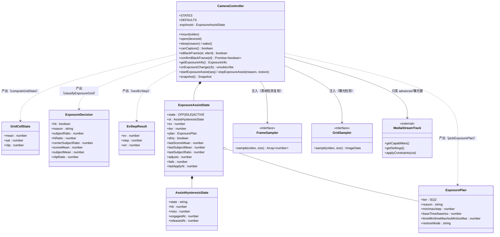
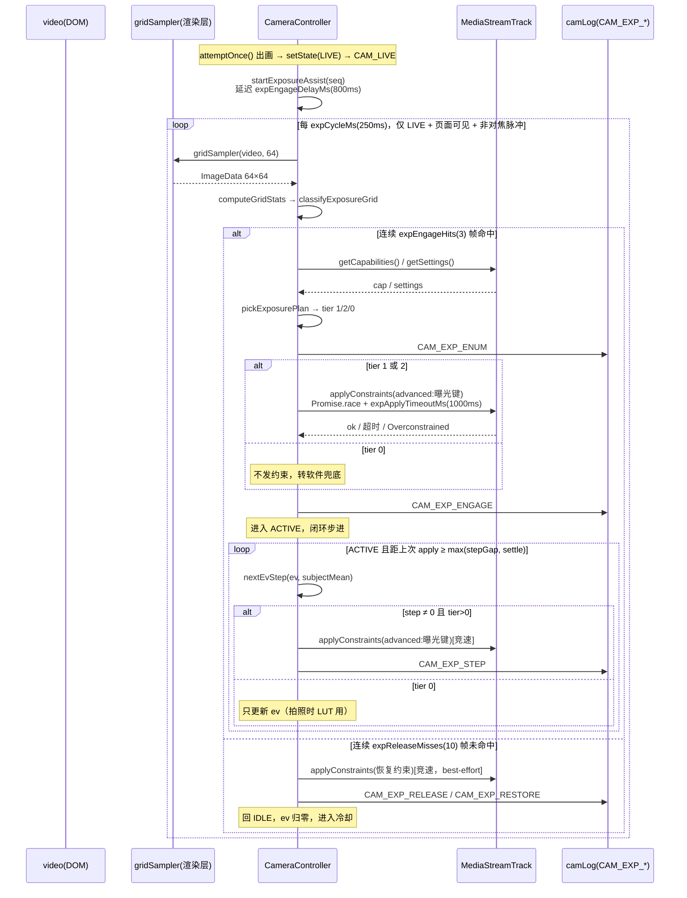
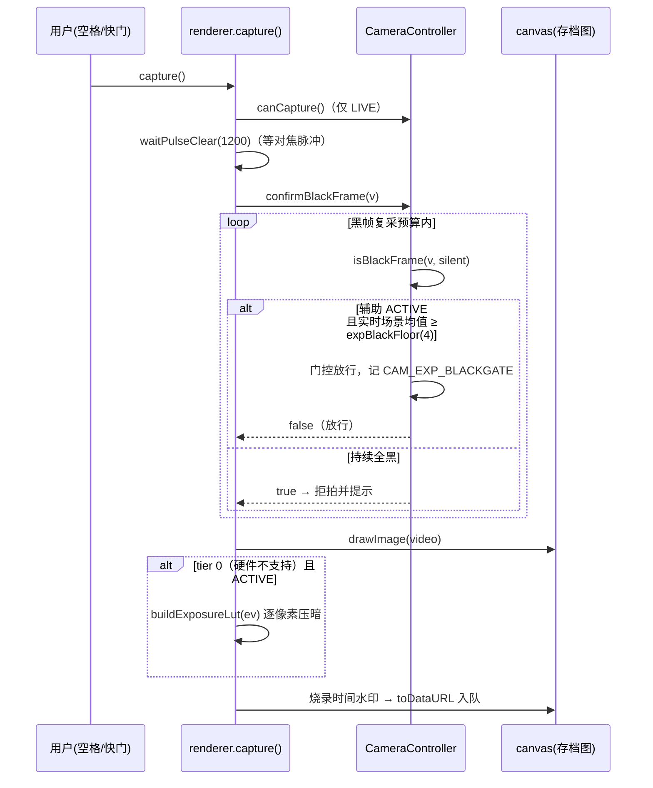
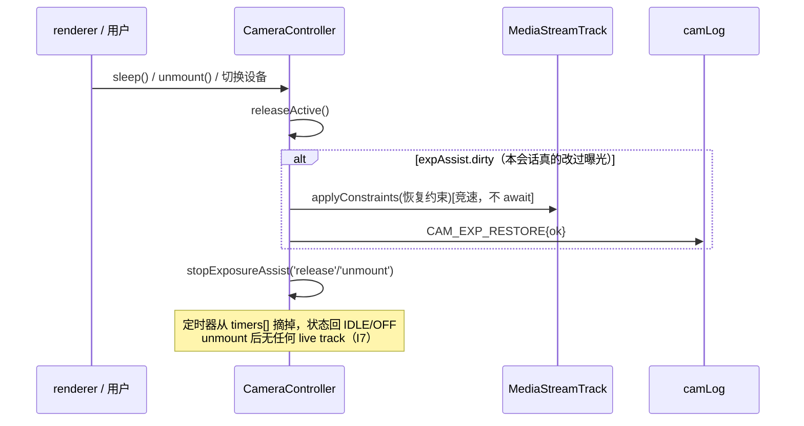
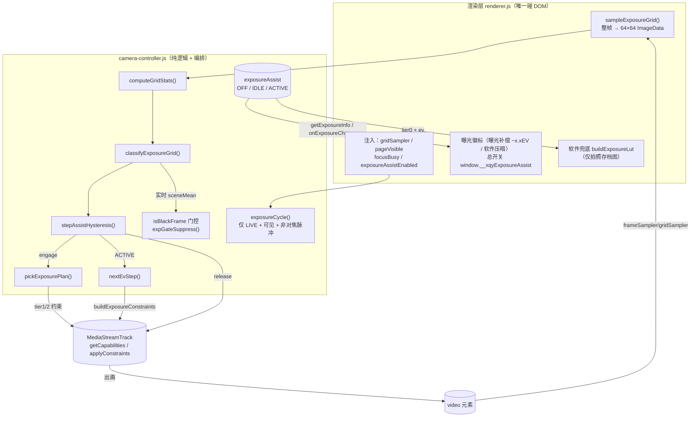

# 黑色衣物拍摄过曝防护方案（曝光辅助 Exposure Assist）设计文档

| 项 | 内容 |
| --- | --- |
| 文档编号 | XQY-EXP-DESIGN-2024-001 |
| 作者 | 高见远（软件架构师） |
| 关联需求 | 摄像头拍摄黑色衣物时自动曝光把衣物提亮成灰白色（过曝、黑色层次丢失），照片不可用 |
| 关联模块 | `renderer/camera-controller.js`、`renderer/renderer.js`、`scripts/verify-camera*.js` |
| 性质 | 增量设计（不改动既有行为契约；新增能力全部可经总开关一键退出） |
| 状态 | 待评审 |

> 现场背景（第二张截图）：取景台上是**亮黄色垫板（明亮背景）+ 深色衣物**，属于「亮背景 + 暗主体」场景。
> 摄像头 AE 以亮垫板为参照，把黑色衣物提亮成灰白色。方案必须只对这一场景发力，
> 且不能误伤「整体昏暗店面 / 黑色台垫 / 黑色电线 / 镜头遮挡全黑」等相邻暗场景。

---

## Part A：系统设计

### 1. 实现方式（Implementation Approach）

#### 1.1 核心难点分析

| # | 难点 | 本质 | 方案要点 |
| --- | --- | --- | --- |
| D1 | **「过曝的黑」在单帧里长得不像黑** | 被 AE 提亮后，黑衣物区域渲染成 mean≈90~185 的低饱和灰白色，与白衣物的区别只剩「比垫板暗、饱和度低」 | 判定不写死「mean<60 才算黑」，改为**低饱和 + 相对更暗的主体格**（`mean ≤ 185 且 sat < 0.28`），两类渲染形态（真暗 40 / 过曝灰白 150）都覆盖 |
| D2 | **四类相邻暗场景的区分** | 整体昏暗店面、黑色台垫、黑色电线、镜头遮挡全黑，与目标场景在「暗」这个维度上同构 | 四道闸门（见 §6.1）：场景均值下限 / 高亮参照面积下限 / 主体面积上下限 / 中心加权。任一道不过即不触发 |
| D3 | **摄像头能力差异极大** | 现场既有 `exposureCompensation` 齐全的，也有只有 `exposureMode:'manual' + exposureTime` 的，还有全没有的；部分 UVC 连 `getCapabilities()` 都抛异常 | 三档降级：硬件偏置(t1) → 硬件手动(t2) → 拍照时软件兜底(t0)，能力探测全包 try/catch |
| D4 | **UVC 设备 applyConstraints 永不 settle** | 项目既有血泪教训（分辨率锁定、对焦脉冲都因此加过竞速） | 曝光 applyConstraints 一律 `Promise.race` + `waitMs` 超时 + `cancel()` 回收，与 `tryApplyRung` 同构 |
| D5 | **降曝后中心变更暗 → 撞黑帧拒拍闸门** | `blackMean:12` 是绝对阈值，与曝光补偿完全无联动；误判会把正常黑衣物照片拒掉 | 明确选型：**门控放行 + 场景均值兜底**（而非阈值联动），理由与边界见 §9.1 |
| D6 | **AE 回弹与画面跳变** | 连续 AE 模式下摄像头会对抗负补偿；一步跨太大 EV 画面会「闪」 | 闭环比例控制 + 单步上限 1/3 档 + 死区 + 频率限制（§7.3） |
| D7 | **既有机制时序竞争** | 对焦脉冲（single-shot 期间部分 UVC 停输出）、分辨率锁定（play() 后不得改分辨率）、DEGRADED 重连、拍照闸门 | 曝光约束绝不夹带 width/height（红线）；对焦脉冲期间整周期跳过；LIVE 后延迟启动（§9.2/§9.3） |

#### 1.2 框架与库选型

- **不引入任何新第三方库**。全部能力由浏览器既有 API 提供：`MediaStreamTrack.getCapabilities() / getSettings() / applyConstraints()`（曝光）、离屏 `canvas`（帧降采样统计）、`Uint8ClampedArray`（软件兜底 LUT）。
- **测试同样零新依赖**：既有 `scripts/verify-camera*.js` 全部只用 Node 内置模块（`fs`/`path`/`assert`），新增脚本保持一致。

#### 1.3 架构模式

沿用项目既有分层，**不发明新模式**：

```
┌ 纯函数层（可 Node 单测，模块级导出）──────────────────────────────┐
│ computeGridStats / classifyExposureGrid / stepAssistHysteresis    │
│ nextEvStep / pickExposurePlan / buildExposureConstraints          │
│ buildExposureRestoreConstraints / buildExposureLut                │
└──────────────────────────────────────────────────────────────────┘
┌ 编排层（控制器闭包内，依赖注入）──────────────────────────────────┐
│ exposureCycle：检测 → 滞回决策 → engage/release → EV 闭环 → 恢复   │
│ 与状态机（LIVE/DEGRADED/SLEEP）、黑帧门控、日志、快照联动          │
└──────────────────────────────────────────────────────────────────┘
┌ 渲染层（renderer.js，唯一碰 DOM 的地方）─────────────────────────┐
│ sampleExposureGrid（整帧→64×64 ImageData）                        │
│ 注入 gridSampler / pageVisible / focusBusy / exposureAssistEnabled│
│ 曝光徽标 UI；拍照时 tier0 软件兜底（LUT 压暗）                     │
└──────────────────────────────────────────────────────────────────┘
```

选型理由：控制器「纯逻辑 + 依赖注入」是该项目用 8 个校验脚本固化下来的契约（摄像头模块可在 Node 下用假对象单测），曝光辅助的**判定与数学**必须落在纯函数层，**编排**放在控制器闭包内（它需要 track、waitMs、日志、状态机这些内部件），**DOM 只留在渲染层**。这样 CI 无摄像头环境也能覆盖 90% 以上逻辑。

---

### 2. 文件清单（File List）

| 文件 | 动作 | 说明 |
| --- | --- | --- |
| `docs/exposure-assist-design.md` | 新增 | 本设计文档 |
| `docs/sequence-diagram.mermaid` | 新增 | 时序图抽取（与 §4 一致） |
| `docs/class-diagram.mermaid` | 新增 | 类图抽取（与 §3 一致） |
| `renderer/camera-controller.js` | 改 | DEFAULTS 追加 `exp*` 段；新增 8 个纯函数并模块导出；新增曝光辅助编排区；`attemptOnce`/`handleTrackUnmuted`/`releaseActive`/`isBlackFrame`/`snapshot`/`api` 接线 |
| `renderer/renderer.js` | 改 | 新增 `sampleExposureGrid`；控制器注入 4 项；`onExposureChange` 订阅与徽标；`capture()` 软件兜底 |
| `renderer/styles.css` | 改 | 新增 `.exposure-badge` 样式（复用 `--success*`/`--warning*` 变量） |
| `scripts/verify-camera.js` | 改 | 事件白名单 ENUM 追加 8 个 `CAM_EXP_*` 事件（漏登记静态扫描用例即红，项目纪律第 1 条） |
| `scripts/verify-camera-exposure.js` | 新增 | 曝光辅助回归主检：纯函数用例 + 控制器集成用例 + 渲染层静态契约扫描 |
| `scripts/verify-camera-exposure-mutation.js` | 新增 | 变异测试（负向对照，防假阳性，项目纪律第 3 条） |
| `package.json` | 改 | `verify` 链追加 `node scripts/verify-camera-exposure.js` |
| `main/camera-log.js` | **不改** | `CAM_EXP_*` 字段全部是原始类型附加字段且 ≤6 个，`FIXED_KEYS` 已覆盖 `seq/reason/err/res`，无需改 |

---

### 3. 数据结构与接口（classDiagram）



**接口契约说明（渲染层→控制器的 4 个新注入）**：

| 注入名 | 签名 | 语义 | 缺省行为 |
| --- | --- | --- | --- |
| `gridSampler` | `(video, size) => ImageData\|null` | 整帧缩到 `size×size` 的像素数据 | 未注入 → 曝光辅助整体 OFF |
| `pageVisible` | `() => boolean` | 页面可见性（`!document.hidden`） | 未注入 → 不拦（渲染层总会注入） |
| `focusBusy` | `() => boolean` | 对焦脉冲进行中（`focusPulseBusy`） | 未注入 → 不拦 |
| `exposureAssistEnabled` | `() => boolean` | 总开关（`window.__xqyExposureAssist !== false`） | 未注入 → 视为启用 |

---

### 4. 程序调用流程（sequenceDiagram）

#### 4.1 主闭环：检测 → engage → EV 闭环 → release → 恢复



#### 4.2 拍照路径：黑帧门控 + 软件兜底



#### 4.3 休眠 / 卸载 / 切设备：恢复与收敛



---

### 5. 总体架构与数据流



**与既有模块的接入点（改动脉络）**：

| 既有模块 | 接入点 | 关系 |
| --- | --- | --- |
| 状态机 `setState` | `attemptOnce()` 出画末尾（CAM_LIVE 后）、`handleTrackUnmuted()` 复活分支 | 进入 LIVE → 启动曝光辅助（延迟 800ms） |
| 流回收 `releaseActive()` | 函数开头（stop 轨道之前） | dirty 时 best-effort 恢复 + 停止辅助 |
| 黑帧检测 `isBlackFrame` | 判定函数内部门控 | ACTIVE 且场景健康 → 放行（§9.1） |
| 对焦脉冲 `focusBusy` | `exposureCycle` 头部 | 脉冲期间整周期跳过（§9.2） |
| 分辨率锁定 `applyMaxResolution` | **无代码交点** | 曝光约束只带 `advanced` 曝光键，物理上不可能碰分辨率（§9.3） |
| 日志 `camLog` | 8 个 `CAM_EXP_*` 事件 | 全部登记进 `verify-camera.js` ENUM（§9.4） |
| 拍照 `capture()` | 黑帧复采之后、水印之前 | tier0 时 LUT 压暗存档图 |
| 快照 `snapshot()` | 新增 `exposure` 字段 | 现场复盘（§9.5） |

---

### 6. 检测算法详解

#### 6.1 场景判定与四类相邻暗场景的区分

**网格化统计**（`computeGridStats`）：渲染层把整帧画到 64×64 离屏 canvas（开销 ≈4096 像素/周期，250ms 一次，实测可忽略），控制器按 8×8=64 格切分，每格计算：

- `mean`：Rec.601 灰度均值（`(r*299+g*587+b*114)/1000`）
- `sat`：饱和度 `(max-min)/max`（max=0 时记 0，避免除零）
- `clip`：高光裁剪像素（luma>250）占比

**格类别**（互不排斥的两组比例，刻意不做划分——垫板偏暗时可能同时落进两组，由场景级闸门裁决）：

- **高亮格** `hi`：`mean > expHiMeanMin(185)` —— 亮垫板/亮背景参照
- **主体格** `subject`：`mean ≤ expSubjectMeanMax(185)` 且 `sat < expSubjectSatMax(0.28)` —— 低饱和且比垫板暗的区域。**关键设计**：不要求 `mean<60`。被 AE 提亮成灰白色的黑衣物（mean 90~185、sat≈0.05~0.15）与正确曝光的黑衣物（mean 20~60）都算主体；深蓝/深棕/深绿衣物因饱和度高被排除。

**场景级判定**（`classifyExposureGrid`，按序短路）：

```
sceneMean        = 全格 mean 平均
subjectRatio     = subject 格数 / 总格数
hiRatio          = hi 格数 / 总格数
centerSubject    = 中心区域（网格中央一半）的 subject 格占比
subjectMean      = subject 格的 mean 平均（EV 闭环的被控量）

① sceneMean < expSceneMeanMin(45)              → reason='overall-dark-or-blocked'，不触发
② hiRatio < expHiAreaMin(0.06)                 → reason='no-bright-reference'，不触发
③ subjectRatio < expSubjectAreaMin(0.08)       → reason='subject-too-small'，不触发
④ subjectRatio > expSubjectAreaMax(0.75)       → reason='subject-too-large'，不触发
⑤ centerSubject < expCenterSubjectMin(0.15)    → reason='subject-off-center'，不触发
⑥ 其余                                         → hit=true, reason='black-garment'
```

**场景区分表**（现场截图 + 用户点名的易误判场景）：

| 场景 | sceneMean | hiRatio | subjectRatio | centerSubject | 判定 | 理由 |
| --- | --- | --- | --- | --- | --- | --- |
| A. 黑衣物 + 亮黄垫板（**目标**） | ≈138 | ≈0.6 | ≈0.35 | ≈0.7 | **触发** | 四道闸门全过 |
| B. 整体昏暗店面 / 黑色台垫 | 30~50 | <0.06 | >0.75 | — | 不触发 | ①或④：没有亮参照就无法区分「AE 提亮黑衣物」与「场景本来就暗」；贸然负补偿会把正常暗场景压到逼近黑帧闸门 |
| C. 镜头遮挡 / 信号黑 | ≈2 | ≈0 | ≈1 | ≈1 | 不触发 | ①：那是黑帧检测的职责，且负补偿对全黑画面无意义 |
| D. 白衣物 / 浅色衣物 + 白垫板 | ≈210 | ≈0.9 | ≈0.02 | — | 不触发 | ③：主体面积太小，AE 工作正常无需干预 |
| E. 黑色电线 / 桌沿阴影（画面边缘暗物） | 高 | 中 | 0.03~0.07 | <0.15 | 不触发 | ③或⑤：零星暗物 + 暗质量不在中央 |
| F. 深蓝 / 深棕衣物 + 亮垫板 | 高 | 中 | ≈0.02 | — | 不触发 | 饱和度闸门：它们不会过曝成灰白，不需要干预 |

**为什么保留 `centerSubject`（中心加权）**：门店工位决定衣物总放在台垫中央；暗质量必须落在中央才认，可排除画面边缘的暗物（电线、阴影、桌沿），比单纯面积阈值更难误触。

#### 6.2 阈值表（DEFAULTS 新增项，全部集中在一处可调）

| 配置名 | 默认值 | 含义与取法 |
| --- | --- | --- |
| `expGridSize` | 64 | 整帧降采样边长（64×64 像素统计） |
| `expGridCells` | 8 | 网格划分数（8×8=64 格，每格 8×8 像素） |
| `expSubjectMeanMax` | 185 | 主体格亮度上限（比垫板暗） |
| `expSubjectSatMax` | 0.28 | 主体格饱和度上限（低饱和=灰黑系） |
| `expHiMeanMin` | 185 | 高亮格亮度下限（亮垫板参照） |
| `expSubjectAreaMin` | 0.08 | 主体面积下限（零星暗物不触发） |
| `expSubjectAreaMax` | 0.75 | 主体面积上限（超过视为整体暗场景） |
| `expHiAreaMin` | 0.06 | 高亮面积下限（没有亮参照不触发） |
| `expCenterSubjectMin` | 0.15 | 中心区域主体下限 |
| `expSceneMeanMin` | 45 | 场景均值下限（昏暗/遮挡/黑信号排除） |
| `expEngageHits` | 3 | 滞回：连续 3 帧命中才 engage（≈750ms） |
| `expReleaseMisses` | 10 | 滞回：连续 10 帧未命中才 release（≈2.5s） |
| `expMinHoldMs` | 1500 | engage 后最短保持（衣物半出画不急着恢复） |
| `expReEngageCooldownMs` | 3000 | release 后冷却（防半出画→再入画反复横跳） |
| `expCycleMs` | 250 | 检测周期 |
| `expEngageDelayMs` | 800 | LIVE 后启动延迟（避开分辨率探测/首帧 AE 收敛） |
| `expTargetMean` | 58 | 闭环目标：主体平均亮度（≈23% 灰，黑而有纹理） |
| `expDeadzone` | 8 | 死区：误差 <8 不调整（AE 自身波动 ±几格很正常） |
| `expEvGain` | 0.025 | 步长增益：误差×0.025=步长(EV)（40 亮度≈1EV） |
| `expMaxStepEv` | 0.34 | 单步上限 1/3 档（防画面跳变） |
| `expEvMin` | -3.0 | 累计补偿下限（再暗就逼近黑帧闸门且暗部细节丢失）。**勘误 2026-10：原为 -2.0**，现场数据见 §10 第 6 条：黑白相间鞋在 0→-2.0 全程 subjectMean 仍在 155~182，闭环贴住下限空转永不达标，-2.0 不够，加深到 -3.0 |
| `expStepGapMs` | 500 | 两次曝光 applyConstraints 最小间隔 |
| `expSettleMs` | 400 | 单次调整后稳定等待（拿过渡值算步长会过冲） |
| `expApplyTimeoutMs` | 1000 | 曝光 applyConstraints 超时竞速（UVC 悬挂兜底） |
| `expApplyFailLimit` | 2 | 连续失败这么多次 → 停硬件路径、降级软件兜底 |
| `expBlackFloor` | 4 | 黑帧门控兜底：ACTIVE 时场景均值 <4 仍判黑帧拒拍 |

#### 6.3 滞回状态机（防抖）

`stepAssistHysteresis(st, hit, nowMs, cfg)` 纯函数，输入历史状态 + 本帧命中 + 当前时刻：

- engage：`IDLE` 且连续 `expEngageHits` 帧命中，且距上次 release ≥ `expReEngageCooldownMs`
- release：`ACTIVE` 且连续 `expReleaseMisses` 帧未命中，且已保持 ≥ `expMinHoldMs`
- 其余：只累计 hit/miss 计数，不改状态

> **勘误 2026**：上面两条闸门依赖 `engagedAt` / `releasedAt` 两个时间戳，因此「其余：只累计
> hit/miss 计数」时**返回的状态对象必须把这两个时间戳原样带下去**。若按 §8.3 最初的
> `{ state, hit, miss }` 三字段写法，第一个不改状态的帧起 `st.engagedAt` 就是 `undefined`，
> `nowMs - (st.engagedAt || 0)` 恒成立 → **最短保持与冷却两道闸门永久失效**（release 后
> 仅 750ms 就会重新 engage）。实现与 §8.3 代码片段均已修正。

**为什么必须滞回**：单帧判定会因AE 波动、衣物微动、行人掠过而抖动；没有滞回，曝光补偿会跟着画面闪烁反复 engage/release——那比过曝本身更扰人，且每次 engage 都是一串 applyConstraints（给爱悬挂的 UVC 添堵）。

---

### 7. 曝光调整策略

#### 7.1 能力探测与三档降级路径

`pickExposurePlan(cap, settings)` 在每次 engage 时重新探测（换摄像头/换 USB 口后能力可能变），优先级固定：

| 档位 | 触发条件 | 施加约束（只带 advanced 曝光键） | 恢复约束 | 特点 |
| --- | --- | --- | --- | --- |
| **t1 硬件偏置** | `cap.exposureCompensation` 存在（有 min/max） | `{advanced:[{exposureMode:'continuous', exposureCompensation: ev}]}`（按 cap.step 取整、钳 [min,max]） | `{advanced:[{exposureCompensation: 0}]}` | **首选**：保留 AE 自适应，只加负偏置；语义最干净 |
| **t2 硬件手动** | `cap.exposureMode` 含 `'manual'` 且 (`exposureTime` 或 `iso`) 可用，**且至少有一个给出了 `min`** | `{advanced:[{exposureMode:'manual', exposureTime: base×2^ev}]}`（无 time 时才退而调 iso 且只往下调） | `continuous` 在列 → `{advanced:[{exposureMode:'continuous'}]}`；否则还原基线 time/iso | AE 完全交还给我们控制，确定性强但冻结自适应；释放时必须恢复 |
| **t0 软件兜底** | 以上都不可用 / `getCapabilities` 抛异常 | 不发任何约束 | 无 | 只影响存档图：拍照时 LUT 压暗；预览仍过曝（徽标提示「软件压暗」） |

**为什么优先压 exposureTime 不升 iso**：升 iso 只加噪点不救过曝；曝光时间才是曝光量的主轴。iso 只在设备没有 time 能力时启用。

**EV → 曝光时间换算**：`time = clamp(baseTime × 2^ev, timeMin, timeMax)`，ev 为负 → 时间缩短 → 进光量减少。

#### 7.2 EV 闭环步进（`nextEvStep`）

```
err  = subjectMean - expTargetMean            （正=还太亮，需要更负）
step = clamp(err × expEvGain, ±expMaxStepEv)  （比例控制：误差越大步长越大；正=要压暗）
ev   = clamp(ev - step, expEvMin, 0)          （下限保护 + 只往防过曝方向补）
死区：|err| < expDeadzone → step = 0
```

> **勘误 2026**：本节原写作 `ev = clamp(ev + step, ...)`，符号是反的。`err > 0`（过亮）时
> `step > 0`，加上去只会把 EV 推向 0，随即被「上限锁 0」夹住，**负补偿一次都发不出去**，
> 闭环永远停在 0（用 `subjectMean=120 / expTargetMean=58` 连推 20 帧实测 ev ≡ 0）。
> 正确写法是减去 `step`：`step` 的语义是「要压暗多少」，EV 应往负方向走。
> 实现与 §8.3 代码片段均已按此修正（`renderer/camera-controller.js` 的 `nextEvStep`）。

- **分步 settle**：单步 ≤1/3 档；每次 apply 后至少 `expSettleMs(400ms)` 才复测，两次 apply 至少间隔 `expStepGapMs(500ms)`。从 0 收敛到 −1.7EV 约 5~6 步 ≈3s——衣物在台垫上停留通常以秒计，可接受；换来的是画面不跳变。
- **为什么闭环而不是一步到位**：AE 会回弹（见风险 R2），固定一步的补偿量在不同光照/衣物反光下不是过就是欠；闭环按实测亮度持续修正，天然抗回弹。
- **为什么上限锁 0**：本方案只解决「过曝」；欠曝场景（画面整体偏暗）交给 AE 自己，正补偿不在职责内。

> **勘误 2026-10（下限加深）**：本节公式中的 `expEvMin` 原为 `-2.0`。现场（黑白相间鞋、
> 白色鞋底完全过曝裁剪）日志显示 ev 从 0 压到 -2.0 期间 `subjectMean` 始终 155~182，
> 闭环贴住下限空转、永不达标。按亮度模型 `mean = 150×2^(ev/2.2)` 推演：旧下限 -2.0 处
> 仍有 err≈22（> 死区 8），而加深到 -3.0 后闭环在 ev≈-2.72 处落入死区真正收敛
> （`verify-camera-exposure.js` D14/D15/D16 逐项断言）。§6.2 阈值表、§8.1 代码段与
> 实现均已同步为 -3.0。注意实际下发仍受设备 `cap.exposureCompensation.min` 二次钳位。

#### 7.3 软件兜底（`buildExposureLut`，仅 tier0）

```
out = in × 2^(ev / gamma)           gamma = 2.2（sRGB 编码指数，与 §7.5 判定同源）
                                    ev 为负 → 系数 <1 → 压暗
```

> **勘误 2026-10（QA DEF-1，严重）**：本节原为 `out = 255 × (in/255)^(2^-ev)`。那是在**码值域做幂
> 运算**：设码值 V ∝ L^(1/2.2)，则 V^(2^-ev) ∝ L^(2^-ev)，等价于把线性光**取幂** L → L^(2^-ev)，
> 而不是曝光补偿应有的 L → L×2^ev。于是本模块里曾同时存在两套「EV 的定义」（§7.5 判定用 sRGB
> 模型、§7.3 兜底用幂次曲线）。实测 `ev=-3`（tier0 闭环顶到 `expEvMin` 后的真实取值）：
>
> | 输入码值 | 旧 LUT | 正确值 | 后果 |
> | --- | --- | --- | --- |
> | 150（黑衣物主体） | 4 | 58（= `expTargetMean`） | 存档图被压成近全黑 |
> | 255（白色鞋底裁剪） | 255 | 99 | **被裁剪的白色一点没救回来**（现场投诉的正是这项） |
> | 20 / 30 / 45 / 60（褶皱暗部） | 0 / 0 / 0 / 0 | 8 / 12 / 17 / 23 | 暗部层次被抹平 |
> | 等效实际 EV | -1EV→-2.19EV、-2EV→-5.05EV、-3EV→**-12EV** | 1:1 | 越深偏差越离谱 |
>
> 为什么这轮才致命：① 幽灵能力检测把设备导向 tier0（原先 tier0 只在「设备根本没能力」时才到）；
> ② `expEvMin` 加深到 -3.0，而 -3.0 的依据正是「150 → 58 需要 -3EV」（sRGB 模型）——下限越深、
> 幂次曲线的偏差越大。
>
> 为什么既有测试没抓住：主检对 LUT 只有单调性/端点断言，**没有任何「压暗量 vs EV」的语义校验**；
> 而 tier0「不参与有效性验证、只改存档图」的例外让预览采样永远看不到 LUT 的效果。已补 E46~E50
> 五条语义断言 + M34 负向对照（把 LUT 退回幂次曲线必须转红）。

- **为什么是「码值域乘法」而不是幂次曲线**：硬件的曝光补偿做的是线性光等比例缩放（L → L×2^ev），8bit 码值域因此是一次乘法（×2^(ev/gamma)）。软件兜底要假装自己是硬件，就必须用同一条曲线——否则「判定说该降 27%」与「兜底实际压掉 96%」会同时成立。原始理由「幂次曲线保住暗部层次」也随之更正：真正保住层次的是**等比例压暗**（暗部按比例一起降，相对关系不变），幂次曲线恰恰是把暗部压死的那个。
- LUT 是 `Uint8ClampedArray(256)` 纯函数产出，Node 可单测（单调性/端点/**压暗量语义**）；渲染层在 `capture()` 里逐像素套用，**只改存档图，不改预览**（徽标会说明）。

#### 7.3.1 tier0 的 EV 取解析解（不用闭环，`solveTier0Ev`）

`solveTier0Ev(subjectMean, cfg)`：`ev = clamp(gamma × log2(expTargetMean / subjectMean), expEvMin, 0)`。

**为什么 tier0 不能用 `nextEvStep` 的闭环**：tier0 只改存档图、不改预览，闭环读到的 `subjectMean` 永远是**没被压暗的原图**，误差恒为正 → EV 一路撞到 `expEvMin`。实测主体 100（只需 -1.73EV）却取了 -3.00EV，存档被过压 1.27 档；主体 130 只需 -2.56EV。而解析解直接解 `code × 2^(ev/gamma) = expTargetMean`，一步到位且不会过压。语义断言 E51~E57（含「解析解自洽：按解压暗后确实落在目标附近」），负向对照 M35（tier0 退回闭环步进必须转红）。

> 为什么 -3.0 的下限仍然保留：解析解会撞到 `expEvMin`，主体比 150 更亮时（如 182 需要 -3.63EV）下限就是「最多只能压这么多」的护栏，与 tier1/tier2 共用同一个常量，避免三档出现三个「下限」。

#### 7.4 恢复条件表

| 触发 | 路径 | 恢复内容 | 强度 |
| --- | --- | --- | --- |
| 衣物移出画面（连续未命中 + 最短保持） | `releaseAssist('no-hit')`，**同一 track 仍存活** | tier1：补偿归零；tier2：切回 continuous | **强保证**：竞速 apply，失败记 CAM_EXP_RESTORE 并继续降级 |
| 连续 apply 失败达 `expApplyFailLimit` | `tickClosedLoop` 内 | 同上 + 转 tier0 软件兜底 | 尽力而为 |
| 对焦脉冲 / 页面隐藏 / 非 LIVE | `exposureCycle` 闸门 | 不恢复（保持现场，脉冲过后继续） | — |
| `sleep()` / `unmount()` / 切换设备 / DEGRADED 超时重连 | `releaseActive()` 开头，**track 即将 stop** | dirty 时点火恢复 | **best-effort**：不 await、失败只留痕（流停后设备重置，这些设置本来就会丢） |
| DEGRADED → LIVE（同一 track 复活） | `handleTrackUnmuted` → `startExposureAssist` | 先尽力恢复上一会话补偿再归零重启（`expDirty` 标记避免新流上白发一次多余 applyConstraints） | 尽力而为 + 下个周期自愈 |

**为什么 DEGRADED 复活要「先恢复再归零」**：mute/unmute 不重建 track，设备上的负补偿还在；若内部状态直接归零而设备停在降曝态，两边会对不上，画面会莫名偏暗直到下一次 engage。

#### 7.5 补偿有效性验证与档位自动降级（幽灵能力，现场 2026-10 补）

**症状**（`camera-20261022.log`）：拍黑白相间的鞋，白色鞋底完全过曝裁剪。徽标显示「曝光补偿 -2.0EV」，但画面一点没暗。日志：

```
CAM_EXP_ENGAGE ev:0  sceneMean:191
CAM_EXP_STEP   ev:-0.34  subjectMean:170
CAM_EXP_STEP   ev:-0.68  subjectMean:168
...（全程 155~182 噪声波动）
CAM_EXP_STEP   ev:-2.00  subjectMean:166   ← 贴住 expEvMin 空转
```

**根因**：这台设备的 `exposureCompensation` 是**幽灵能力**——`getCapabilities()` 报告有 min/max、`applyConstraints()` 不报错、甚至 `getSettings()` 也会回显，但画面亮度完全不受影响。闭环因此永远不达标：它只会一路把 ev 推到下限，然后贴在那里空转。

**为什么没有 API 能提前识别**：Chromium 只暴露「能力声明」，不保证「能力生效」。UVC 驱动什么都敢报，`exposureTime` 同样可能是幽灵能力。唯一可信的判据是**实测**：发了补偿，亮度有没有按预期方向降。

**判定（`judgeExposureEffect` 纯函数）**：

```
expected = 1 − 2^(ev / gamma)          // 8bit 灰度是 sRGB 编码：线性光 ×2^ev → 码值 ×2^(ev/gamma)
need     = expected × ratio            // 实测降幅只要达到预期的一半就算有效（留一倍余量）
drop     = (baseline − mean) / baseline
verdict  = 连续 hits 次 drop < need → 'ineffective'
           任一一次 drop ≥ need     → 'effective'（滞回清零）
           证据不足                  → 'pending'
```

- `baseline` = 本档位开始时的 `subjectMean`；`mean` = 每次下发后**过完 settle** 测到的稳态 `subjectMean`。
- 只判**实际下发**的补偿量（`appliedEvOf()`：闭环算出的 ev 会被设备步长取整、min/max 钳位，拿它算预期会高估）。
- `ev = -1` 对应预期降幅 27%；`ratio=0.5` 即要求实测至少降 13.8%——现场幽灵设备的实测降幅是 **0**（甚至反向），离阈值很远，判定面很干净。

**判定参数**（`EXP_EFFECT`，单测可用 `expEffect*` 覆盖；**刻意不进 DEFAULTS**——DEFAULTS 的 `exp*` 项与 §6.2 阈值表一一对应，QA 按 26 项对拍，新增判定参数另立一表）：

- `windowMs`：2000 —— engage / 换档后先等这么久再判。刚下发模式切换时 AE 与驱动都在重收敛，此时的亮度变化不能用来判设备能力（**防误伤的第一道闸**）。
- `minSteps`：3 —— 至少下发过 3 步补偿才判，前两步还混着 AE 收敛。
- `minEv`：1.0 —— 累计补偿至少 1EV 才判。更浅的补偿在 8bit 上只对应几个百分点的亮度变化，会被 AE 抖动和衣物微动淹没。例外：已 `pinned`（贴住 EV 下限或设备把值钳死）时不受此限——那正是现场「压不动还在判」的形态。
- `gamma`：2.2 —— sRGB 编码指数。
- `ratio`：0.5 —— 预期降幅的达成系数（抗 AE 回弹余量）。
- `hits`：2 —— **滞回**：连续 2 次不达标才判无效，单帧不判。AE 收敛、衣物微动、行人掠过都会让单帧亮度偏高，一次误判就会把好设备降成软件兜底（那比过曝更糟：预览不再变化，用户以为功能坏了）。

**降级链（`demoteExposurePlan`）**：`tier1 → tier2 → tier0`，一路只往下走，最多两次。

- tier1 无效：把 `exposureCompensation` 从能力对象里摘掉再探测 → 有 manual 且**真能产出曝光值**（`buildExposureConstraints(next, -1) !== null`，防「切了手动却不压暗」）→ tier2；否则 tier0。
- tier2 无效：tier0（软件 LUT 压暗，徽标如实显示「软件压暗」）。
- 每一步降级：① 先把当前档位的约束还回去（补偿归零 / 切回 continuous，**否则两份曝光偏置会叠在同一台设备上**）→ ② 重新探测 → ③ **ev 归零 + 基线与观测序列重置**（补偿与曝光时间不是同一个量纲，继承旧 ev 没有意义）→ ④ 对新档位重新做一次有效性验证（tier2 也可能是幽灵能力）。
- 留痕：`CAM_EXP_FALLBACK`，`reason` = `comp-ineffective`（tier1 无效）/ `manual-ineffective`（tier2 无效）/ `demote-apply-failed`（换档后的首次 apply 失败）。`reason` 是 FIXED_KEY，不占附加字段额度。

> **为什么 tier0 不参与有效性验证**：软件兜底作用于存档图（拍照时 LUT 压暗），不影响预览采样——拿预览亮度去判它「有没有生效」会永远判成无效，只会制造假降级。

**降级结论的会话级记忆（QA 观察项 U19）**：「本设备某档位无效」是**设备**的属性，不是单次 engage 的属性。若只在单次 engage 内记住，幽灵设备每放一件衣物都要重走一次约 4s 的「徽标显示 -xEV、画面其实没压暗」窗口——那正是现场投诉的形态。实现：控制器内按 `deviceId` 记一张 `{tier: true}` 表，下次 engage 直接跳过该档（留痕 `CAM_EXP_FALLBACK{reason:'ghost-remembered', from, tier}`）；换设备（deviceId 变化）即清空，不串档。**只有「实测无效」才记账**：apply 失败/超时可能是设备忙，记进去会把好设备永久挡在硬件档之外（比误降级更难排查）。负向对照 M36（记忆被删掉 → 换衣物又重走无效窗口必须转红）、M37（记忆不按 deviceId 区分 → 换摄像头串档必须转红）。

**已知边界（QA U4b，本次不改）**：判定用 engage 时刻的固定基线算降幅，与补偿无关的**整体变亮**（环境光持续变亮 ≥6 码值/秒，判定前累计约 50 码值）会被算进「没响应」，理论上可能误判好设备。不改的原因：现场 AE 处于 `continuous` 模式时会自行抵消环境光漂移；且改为「按 Δev 的增量判定」会让单次判据的预期降幅降到 ~10%（0.34EV），噪声 ±8 码值下判别力反而变差。已记入 §10 第 7 条，待现场日志（`CAM_EXP_FALLBACK` 中 `drop` 接近 0 但设备其实可用）积累后再评估。

---

### 8. 关键代码逻辑

> 以下片段与现有代码结构真实兼容（函数名/注入名/配置名对齐现有命名），风格保持一致：`var`、严格模式、中文注释解释「为什么」、`Promise.race` + `waitMs` 竞速。

#### 8.1 `camera-controller.js`：DEFAULTS 新增段（追加在 `resMaxFps` 之后）

```js
    // ===== 曝光辅助：黑色衣物过曝防护（设计文档 docs/exposure-assist-design.md）=====
    // 所有曝光 applyConstraints 只带 advanced 曝光键，绝不夹带 width/height
    // （夹带一次就可能破坏分辨率锁定，项目纪律红线第 4 条）
    expGridSize: 64,             // 整帧降采样边长（64×64 像素统计，开销可忽略）
    expGridCells: 8,             // 网格划分数：8×8=64 格
    expSubjectMeanMax: 185,      // 主体格亮度上限：比垫板暗即候选
    expSubjectSatMax: 0.28,      // 主体格饱和度上限：低饱和=灰黑系；
                                 //   深蓝/深棕/深绿衣物饱和度高，不触发（它们不过曝成灰白）
    expHiMeanMin: 185,           // 高亮格亮度下限：亮垫板/亮背景参照
    expSubjectAreaMin: 0.08,     // 主体面积下限：零星暗物（电线/阴影）不触发
    expSubjectAreaMax: 0.75,     // 主体面积上限：超过视为整体昏暗场景，不触发
    expHiAreaMin: 0.06,          // 高亮面积下限：没有亮参照就无法区分
                                 //   「AE 提亮黑衣物」与「场景本来就暗」
    expCenterSubjectMin: 0.15,   // 中心区域主体下限：衣物在台垫中央，
                                 //   顺带排除画面边缘暗物（电线/桌沿阴影）
    expSceneMeanMin: 45,         // 场景均值下限：低于此=昏暗/遮挡/黑信号，
                                 //   那是黑帧检测的职责，不触发
    expEngageHits: 3,            // 滞回 engage：连续 3 帧命中（≈750ms）
    expReleaseMisses: 10,        // 滞回 release：连续 10 帧未命中（≈2.5s）
    expMinHoldMs: 1500,          // engage 后最短保持：衣物半出画不急着恢复
    expReEngageCooldownMs: 3000, // release 后冷却：防反复横跳
    expCycleMs: 250,             // 检测周期
    expEngageDelayMs: 800,       // LIVE 后启动延迟：避开分辨率探测/首帧 AE 窗口
    expTargetMean: 58,           // 闭环目标：主体平均亮度（黑而有纹理）
    expDeadzone: 8,              // 死区：AE 自身波动 ±几格很正常，不动
    expEvGain: 0.025,            // 步长增益：误差×0.025=步长(EV)
    expMaxStepEv: 0.34,          // 单步上限 1/3 档：小步逼近防画面跳变
    expEvMin: -3.0,              // 累计下限（§7.2 勘误：原 -2.0，现场贴住下限不收敛）
    expStepGapMs: 500,           // 两次曝光 applyConstraints 最小间隔
    expSettleMs: 400,            // 单次调整后稳定等待：拿过渡值算步长会过冲
    expApplyTimeoutMs: 1000,     // 曝光 applyConstraints 超时竞速（UVC 悬挂兜底）
    expApplyFailLimit: 2,        // 连续失败这么多次：停硬件路径、降级软件兜底
    expBlackFloor: 4             // 黑帧门控兜底：ACTIVE 时场景均值 <4 仍拒拍
```

#### 8.2 `camera-controller.js`：纯函数（追加在 `sampleCenterGray` 之后）

```js
  // 网格降采样统计：整帧按 grid×grid 切格，每格算 { mean, sat, clip }
  // 为什么整帧统计而不是继续用中心 64×64：黑色衣物检测要回答的是
  // 「画面里暗主体占多大、有没有亮背景参照」，这是全局问题，中心采样回答不了
  function computeGridStats(image, grid) {
    var g = Math.max(1, grid || DEFAULTS.expGridCells);
    var w = image && image.width ? image.width : 0;
    var h = image && image.height ? image.height : 0;
    var data = image && image.data;
    if (!w || !h || !data) return null;
    var cw = Math.max(1, Math.floor(w / g));
    var ch = Math.max(1, Math.floor(h / g));
    var cells = new Array(g * g);
    for (var cy = 0; cy < g; cy++) {
      for (var cx = 0; cx < g; cx++) {
        var sum = 0;
        var satSum = 0;
        var clip = 0;
        var n = 0;
        var y1 = cy * ch;
        var x1 = cx * cw;
        for (var y = 0; y < ch; y++) {
          var row = (y1 + y) * w;
          for (var x = 0; x < cw; x++) {
            var i = (row + x1 + x) * 4;
            var r = data[i];
            var gg = data[i + 1];
            var b = data[i + 2];
            var mx = Math.max(r, gg, b);
            var mn = Math.min(r, gg, b);
            var luma = (r * 299 + gg * 587 + b * 114) / 1000;
            sum += luma;
            // 饱和度 (max-min)/max；纯黑像素（max=0）定义为 0，避免除零
            satSum += mx > 0 ? (mx - mn) / mx : 0;
            if (luma > 250) clip++;
            n++;
          }
        }
        cells[cy * g + cx] = n
          ? { mean: sum / n, sat: satSum / n, clip: clip / n }
          : { mean: 0, sat: 0, clip: 0 };
      }
    }
    return cells;
  }

  // 场景判定：是否命中「黑色衣物过曝」场景。四类相邻暗场景的区分见设计文档 §6.1
  function classifyExposureGrid(cells, th) {
    var t = th || {};
    var grid = t.grid || DEFAULTS.expGridCells;
    var n = cells && cells.length ? cells.length : 0;
    if (!n) {
      return { hit: false, reason: 'no-cells', subjectRatio: 0, hiRatio: 0, centerSubjectRatio: 0, sceneMean: null, subjectMean: null, clipRatio: 0, cells: 0 };
    }
    var subject = 0;
    var hi = 0;
    var centerSubject = 0;
    var centerTotal = 0;
    var sum = 0;
    var subjSum = 0;
    var clipSum = 0;
    // 中心区域 = 网格中央一半（g/4 ~ 3g/4）
    var lo = Math.floor(grid / 4);
    var hiEdge = Math.ceil((grid * 3) / 4);
    for (var i = 0; i < n; i++) {
      var c = cells[i];
      var cx = i % grid;
      var cy = Math.floor(i / grid);
      // 主体格：比垫板暗且低饱和。刻意不要求 mean<60 —— 被 AE 提亮成
      // 灰白色的黑衣物（mean 90~185、sat≈0.1）正是要救的对象
      var isSubject = c.mean <= t.expSubjectMeanMax && c.sat < t.expSubjectSatMax;
      if (isSubject) { subject++; subjSum += c.mean; }
      if (c.mean > t.expHiMeanMin) hi++;
      sum += c.mean;
      clipSum += c.clip;
      if (cx >= lo && cx < hiEdge && cy >= lo && cy < hiEdge) {
        centerTotal++;
        if (isSubject) centerSubject++;
      }
    }
    var out = {
      hit: false,
      reason: 'normal',
      subjectRatio: subject / n,
      hiRatio: hi / n,
      centerSubjectRatio: centerTotal ? centerSubject / centerTotal : 0,
      sceneMean: sum / n,
      subjectMean: subject ? subjSum / subject : null,
      clipRatio: clipSum / n,
      cells: n
    };
    // 按序短路：每一道都对应一类必须排除的场景（设计文档 §6.1 场景表）
    if (out.sceneMean < t.expSceneMeanMin) { out.reason = 'overall-dark-or-blocked'; return out; }
    if (out.hiRatio < t.expHiAreaMin) { out.reason = 'no-bright-reference'; return out; }
    if (out.subjectRatio < t.expSubjectAreaMin) { out.reason = 'subject-too-small'; return out; }
    if (out.subjectRatio > t.expSubjectAreaMax) { out.reason = 'subject-too-large'; return out; }
    if (out.centerSubjectRatio < t.expCenterSubjectMin) { out.reason = 'subject-off-center'; return out; }
    out.hit = true;
    out.reason = 'black-garment';
    return out;
  }

  // 滞回状态机：engage 要连续 expEngageHits 帧命中，release 要连续
  // expReleaseMisses 帧未命中且满足最短保持/冷却。单帧抖动不改状态，
  // 否则补偿会跟着画面闪烁反复横跳（那比过曝本身更扰人）
  function stepAssistHysteresis(st, hit, nowMs, cfg) {
    var c = cfg || DEFAULTS;
    // 【勘误 2026】原文为 { state, hit, miss } 三字段，会丢掉 engagedAt/releasedAt：
    // 第一个「不改状态」的帧起 st.engagedAt 就变 undefined，下面两道闸门
    // （最短保持 / 释放后冷却）的 nowMs - (st.x || 0) 恒成立而永久失效。
    // 正确写法必须把两个时间戳原样带下去。
    var s = {
      state: st.state,
      hit: st.hit,
      miss: st.miss,
      engagedAt: st.engagedAt || 0,
      releasedAt: st.releasedAt || 0
    };
    if (hit) { s.hit += 1; s.miss = 0; } else { s.miss += 1; s.hit = 0; }
    if (s.state === 'IDLE' && s.hit >= c.expEngageHits &&
        nowMs - (st.releasedAt || 0) >= c.expReEngageCooldownMs) {
      return { st: { state: 'ACTIVE', hit: 0, miss: 0, engagedAt: nowMs, releasedAt: 0 }, action: 'engage' };
    }
    if (s.state === 'ACTIVE' && s.miss >= c.expReleaseMisses &&
        nowMs - (st.engagedAt || 0) >= c.expMinHoldMs) {
      return { st: { state: 'IDLE', hit: 0, miss: 0, engagedAt: 0, releasedAt: nowMs }, action: 'release' };
    }
    return { st: s, action: null };
  }

  // EV 闭环步长：按实测主体亮度与目标的误差算下一步补偿（比例控制）
  //   err  = subjectMean - expTargetMean   （正=还太亮，需要更负）
  //   step = clamp(err × expEvGain, ±expMaxStepEv)   （正=要压暗，EV 往下走）
  //   ev   = clamp(ev - step, expEvMin, 0)
  // 死区内不动：AE 自身波动 ±几格就微调会让日志爆炸、画面有呼吸感
  function nextEvStep(curEv, subjectMean, cfg) {
    var c = cfg || DEFAULTS;
    if (subjectMean == null || !isFinite(subjectMean)) return { ev: curEv, step: 0, err: 0 };
    var err = subjectMean - c.expTargetMean;
    if (Math.abs(err) < c.expDeadzone) return { ev: curEv, step: 0, err: err };
    var step = err * c.expEvGain;
    if (step > c.expMaxStepEv) step = c.expMaxStepEv;
    if (step < -c.expMaxStepEv) step = -c.expMaxStepEv;
    // 【勘误 2026】原文为 curEv + step，符号是反的：err>0（过亮）时 step>0，
    // 加上去只会把 EV 推向 0，再被下一行「上限锁 0」夹住 —— 负补偿一次都发不出去，
    // 闭环永远停在 0（QA 用 subjectMean=120/target=58 连推 20 帧实测 ev≡0）。
    // 正确写法是减去 step：step 的语义是「要压暗多少」，EV 要往负方向走。
    var next = curEv - step;
    if (next < c.expEvMin) next = c.expEvMin; // 下限保护
    if (next > 0) next = 0;                   // 只往防过曝方向补
    return { ev: next, step: next - curEv, err: err };
  }

  // 能力探测 → 三档降级路径（设计文档 §7.1）。摄像头能力差异极大，
  // 且部分 UVC 的 getCapabilities() 直接抛异常，调用方必须包 try
  function pickExposurePlan(cap, settings) {
    if (!cap || typeof cap !== 'object') return { tier: 0, reason: 'no-capabilities' };
    if (cap.exposureCompensation && typeof cap.exposureCompensation.min === 'number') {
      return {
        tier: 1,
        reason: 'exposure-compensation',
        min: cap.exposureCompensation.min,
        max: cap.exposureCompensation.max,
        step: cap.exposureCompensation.step || 0
      };
    }
    var modes = cap.exposureMode || [];
    if (modes.indexOf('manual') >= 0 && (cap.exposureTime || cap.iso)) {
      return {
        tier: 2,
        reason: 'manual-exposure',
        baseTime: settings && settings.exposureTime ? settings.exposureTime : null,
        baseIso: settings && settings.iso ? settings.iso : null,
        timeMin: cap.exposureTime ? cap.exposureTime.min : null,
        timeMax: cap.exposureTime ? cap.exposureTime.max : null,
        isoMin: cap.iso ? cap.iso.min : null,
        isoMax: cap.iso ? cap.iso.max : null,
        restoreMode: modes.indexOf('continuous') >= 0 ? 'continuous' : 'manual-baseline'
      };
    }
    return { tier: 0, reason: 'unsupported' };
  }

  // 按档位构造曝光约束。红线：绝不夹带 width/height/frameRate ——
  // 曝光调整碰分辨率键会破坏 applyMaxResolution 的锁定（项目纪律第 4 条）
  function buildExposureConstraints(plan, ev) {
    if (!plan || plan.tier === 0) return null;
    if (plan.tier === 1) {
      var v = ev;
      // 按设备步长取整：部分 UVC 对非步长整数倍的补偿直接拒绝
      if (plan.step > 0) v = Math.round(ev / plan.step) * plan.step;
      if (v < plan.min) v = plan.min;
      if (v > plan.max) v = plan.max;
      return { advanced: [{ exposureMode: 'continuous', exposureCompensation: v }] };
    }
    // tier2 手动档：EV 负补偿 = 曝光时间 ×2^ev；优先压时间不升 iso
    // （升 iso 只加噪点不救过曝，时间才是曝光量的主轴）
    var adv2 = { exposureMode: 'manual' };
    if (plan.baseTime && plan.timeMin != null) {
      var t = plan.baseTime * Math.pow(2, ev);
      if (t < plan.timeMin) t = plan.timeMin;
      if (t > plan.timeMax) t = plan.timeMax;
      adv2.exposureTime = t;
    } else if (plan.baseIso && plan.isoMin != null) {
      var iso = plan.baseIso * Math.pow(2, ev);
      if (iso < plan.isoMin) iso = plan.isoMin;
      if (iso > plan.isoMax) iso = plan.isoMax;
      adv2.iso = iso;
    }
    return { advanced: [adv2] };
  }

  // 恢复约束：最小约束原则（只发必须发的键）—— 多发一个键就多一次
  // Overconstrained / 悬挂风险。tier1 只把补偿归零；tier2 切回 continuous
  // 把曝光交还 AE（切回连续后 time/iso 约束自动失效，无需逐个还原）
  function buildExposureRestoreConstraints(plan) {
    if (!plan || plan.tier === 0) return null;
    if (plan.tier === 1) return { advanced: [{ exposureCompensation: 0 }] };
    if (plan.restoreMode === 'continuous') return { advanced: [{ exposureMode: 'continuous' }] };
    var adv = { exposureMode: 'manual' };
    if (plan.baseTime) adv.exposureTime = plan.baseTime;
    if (plan.baseIso) adv.iso = plan.baseIso;
    return { advanced: [adv] };
  }

  // 软件兜底查找表：out = 255×(in/255)^(2^-ev)
  // 为什么用 gamma 而不是线性乘：线性乘把中间调成比例压暗，黑衣物的褶皱
  // 纹理全挤在 0 附近直接死黑；gamma 曲线压暗的同时保住暗部层次
  function buildExposureLut(ev) {
    var lut = new Uint8ClampedArray(256);
    if (!ev || ev >= 0) {
      for (var i0 = 0; i0 < 256; i0++) lut[i0] = i0;
      return lut;
    }
    var g = Math.pow(2, -ev);
    for (var i = 0; i < 256; i++) lut[i] = Math.round(255 * Math.pow(i / 255, g));
    return lut;
  }
```

#### 8.3 `camera-controller.js`：编排层（追加在 `startDegradedWatch` 区块之后）

```js
    /* ---------- 曝光辅助：黑色衣物过曝防护（设计文档 docs/exposure-assist-design.md）----------
     * 自包含闭环：检测（纯函数）→ 滞回决策 → 执行（applyConstraints 竞速）→ 恢复。
     * 不碰 DOM、不碰 localStorage；帧数据经注入的 gridSampler 取得。
     */
    var expAssist = {
      state: 'OFF',      // OFF（禁用/无采样器）/ IDLE / ACTIVE
      st: { state: 'IDLE', hit: 0, miss: 0, engagedAt: 0, releasedAt: 0 },
      ev: 0,
      tier: 0,
      plan: null,
      dirty: false,      // 本会话是否真的改过设备曝光（决定要不要恢复）
      lastSceneMean: null,
      lastSubjectMean: null,
      lastSubjectRatio: null,
      adjusts: 0,
      fails: 0,
      lastApplyAt: 0
    };
    var expWatch = null;

    function expEnabled() {
      if (!gridSampler) return false;
      try { return exposureAssistEnabled() !== false; } catch (e) { return false; }
    }

    // LIVE 后启动。内部先 stopExposureAssist('restart', true)：DEGRADED→LIVE
    // 复活时同一 track 上可能还挂着上一会话的负补偿，必须先尽力恢复再归零，
    // 否则设备停在降曝态而内部状态已重置，两边会对不上
    function startExposureAssist(mySeq) {
      stopExposureAssist('restart', true);
      if (!expEnabled()) return;
      expAssist.state = 'IDLE';
      expAssist.st = { state: 'IDLE', hit: 0, miss: 0, engagedAt: 0, releasedAt: 0 };
      expAssist.ev = 0;
      expAssist.tier = 0;
      expAssist.plan = null;
      expAssist.dirty = false;
      expAssist.lastSceneMean = null;
      expAssist.lastSubjectMean = null;
      expAssist.lastSubjectRatio = null;
      expAssist.adjusts = 0;
      expAssist.fails = 0;
      expAssist.lastApplyAt = 0;
      scheduleExposureCycle(mySeq, cfg.expEngageDelayMs);
    }

    function scheduleExposureCycle(mySeq, delay) {
      clearExposureWatch();
      expWatch = st(function () {
        var firedId = expWatch;
        expWatch = null;
        // 回调触发时把自身 id 从 timers 摘掉，避免数组单调增长（与 degradedWatch 同规）
        if (firedId != null) {
          var ti = timers.indexOf(firedId);
          if (ti >= 0) timers.splice(ti, 1);
        }
        if (mySeq !== seq || !alive) return;
        exposureCycle(mySeq);
      }, delay);
      timers.push(expWatch);
    }

    function clearExposureWatch() {
      if (expWatch == null) return;
      try { ct(expWatch); } catch (e) {}
      var i = timers.indexOf(expWatch);
      if (i >= 0) timers.splice(i, 1);
      expWatch = null;
    }

    // 停止辅助；restore=true 且 dirty 时把设备曝光还回去。
    // 新流（attemptOnce 路径）本来就是默认曝光，此时 dirty=false，
    // 不会白发一次 applyConstraints —— 那也是给爱悬挂的 UVC 添堵
    function stopExposureAssist(reason, restore) {
      clearExposureWatch();
      if (restore && expAssist.dirty) restoreExposure(reason);
      expAssist.state = expEnabled() ? 'IDLE' : 'OFF';
      expAssist.st = { state: 'IDLE', hit: 0, miss: 0, engagedAt: 0, releasedAt: 0 };
      expAssist.ev = 0;
      expAssist.tier = 0;
      expAssist.plan = null;
      expAssist.dirty = false;
      emitExposure();
    }

    async function exposureCycle(mySeq) {
      try {
        // 闸门组：仅 LIVE + 页面可见 + 采样器可用。对焦脉冲期间整个周期跳过 ——
        // single-shot 期间部分 UVC 停输出，此时的帧统计全是噪声，且曝光
        // applyConstraints 与对焦 applyConstraints 交叠有回弹风险
        if (mySeq !== seq || !alive || state !== STATES.LIVE) return;
        if (!expEnabled()) { stopExposureAssist('disabled', false); return; }
        if (pageVisible && !pageVisible()) {
          log('info', 'CAM_EXP_SKIP', { seq: seq, reason: 'page-hidden' });
          scheduleExposureCycle(mySeq, cfg.expCycleMs);
          return;
        }
        if (focusBusy && focusBusy()) {
          log('info', 'CAM_EXP_SKIP', { seq: seq, reason: 'focus-pulse' });
          scheduleExposureCycle(mySeq, cfg.expCycleMs);
          return;
        }
        var el = safeVideo();
        if (!frameReady(el)) { scheduleExposureCycle(mySeq, cfg.expCycleMs); return; }
        var image = null;
        try { image = gridSampler(el, cfg.expGridSize); } catch (e) { image = null; }
        var cells = computeGridStats(image, cfg.expGridCells);
        if (!cells) { scheduleExposureCycle(mySeq, cfg.expCycleMs); return; }
        var cl = classifyExposureGrid(cells, cfg);
        expAssist.lastSceneMean = cl.sceneMean;
        expAssist.lastSubjectMean = cl.subjectMean;
        expAssist.lastSubjectRatio = cl.subjectRatio;
        var h = stepAssistHysteresis(expAssist.st, cl.hit, now(), cfg);
        expAssist.st = h.st;
        if (h.action === 'engage') await engageAssist(mySeq, cl);
        else if (h.action === 'release') releaseAssist('no-hit');
        else if (expAssist.state === 'ACTIVE') await tickClosedLoop(mySeq, cl);
        if (mySeq !== seq || !alive) return;
        scheduleExposureCycle(mySeq, cfg.expCycleMs);
      } catch (e) {
        // 曝光辅助任何意外都不得影响预览/拍照主链：记一条日志，下个周期再来
        log('warn', 'CAM_EXP_FALLBACK', { seq: seq, reason: 'cycle-error', err: { name: (e && e.name) || 'Error', message: (e && e.message) || String(e) } });
        if (mySeq === seq && alive) scheduleExposureCycle(mySeq, cfg.expCycleMs);
      }
    }

    async function engageAssist(mySeq, cl) {
      var track = activeTrack();
      expAssist.state = 'ACTIVE';
      expAssist.ev = 0;
      expAssist.adjusts = 0;
      expAssist.fails = 0;
      if (!track || typeof track.getCapabilities !== 'function') {
        expAssist.tier = 0;
        expAssist.plan = null;
        log('warn', 'CAM_EXP_FALLBACK', { seq: seq, reason: 'no-track-capability', tier: 0 });
        emitExposure();
        return;
      }
      var cap = null;
      var settings = null;
      try { cap = track.getCapabilities(); } catch (e) { cap = null; }
      try { settings = track.getSettings(); } catch (e2) { settings = null; }
      var plan = pickExposurePlan(cap, settings);
      expAssist.plan = plan;
      expAssist.tier = plan.tier;
      log('info', 'CAM_EXP_ENUM', { seq: seq, tier: plan.tier, reason: plan.reason });
      if (plan.tier === 0) {
        // 硬件不支持：不发任何约束，改由拍照时软件压暗（徽标提示「软件压暗」）
        log('warn', 'CAM_EXP_FALLBACK', { seq: seq, reason: 'software-fallback', tier: 0 });
        emitExposure();
        return;
      }
      // 先把模式切过去（补偿从 0 起，具体压多少交给闭环），失败即降级 tier0
      var cst = buildExposureConstraints(plan, 0);
      var ok = await applyExposure(track, cst, mySeq);
      if (!ok) {
        expAssist.tier = 0;
        expAssist.plan = null;
        log('warn', 'CAM_EXP_FALLBACK', { seq: seq, reason: 'engage-apply-failed', tier: plan.tier });
      } else {
        expAssist.dirty = true;
      }
      log('info', 'CAM_EXP_ENGAGE', {
        seq: seq,
        tier: expAssist.tier,
        ev: expAssist.ev,
        subjectRatio: Math.round(cl.subjectRatio * 100) / 100,
        sceneMean: cl.sceneMean == null ? null : Math.round(cl.sceneMean)
      });
      emitExposure();
    }

    async function tickClosedLoop(mySeq, cl) {
      var nowMs = now();
      // 频率限制：距上次 apply 不足 max(stepGap, settle) 不动。不足 settle
      // 说明 AE 还在收敛，此刻测的亮度是过渡值，拿它算步长会过冲
      if (nowMs - expAssist.lastApplyAt < Math.max(cfg.expStepGapMs, cfg.expSettleMs)) return;
      var r = nextEvStep(expAssist.ev, cl.subjectMean, cfg);
      if (r.step === 0) return;
      if (expAssist.tier === 0) {
        // 软件兜底档：没有约束可发，EV 照样闭环推进（供拍照时 LUT 使用）
        expAssist.ev = r.ev;
        expAssist.lastApplyAt = nowMs;
        expAssist.adjusts += 1;
        log('info', 'CAM_EXP_STEP', { seq: seq, tier: 0, ev: Math.round(r.ev * 100) / 100, step: Math.round(r.step * 100) / 100, subjectMean: cl.subjectMean == null ? null : Math.round(cl.subjectMean) });
        emitExposure();
        return;
      }
      var track = activeTrack();
      if (!track) return;
      var cst = buildExposureConstraints(expAssist.plan, r.ev);
      var ok = await applyExposure(track, cst, mySeq);
      if (!ok) {
        // 连续失败达到上限：停硬件路径降软件兜底，并把这轮补偿恢复掉
        if (expAssist.fails >= cfg.expApplyFailLimit) {
          log('warn', 'CAM_EXP_FALLBACK', { seq: seq, reason: 'fail-limit', tier: expAssist.tier });
          restoreExposure('fail-limit');
          expAssist.tier = 0;
          expAssist.plan = null;
          emitExposure();
        }
        return;
      }
      expAssist.ev = r.ev;
      expAssist.lastApplyAt = nowMs;
      expAssist.adjusts += 1;
      log('info', 'CAM_EXP_STEP', { seq: seq, tier: expAssist.tier, ev: Math.round(r.ev * 100) / 100, step: Math.round(r.step * 100) / 100, subjectMean: cl.subjectMean == null ? null : Math.round(cl.subjectMean) });
      emitExposure();
    }

    // 曝光约束统一定价竞速：部分 UVC 摄像头 applyConstraints 永不 settle，
    // 不竞速会把曝光周期（进而拍照前的等待）卡死。与 tryApplyRung 同构
    async function applyExposure(track, cst, mySeq) {
      if (!track || !cst || typeof track.applyConstraints !== 'function') return false;
      var acw = waitMs(cfg.expApplyTimeoutMs);
      var timedOut = false;
      var err = null;
      try {
        await Promise.race([
          track.applyConstraints(cst).then(function () { return 'ok'; }, function (e) { err = e; return 'err'; }),
          acw.promise.then(function (v) { if (v !== false) timedOut = true; return 'timeout'; })
        ]);
      } catch (e2) {
        err = err || e2;
      }
      // 无论胜负都回收定时器：落败一侧的计时器若留下就是悬挂定时
      acw.cancel();
      if (timedOut || err) {
        expAssist.fails += 1;
        log('warn', 'CAM_EXP_FALLBACK', {
          seq: mySeq,
          reason: timedOut ? 'apply-timeout' : 'apply-error',
          err: err ? { name: (err && err.name) || 'Error', message: (err && err.message) || '' } : null
        });
        return false;
      }
      expAssist.fails = 0;
      return true;
    }

    function releaseAssist(reason) {
      if (expAssist.state !== 'ACTIVE') return;
      log('info', 'CAM_EXP_RELEASE', { seq: seq, reason: reason, ev: Math.round(expAssist.ev * 100) / 100 });
      // 衣物移出画面时 track 还活着，这里的恢复是用户可感知的，必须真发
      restoreExposure(reason);
      expAssist.state = 'IDLE';
      expAssist.st = { state: 'IDLE', hit: 0, miss: 0, engagedAt: 0, releasedAt: now() };
      expAssist.ev = 0;
      expAssist.tier = 0;
      expAssist.plan = null;
      expAssist.dirty = false;
      emitExposure();
    }

    // 恢复曝光：best-effort，fire-and-forget（sleep/unmount 路径是同步调用它的）。
    // 恢复失败只留痕 —— 那些路径里流马上就停，设备重置后设置本来就会丢
    function restoreExposure(reason) {
      var plan = expAssist.plan;
      if (!plan || plan.tier === 0 || expAssist.tier === 0) return Promise.resolve(false);
      var track = activeTrack();
      var cst = buildExposureRestoreConstraints(plan);
      return applyExposure(track, cst, seq).then(function (ok) {
        expAssist.dirty = !ok ? expAssist.dirty : false;
        log('info', 'CAM_EXP_RESTORE', { seq: seq, reason: reason, ok: ok });
        return ok;
      }, function () {
        log('warn', 'CAM_EXP_RESTORE', { seq: seq, reason: reason, ok: false });
        return false;
      });
    }

    // 黑帧门控放行条件（设计文档 §9.1）。用「刚刚」采的场景均值而不是
    // 上一个周期的值：挡镜头后 sceneMean 会在一个周期内崩塌，若拿陈旧值
    // 放行，被遮挡的 release 滞回窗口（≈2.5s）里就可能放进黑照片。
    // gridSampler 是同步的，重新采一次的代价可接受
    function expGateSuppress() {
      if (expAssist.state !== 'ACTIVE' || !gridSampler) return false;
      var sceneMean = expAssist.lastSceneMean;
      try {
        var image = gridSampler(safeVideo(), cfg.expGridSize);
        var cells = computeGridStats(image, cfg.expGridCells);
        var cl = cells ? classifyExposureGrid(cells, cfg) : null;
        if (cl && cl.sceneMean != null) sceneMean = cl.sceneMean;
      } catch (e) { /* 采样失败时退回上一个周期的值 */ }
      return sceneMean != null && sceneMean >= cfg.expBlackFloor;
    }

    function emitExposure() {
      emit('exposure', {
        state: expAssist.state,
        ev: expAssist.ev,
        tier: expAssist.tier,
        reason: expAssist.lastSubjectRatio == null ? null : 'ok',
        sceneMean: expAssist.lastSceneMean,
        subjectMean: expAssist.lastSubjectMean,
        adjusts: expAssist.adjusts
      });
    }
```

#### 8.4 `camera-controller.js`：接线点（4 处小改）

```js
    // ① attemptOnce() 出画末尾（log CAM_LIVE 之后、return true 之前）：
    // 曝光辅助在 LIVE 之后启动，内部再延迟 expEngageDelayMs 避开
    // 分辨率探测与首帧 AE 收敛窗口
    startExposureAssist(mySeq);

    // ② handleTrackUnmuted() 的 frameReady 分支（DEGRADED→LIVE 复活）：
        clearDegradedWatch();
        setState(STATES.LIVE, 'unmuted');
        // 同一 track 复活：曝光辅助重启（内部先尽力恢复上一会话的补偿
        // 再归零，否则设备停在降曝态而内部状态已重置，两边会对不上）
        startExposureAssist(seq);

    // ③ releaseActive() 开头（stream 置空后、stop 轨道之前）：
    // 曝光恢复赶在 track.stop() 之前点火：best-effort、不 await、失败只留痕
    if (expAssist.state === 'ACTIVE' && expAssist.dirty) restoreExposure('release');
    stopExposureAssist('release', false);

    // ④ isBlackFrame() 判定函数内部（r.black 为真时、写 CAM_CAPTURE_REJECT 之前）：
    if (r.black && expGateSuppress()) {
      // 曝光辅助 ACTIVE 期间的门控放行（设计文档 §9.1）：手动降曝后中心
      // 区域必然更暗，沿用 blackMean:12 的绝对阈值会把「被正确压暗的
      // 黑色衣物」误判成「画面全黑」而拒拍。ACTIVE 的成立条件本身已排除
      // 挡镜头/黑信号（要求高亮参照 ≥ expHiAreaMin、场景均值 ≥ expSceneMeanMin），
      // 故只保留一条兜底：实时场景均值 ≥ expBlackFloor 才放行。
      // 为什么这里不守 silent 约定：它不是拒收记录，而是「门控放行了一次
      // 本会被误拒的拍摄」的证据，且只在黑衣物+辅助激活时出现，量极小
      log('info', 'CAM_EXP_BLACKGATE', {
        seq: seq,
        reason: 'assist-active',
        sceneMean: expAssist.lastSceneMean == null ? null : Math.round(expAssist.lastSceneMean),
        mean: Math.round(r.mean * 100) / 100,
        variance: Math.round(r.variance * 100) / 100
      });
      return false;
    }
```

`snapshot()` 新增字段与 `api` 新增导出：

```js
    // snapshot() 追加（现场复盘用）：
        exposure: {
          state: expAssist.state,
          ev: expAssist.ev,
          tier: expAssist.tier,
          sceneMean: expAssist.lastSceneMean,
          subjectMean: expAssist.lastSubjectMean,
          subjectRatio: expAssist.lastSubjectRatio,
          adjusts: expAssist.adjusts,
          fails: expAssist.fails
        },

    // api 追加：
      getExposureInfo: function () {
        return {
          state: expAssist.state,
          ev: expAssist.ev,
          tier: expAssist.tier,
          sceneMean: expAssist.lastSceneMean,
          subjectMean: expAssist.lastSubjectMean,
          adjusts: expAssist.adjusts,
          fails: expAssist.fails
        };
      },
      onExposureChange: function (cb) { return on('exposure', cb); },
      // 生命周期由控制器自管理（attemptOnce / handleTrackUnmuted / releaseActive
      // 内部调用）；暴露出来仅为单测驱动，渲染层不调用
      startExposureAssist: startExposureAssist,
      stopExposureAssist: stopExposureAssist,

    // 模块级导出追加（供单测直接断言）：
    computeGridStats: computeGridStats,
    classifyExposureGrid: classifyExposureGrid,
    stepAssistHysteresis: stepAssistHysteresis,
    nextEvStep: nextEvStep,
    pickExposurePlan: pickExposurePlan,
    buildExposureConstraints: buildExposureConstraints,
    buildExposureRestoreConstraints: buildExposureRestoreConstraints,
    buildExposureLut: buildExposureLut
```

#### 8.5 `renderer.js`：采样器与注入

```js
    // 曝光检测采样：整帧缩到 size×size 取 ImageData（不取中心 —— 黑色衣物
    // 检测要的是全画面的暗/亮分布）。统计与判定在 controller 纯函数里做
    function sampleExposureGrid(video, size) {
      try {
        const vw = video.videoWidth;
        const vh = video.videoHeight;
        if (!vw || !vh) return null;
        const side = Math.max(1, Math.min(size || 64, vw, vh));
        const canvas = document.createElement('canvas');
        canvas.width = side;
        canvas.height = side;
        const ctx = canvas.getContext('2d');
        ctx.drawImage(video, 0, 0, vw, vh, 0, 0, side, side);
        return ctx.getImageData(0, 0, side, side);
      } catch (e) {
        return null;
      }
    }

    // createCameraController 注入追加（与既有注入并列）：
            gridSampler: sampleExposureGrid,
            pageVisible: () => !document.hidden,
            focusBusy: () => focusPulseBusy,
            exposureAssistEnabled: () => window.__xqyExposureAssist !== false,
```

#### 8.6 `renderer.js`：徽标与拍照软件兜底

```js
    // 曝光辅助徽标（设计文档 §7.3）：ACTIVE 才显示；tier 0（软件兜底）用告示样式
    const exposureInfo = Vue.ref(null);
    const exposureBadge = Vue.computed(() => {
      const e = exposureInfo.value;
      if (!e || e.state !== 'ACTIVE') return null;
      const ev = (Math.round(e.ev * 10) / 10).toFixed(1);
      if (e.tier === 0) return { text: '软件压暗 ' + ev + 'EV', level: 'warn' };
      return { text: '曝光补偿 ' + ev + 'EV', level: 'ok' };
    });

    // 订阅（与 onStateChange 并列）：
      controller.onExposureChange && controller.onExposureChange((e) => { exposureInfo.value = e; });

    // syncCameraState() 非 LIVE 分支追加（离开 LIVE 徽标即消失）：
        exposureInfo.value = null;

    // 拍照操作条模板（.camera-bar 内，与设备下拉/快门并列）：
            <span v-if="exposureBadge" class="exposure-badge" :class="exposureBadge.level">{{ exposureBadge.text }}</span>

    // capture() 内 drawImage 之后、drawTimeWatermark 之前（软件兜底）：
        // 曝光辅助软件兜底（硬件不支持补偿时）：用闭环算出的 EV 压暗后再烧水印。
        // 水印放在压暗之后，保证时间戳始终是醒目的白色
        const exp = controller.getExposureInfo ? controller.getExposureInfo() : null;
        if (exp && exp.state === 'ACTIVE' && exp.tier === 0 && exp.ev < 0) {
          const lut = window.CameraController.buildExposureLut(exp.ev);
          const frame = ctx.getImageData(0, 0, canvas.width, canvas.height);
          const px = frame.data;
          for (let i = 0; i < px.length; i += 4) {
            px[i] = lut[px[i]];
            px[i + 1] = lut[px[i + 1]];
            px[i + 2] = lut[px[i + 2]];
          }
          ctx.putImageData(frame, 0, 0);
        }
```

#### 8.7 `styles.css`：徽标样式（复用既有语义色变量）

```css
/* 曝光辅助徽标：ACTIVE 时常驻拍照操作条；tier0 软件兜底用告示色（设计文档 §7.3） */
.exposure-badge {
  display: inline-flex;
  align-items: center;
  padding: 2px 10px;
  border-radius: 999px;
  font-size: 12px;
  line-height: 20px;
  white-space: nowrap;
}
.exposure-badge.ok {
  color: var(--success);
  background: var(--success-soft);
  border: 1px solid var(--success);
}
.exposure-badge.warn {
  color: var(--warning-dark);
  background: var(--warning-soft);
  border: 1px solid var(--warning-line);
}
```

#### 8.8 applyConstraints 竞速总模式（本次全部曝光调用共用）

```js
      var acw = waitMs(cfg.expApplyTimeoutMs);   // UVC 悬挂兜底
      try {
        await Promise.race([
          track.applyConstraints(cst).then(ok, err),
          acw.promise.then(timeout)
        ]);
      } finally { acw.cancel(); }                // 落败一侧的定时器必须回收
```

---

### 9. 与既有机制的交互契约

#### 9.1 与黑帧拒拍（`blackMean:12`）的冲突处理 —— 选型：**门控放行 + 场景均值兜底**

**冲突**：手动降曝后中心 64×64 区域必然更暗，`isBlackFrame` 的绝对阈值（mean<12 且 variance<4）可能把「被正确压暗的黑色衣物」误判成「画面全黑」而拒拍。

**三个候选方案的取舍**：

| 方案 | 做法 | 结论 |
| --- | --- | --- |
| 阈值联动 | ACTIVE 时按 EV 抬高 blackMean | ❌ 放弃：正确阈值随 EV×设备×光照三变量漂移，任何静态抬高都是拍脑袋常数；且 threshold 与 EV 耦合后，黑帧检测自身的行为变得不可推理 |
| **门控放行 + 兜底** | ACTIVE 且实时场景均值 ≥ `expBlackFloor(4)` → 放行并记 `CAM_EXP_BLACKGATE` | ✅ **采用**：engage 条件本身已要求「高亮参照 ≥6% 且场景均值 ≥45」——挡镜头/信号黑根本 engage 不了；ACTIVE 状态就是「画面有真实内容」的证明 |
| 停用黑帧检测 | ACTIVE 时整体关闭 | ❌ 放弃：放弃了「挡镜头」这一黑帧检测的主职场景，风险过于集中 |

**边界与兜底**：门控不是无条件放行——`expGateSuppress()` 在**放行前重新采一帧**（gridSampler 同步），实时场景均值 < `expBlackFloor(4)` 仍走原拒拍逻辑。这覆盖了「ACTIVE 期间镜头被捂住」：sceneMean 在一个周期内崩塌，复采即刻看到，不会因 release 滞回窗口（≈2.5s）放进黑照片。

**互斥性论证**：门控生效（ACTIVE）与「全黑帧」两个场景由构造互斥——全黑画面 hiRatio≈0、sceneMean≈0，永远过不了 engage 闸门。因此门控不存在「放行真黑帧」的结构性可能，只剩「挡住一半、场景均值 4~45」的灰区，由 `expBlackFloor` 兜底。

#### 9.2 与对焦脉冲（`startFocusPulse` / `focusPulseBusy`）的避让

- 曝光周期头部检查 `focusBusy()`：脉冲期间**整周期跳过**（记 `CAM_EXP_SKIP{reason:'focus-pulse'}`，下周期再来）。原因：single-shot 期间部分 UVC 停输出，此时帧统计是噪声；且两次 applyConstraints 交叠有回弹风险。
- 拍照路径本身已有 `waitPulseClear(1200)` 先行等待，曝光采样与拍照采样都天然避开脉冲窗口。
- 残留风险（可接受）：脉冲启动与曝光 apply 之间存在极小交叠窗口（脉冲每 20s 一次、曝光 apply 每 ≥500ms 一次），浏览器对同一 track 的 applyConstraints 实际串行执行，最坏情况是曝光约束被脉冲约束短暂覆盖——下一个曝光周期复测后会自行修正（自愈）。

#### 9.3 与分辨率锁定（`applyMaxResolution`）的红线

- 曝光约束**只带** `advanced:[{ 曝光键 }]`，物理上不可能夹带 `width/height/frameRate`（`buildExposureConstraints` 无分辨率出口，变异测试对此断言）。
- 时序上：分辨率锁定发生在 `attachStream`/`play()` **之前**（既有代码保证），曝光辅助在 LIVE 之后 800ms 才启动，两者不在同一时间窗。

#### 9.4 与 DEGRADED 重连 / 拍照闸门（仅 LIVE）/ 休眠卸载的衔接

| 状态迁移 | 曝光辅助行为 |
| --- | --- |
| STARTING → LIVE（`attemptOnce`） | 启动（延迟 800ms）；新流 dirty=false，不白发恢复约束 |
| LIVE → DEGRADED（mute） | 周期守卫自动停排程；内部状态与 ev **保留**（设备上的补偿也还在，两边一致） |
| DEGRADED → LIVE（unmute，同一 track） | `startExposureAssist`：先尽力恢复上一会话补偿，再归零重启 |
| DEGRADED 超时 → 重连（新 track） | `releaseActive` 恢复（best-effort）+ 停止；新会话重新 engage |
| LIVE → SLEEPING / UNMOUNT / 切设备 | `releaseActive` 开头：dirty 则点火恢复（不 await）+ 停止；定时器从 `timers[]` 摘掉，无悬挂（I7） |
| 窗口隐藏（`document.hidden`） | 渲染层本就 sleep 摄像头；`pageVisible` 注入是二道闸门（主进程窗口可见性路径） |
| 拍照（`capture`） | 曝光辅助不设额外闸门：仅 LIVE 可拍是既有契约；tier0 时在存档前 LUT 压暗 |

#### 9.5 事件白名单与 `CAM_EXP_*` 事件清单

> 项目纪律第 1 条：新增 `CAM_*` 必须同步 `scripts/verify-camera.js` 的 ENUM（静态扫描 `/‘CAM_[A-Z_]+’/g`，漏登记即红）。
> 日志纪律：附加字段 ≤6 个（`main/camera-log.js` `MAX_EXTRA_KEYS=6`）且只允许原始类型；`seq/reason/err` 是 FIXED_KEYS 不占额度。

| 事件 | 级别 | 触发时机 | 附加字段（不含 FIXED） |
| --- | --- | --- | --- |
| `CAM_EXP_ENUM` | info | engage 时能力探测完成 | `tier`, `reason` |
| `CAM_EXP_ENGAGE` | info | 进入 ACTIVE | `tier`, `ev`, `subjectRatio`, `sceneMean` |
| `CAM_EXP_STEP` | info | 每次 EV 调整 | `tier`, `ev`, `step`, `subjectMean`, `clipRatio` |
| `CAM_EXP_RELEASE` | info | 退出 ACTIVE | `ev`（`reason` 为 FIXED） |
| `CAM_EXP_RESTORE` | info | 恢复曝光完成 | `ok`（`reason` 为 FIXED） |
| `CAM_EXP_SKIP` | info | 周期跳过 | 无（`reason` 为 FIXED） |
| `CAM_EXP_FALLBACK` | warn | 硬件路径失效/降级 | `tier`（`reason`/`err` 为 FIXED）。幽灵能力降级追加 `from`, `ev`, `drop` |
| `CAM_EXP_BLACKGATE` | info | 黑帧门控放行一次本会被误拒的拍摄 | `sceneMean`, `mean`, `variance` |

`CAM_EXP_STEP` 的 `clipRatio`（高光裁剪占比，千分位）：白色鞋底 / 白垫板「还在被裁剪」是过曝的直接证据。`classifyExposureGrid` 早就算出了 clip，只是没透出——现场调参时没有它只能靠猜。

`CAM_EXP_FALLBACK` 新增 reason 取值（FIXED_KEY，不占附加字段额度）：

| reason | 含义 | 追加字段 |
| --- | --- | --- |
| `comp-ineffective` | tier1 的 exposureCompensation 是幽灵能力（发了补偿亮度不降） | `tier`（降级**后**的档位）, `from`（原档位）, `ev`, `drop`（实测降幅） |
| `manual-ineffective` | tier2 的 manual 曝光同样是幽灵能力 | 同上 |
| `demote-apply-failed` | 降级换档后的首次 applyConstraints 失败 | `tier` |

#### 9.6 `snapshot()` 新增字段

```js
exposure: { state, ev, tier, sceneMean, subjectMean, subjectRatio, adjusts, fails }
```

现场复盘用法：`state=ACTIVE & tier=1 & ev=-1.2` = 硬件补偿正常工作；`tier=0` = 设备不支持、走软件兜底（照片预览仍过曝是预期）；`fails>0` = applyConstraints 在失败/超时。

---

### 10. 待明确事项与假设（Anything UNCLEAR）

1. **`expTargetMean=58` 是初值**，需现场用真实黑色衣物标定。标定方法：开辅助后看 `CAM_EXP_STEP` 日志里 `subjectMean` 的收敛值，若稳定在 40 或 80 更符合门店审美，调 `expTargetMean` 一处即可。
2. **`expHiMeanMin=185`（垫板够亮）以现场亮黄垫板为基准**。若门店换用米色/浅灰垫板（mean 120~150），`hiRatio` 可能不达标导致不触发——阈值集中在 DEFAULTS，一处可改；建议上线后收集一周 `CAM_EXP_ENUM`/snapshot 再定稿。
3. **摄像头能力名以 Chromium 标准为准**。部分 UVC 经 DirectShow 适配层可能暴露非标能力，会落到 tier0 软件兜底（功能降级但可用）；真机 QA 需记录各店设备实际档位。
4. **构图占比极大的黑色衣物（占画面 80%+）不触发**（`expSubjectAreaMax=0.75` 保守上限）。此场景是否也要防护，待产品确认——保守选择的代价是「几乎满画面的黑衣物」仍可能过曝。
5. **软件兜底只改存档图不改预览**（tier0 时预览仍过曝）。用户是否预期「预览也变暗」待产品确认；硬件档（t1/t2）预览与存档一致。
6. ~~**EV 下限 −2.0 是否够**（极黑衣物 + 强环境光下）待现场数据~~ —— **已于 2026-10 用现场数据结案**：黑白相间鞋那台设备 ev 压到 -2.0 时 subjectMean 仍 155~182（>80 判据成立），确认 -2.0 不够，已加深到 **-3.0**（见 §7.2 勘误、§6.2 阈值表）。遗留观察点：加深后若某台设备出现「收敛到 -3.0 仍不达标」，那已经不是下限问题，而是该设备的曝光能力整体失效 —— 应走 §7.5 的幽灵能力降级路径（日志里应能看到 `comp-ineffective` / `manual-ineffective`）。
7. **判定基线的环境光漂移边界（QA U4b，2026-10 新增）**：环境光持续变亮 ≥6 码值/秒时，好设备可能被误判成幽灵能力（固定基线算出的降幅被整体变亮抵消）。现场 `continuous` 模式下 AE 会自行抵消，风险可控；若 `CAM_EXP_FALLBACK` 里出现 `drop≈0` 但换衣/遮挡后又能正常压暗的记录，即为该边界命中，届时改按 Δev 增量判定。

---

## Part B：任务分解

### 11. 所需依赖包（Required Packages）

**零新增**。全部使用浏览器既有 API（MediaStreamTrack 约束、canvas、TypedArray）与 Node 内置模块（测试）。既有依赖不变：

```
- electron@^33.0.0: 桌面运行时（既有）
- vue@^3.4.38: 渲染层框架（既有）
```

### 12. 任务列表（Task List，按依赖排序）

#### T01 基础设施与测试契约登记

- **源文件**：
  - `package.json`：`verify` 链追加 `&& node scripts/verify-camera-exposure.js`
  - `scripts/verify-camera.js`：ENUM 数组追加 8 个 `CAM_EXP_*` 事件（带分组注释「曝光辅助：黑色衣物过曝防护」）
  - `scripts/verify-camera-exposure.js`：**新建**（主检脚本骨架：`assert` 助手 + 纯函数用例组 A~F 场景 + 滞回 + EV + LUT + plan；首轮允许红，T02 完成后转绿）
- **依赖**：无
- **优先级**：P0
- **验收**：`node scripts/verify-camera.js` 白名单用例通过；新脚本可运行（结果红而已，因为函数未实现）

#### T02 检测 / 决策 / EV / LUT 纯函数层

- **源文件**：
  - `renderer/camera-controller.js`：DEFAULTS 追加 `exp*` 段（§6.2 表）；`sampleCenterGray` 之后追加 8 个纯函数（§8.2）；模块导出区追加 8 个函数名
  - `scripts/verify-camera-exposure.js`：补齐纯函数用例——A~F 六场景判定（§6.1 场景表逐行断言 reason/hit）、滞回 engage/release/冷却/最短保持、EV 死区/钳位/单步上限、LUT 单调性与端点、plan 三档与降级
  - `scripts/verify-camera-exposure-mutation.js`：**新建**（负向对照）：把 `expHiAreaMin` 常量化成 0 / 移除 `nextEvStep` 的 `expEvMin` 钳位 / 移除死区 / 移除滞回门槛——每种变异必须让对应用例转红，证明用例不是摆设
- **依赖**：T01
- **优先级**：P0
- **验收**：`node scripts/verify-camera-exposure.js` 全绿；`node scripts/verify-camera-exposure-mutation.js` 全部「变异后转红、还原后转绿」

#### T03 控制器曝光编排与既有机制联动

- **源文件**：
  - `renderer/camera-controller.js`：注入区追加 `gridSampler/pageVisible/focusBusy/exposureAssistEnabled`（§8.3 编排区全部函数）；4 处接线（§8.4：attemptOnce / handleTrackUnmuted / releaseActive / isBlackFrame 门控）；`snapshot().exposure`；api 追加 `getExposureInfo/onExposureChange/startExposureAssist/stopExposureAssist`
  - `scripts/verify-camera-exposure.js`：控制器集成用例组——假 track 录制 `applyConstraints` 序列（断言只含 advanced 曝光键、无 width/height）、**永不 settle 的悬挂假 track**（断言 1s 竞速放行且无残留定时器）、黑帧门控「ACTIVE 放行 / 场景均值崩塌照常拒」、`unmount()` 后 `timers/waiters` 无残留、engage→step→release→restore 全链路事件序列
  - `scripts/verify-camera-exposure-mutation.js`：补编排变异——移除 `expGateSuppress` 调用 / 移除 `Promise.race` / 移除 `releaseAssist` 里的恢复 / 移除 `focusBusy` 避让，每种必须转红
- **依赖**：T02
- **优先级**：P0
- **验收**：`node scripts/verify-camera-exposure.js` 全绿；`node scripts/verify-camera.js` 既有 23 组用例不回归；变异测试全转红后还原

#### T04 渲染层接入与拍照页 UI

- **源文件**：
  - `renderer/renderer.js`：`sampleExposureGrid`（§8.5）；控制器注入 4 项；`onExposureChange` 订阅与 `exposureInfo/exposureBadge`；`syncCameraState` 非 LIVE 清徽标；`.camera-bar` 模板徽标（§8.6）；`capture()` tier0 软件兜底
  - `renderer/styles.css`：`.exposure-badge` 样式（§8.7，复用 `--success*`/`--warning*` 变量）
  - `scripts/verify-camera-exposure.js`：渲染层静态契约扫描组（沿用 `verify-camera.js` 先例：读文件断言注入名 `gridSampler/pageVisible/focusBusy/exposureAssistEnabled`、开关名 `__xqyExposureAssist`、徽标类名 `exposure-badge`、`capture()` 内 LUT 调用点在 `drawTimeWatermark` 之前）
- **依赖**：T03（徽标依赖 `getExposureInfo/onExposureChange`；UI 部分可对照设计文档先行，集成需 T03）
- **优先级**：P1
- **验收**：`npm run verify` 全链通过；真机 QA 清单（见 §15 R6）逐项打勾

#### T05 现场缺陷修复：幽灵能力检测 + 档位自动降级（2026-10 追加）

- **源文件**：
  - `renderer/camera-controller.js`：`expEvMin` 由 -2.0 加深到 -3.0（§7.2 勘误）；新增 `EXP_EFFECT` 判定参数表与 `judgeExposureEffect` / `appliedEvOf` / `demoteExposurePlan` 三个纯函数（§7.5）；编排层新增 `resetEffectWatch` / `recordEffectSample` / `demoteExposureTier`，`CAM_EXP_STEP` 追加 `clipRatio`
  - `scripts/verify-camera-exposure.js`：新增 O 组（有效性判定纯函数）、P 组（降级链）、R 组（控制器集成：幽灵设备降级 / 正常设备不误伤 / clipRatio），D 组补 D13~D16（下限加深的必要性）
  - `scripts/verify-camera-exposure-mutation.js`：新增 M30（无效检测被删掉）/ M31（下限改回 -2.0）/ M32（滞回被删掉）/ M33（降级前不还原旧档位）
  - `docs/exposure-assist-design.md`：§6.2 / §7.2 / §8.1 / §10 第 6 条同步 -3.0 并留勘误；新增 §7.5；§9.5 补 `clipRatio` 与新 reason
- **依赖**：T03（编排已完成）
- **优先级**：P0（现场阻塞：拍黑白鞋白色鞋底完全过曝裁剪）
- **验收**：`npm run verify` 全链 EXIT=0；QA 独立套件与既有 `verify-camera.js` 不回归；4 条新变异体全部转红

**任务划分说明**：5 个任务呈层级链（契约 → 纯函数 → 编排 → 渲染层 → 现场修复），这是本设计的最小可行切分——检测/决策数学不落地，编排无从测试；编排 api 不定稿，渲染层无法集成。每个任务 ≥3 个相关文件、按模块分组，配置文件（package.json）与契约登记（ENUM）集中在 T01，未分散。

### 13. 共享知识（Shared Knowledge）

- **事件白名单**：新增 `CAM_EXP_*` 必须同步 `scripts/verify-camera.js` 的 ENUM；静态扫描漏登记即红（项目纪律第 1 条）。
- **日志字段纪律**：附加字段 ≤6 个且只允许 string/number/boolean/null（`MAX_EXTRA_KEYS=6`）；对象/数组不入日志；`seq/reason/err/res` 是 FIXED_KEYS 不占额度。
- **applyConstraints 铁律**：曝光约束只带 `advanced:[{曝光键}]`，**绝不夹带 width/height/frameRate**；一律 `Promise.race` + `waitMs(cfg.expApplyTimeoutMs)` + 失败一侧 `cancel()` 回收定时器。
- **纯函数优先**：检测/滞回/EV/约束构造/LUT 全部纯函数 + 模块级导出，Node 可单测；每项修复配负向对照（变异测试转红才算数）。
- **控制器边界**：不碰 DOM、不碰 localStorage；新能力一律依赖注入（参照 `blackFrameEnabled` 注入模式）；页面可见性经 `pageVisible` 注入而非直接读 `document`。
- **总开关**：`window.__xqyExposureAssist !== false`（镜像既有 `window.__xqyBlackFrame`），运维/排障可一行命令整体退出。
- **曝光状态机**：`OFF/IDLE/ACTIVE` 三态；`ev ∈ [expEvMin(-3.0), 0]`；仅 `LIVE + pageVisible + !focusBusy` 运行周期。
- **档位降级链**：能力探测 `tier1 → tier2 → tier0` + 有效性验证降级（幽灵能力）`tier1 → tier2 → tier0`；每次降级先还原旧档位约束、ev 归零、重新验证（§7.5）。
- **测试配置模式**：缩短 `exp*` 毫秒值跑快测（参照 `verify-camera-blackretry.js` 的 `CFG = { blackRetryMs: 80, ... }` 写法），假对象驱动（假 track 可录制约束、可模拟悬挂）。
- **CI 无摄像头策略**：纯函数 + 假 track 覆盖全部判定/数学/时序逻辑；渲染层只做静态契约扫描；真机行为走 QA 清单。

### 14. 任务依赖图（Task Dependency Graph）


### 15. 风险清单与缓解

| # | 风险 | 影响 | 缓解 |
| --- | --- | --- | --- |
| R1 | **设备能力差异极大**：Chromium 版本/驱动对 `exposureCompensation`、`exposureMode` 支持不一；部分 UVC `getCapabilities()` 抛异常或暴露非标能力 | 某些设备只有 t2/t0 档，效果打折 | 探测全包 try/catch；三档降级路径；`CAM_EXP_ENUM` 落档位留证，便于按设备追加适配；t0 保证「功能可用、效果降级」 |
| R2 | **AE 回弹**：continuous 模式下摄像头 AE 对抗负补偿（尤其背景亮度变化时），ev 可能反复震荡 | 画面亮度呼吸感；`CAM_EXP_STEP` 日志中 ev 来回跳 | 闭环每周期复测修正；`expStepGap/expSettleMs` 防过冲；若某设备回弹严重（日志可见震荡频率），后续可按设备改走 t2 手动档 |
| R3 | **误触发**：黑色台垫+暗店面、黑色电线、阴影、深色反光物 | 无谓降曝，用户困惑 | 四道场景闸门 + 滞回 + 中心加权；总开关 `window.__xqyExposureAssist=false` 一键退出；徽标让辅助状态可见不隐性 |
| R4 | **性能开销**：每 250ms 一次 64×64 `getImageData` + 64 格统计；`confirmBlackFrame` 复采期每次多采一格 | 低端机 CPU 占用上升 | 实测验证（QA 项）；`expCycleMs/expGridSize` 可配；`document.hidden` 与非 LIVE 不采；统计是 O(4096) 纯算术，预期 <1ms/周期 |
| R5 | **时序竞争残留**：对焦脉冲启动与曝光 apply 的极小交叠窗口；DEGRADED 复活时恢复与重启的竞态 | 短暂约束被覆盖 | 浏览器对同 track 的 applyConstraints 实际串行；下个周期自愈；恢复与重启的顺序在 `startExposureAssist` 内固定（先恢复后归零） |
| R6 | **CI/无摄像头环境验证不足**：真机曝光行为（尤其 UVC 悬挂、AE 回弹）无法在 Node 覆盖 | 线上才发现设备级问题 | 纯函数 + 假 track（含悬挂模拟）覆盖判定/数学/竞速/门控；渲染层静态契约扫描；真机 QA 清单：①亮黄垫板+黑衣物 3s 内徽标出现且照片黑色层次恢复；②衣物移出 3s 内徽标消失、画面恢复正常；③挡镜头仍提示全黑；④昏暗店面/黑台垫不出现徽标；⑤`__xqyExposureAssist=false` 全静默；⑥连拍 10 张无卡顿无拒拍 |
| R7 | **黑帧门控灰区**：ACTIVE 期间「挡住一半镜头」（场景均值 4~45）时，从遮挡发生到 release 滞回结束（≈2.5s）内拍照 | 极端情况下可能入库一张大半黑的照片 | `expGateSuppress` 放行前**实时复采**（不等周期），均值跌破 `expBlackFloor(4)` 即照常拒拍；残留灰区（均值 4~45 的半遮挡）记入待明确事项，上线后按 `CAM_EXP_BLACKGATE` 日志频次评估是否收紧 |
| R8 | **有效性验证误判（新增）**：把「响应慢 / AE 回弹严重」的好设备误判成幽灵能力，降成软件兜底——预览不再变化，用户会以为功能坏了 | 现场效果打折，且比过曝更难解释（徽标说「软件压暗」，画面却一直亮着） | 三重防误伤：收敛窗口 2s + 步数/深度门槛 + 连续 2 次滞回；达成系数只要预期降幅的**一半**（留一倍余量）；实测降幅按「实际下发值」折算（防设备钳位导致高估）；降级留痕 `comp-ineffective` / `manual-ineffective` 带 `drop`，现场可逐台回看；`expEffect*` 参数可配 |

---

## 附：Mermaid 图源码

- 时序图：`docs/sequence-diagram.mermaid`（§4 三个流程）
- 类图：`docs/class-diagram.mermaid`（§3）
